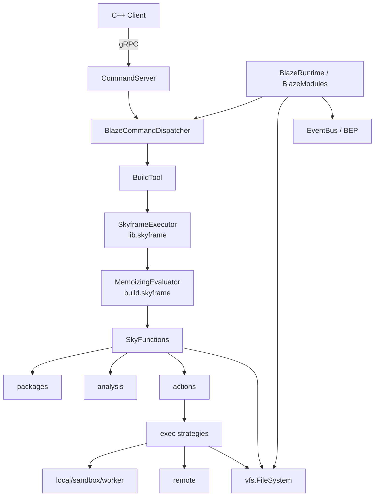

# Bazel Module Architecture Overview

High-level map of Bazel's process shape, Java packages, Skyframe placement, and pluggable seams. Narrative background: [`docs/contribute/codebase.mdx`](./contribute/codebase.mdx) (partly stale; claims below were checked against source).

## Process shape

Bazel is a long-lived Java server behind a thin C++ client.

```
┌─────────────┐  gRPC (command_server.proto)  ┌───────────────────────┐
│ C++ client  │ ─────────────────────────────► │ Java server           │
│ src/main/cpp│ ◄───────────────────────────── │ CommandServer         │
└─────────────┘   stdout / exit code           │ BlazeCommandDispatcher│
                                               └──────────┬────────────┘
                                                          │
                                               BuildTool / BlazeModules
```

| Piece | Location | Role |
|-------|----------|------|
| Client | `src/main/cpp` | Extract install, find/start server, forward command, Ctrl-C, `bazel run` exec |
| Server entry | `Bazel.main` → `BlazeRuntime.main(BAZEL_MODULES, …)` | Boots runtime with the fixed module list |
| gRPC handling | `server/CommandServer.serveAndAwaitTermination` | Serves client requests |
| Wire protocol | `src/main/protobuf/command_server.proto` | Client ↔ server gRPC |
| Command lock | `BlazeCommandDispatcher.commandLock` | One command at a time ("Another command is running") |

## Module layers

```
src/main/
├── cpp/                         # client
├── protobuf/                    # wire formats
├── starlark/                    # builtins_bzl/, docgen/ (not the interpreter)
└── java/
    ├── net/starlark/java/       # Starlark interpreter
    └── com/google/devtools/build/
        ├── skyframe/            # ★ incremental evaluation engine
        └── lib/
            ├── runtime/         # BlazeRuntime, BlazeModule, commands
            ├── server/          # CommandServer (gRPC)
            ├── buildtool/       # BuildTool, ExecutionTool
            ├── skyframe/        # ★ SkyframeExecutor + core Bazel SkyFunctions
            ├── vfs/             # FileSystem, Path, DigestHashFunction
            ├── unix/ windows/   # concrete FileSystem implementations
            ├── packages/        # BUILD → Package loading
            ├── analysis/        # configured targets, configs, providers
            ├── actions/         # Action / Artifact / Spawn
            ├── exec/            # SpawnStrategyRegistry, ModuleActionContextRegistry
            ├── remote/ sandbox/ worker/ standalone/ dynamic/  # execution backends
            ├── rules/           # built-in rule classes (+ rules/repository/)
            ├── bazel/repository/ bazel/bzlmod/  # external deps SkyFunctions
            ├── query2/          # query / cquery / aquery
            └── buildeventstream/ buildeventservice/  # BEP / BES
```

## Where Skyframe sits

| Package | Role |
|---------|------|
| `com.google.devtools.build.skyframe` | Engine: `SkyKey` → `SkyFunction` → `SkyValue`, `MemoizingEvaluator`, graph, invalidation, parallel evaluation |
| `com.google.devtools.build.lib.skyframe` | `SkyframeExecutor` (owns the `MemoizingEvaluator`) plus core Bazel SkyFunctions: packages, configured targets, actions, artifacts, toolchains |
| `lib/bazel/repository`, `lib/bazel/bzlmod`, `lib/rules/repository` | Repository / bzlmod SkyFunctions, contributed by `BazelRepositoryModule` |

The engine is mostly generic but **not domain-free**: `build/skyframe/BUILD` depends on `lib/packages`, `lib/cmdline`, and `lib/skyframe:package_value`; `InMemoryGraphImpl` and `IncrementalInMemoryNodeEntry` reference `Label`, `PackageIdentifier`, `Target`, and `PackageoidValue` (label/package interning).

Call chain:

```
BuildTool → SkyframeExecutor (lib.skyframe) → MemoizingEvaluator (build.skyframe) → SkyFunctions
```

Build pipeline as Skyframe evaluations:

```
target patterns → loading (Package) → analysis (ConfiguredTarget)
        → action graph → execution (ActionExecutionFunction) → tests
```



## Command lifecycle

1. `BlazeCommandDispatcher` acquires the command lock, parses options, creates the EventBus
2. Target pattern evaluation: `BuildTool.evaluateTargetPatterns` → `TargetPatternPhaseValue`
3. Loading/analysis → action graph
4. `ExecutionTool` asks every module to `registerActionContexts` / `registerSpawnStrategies`, then executes actions
5. BEP / modules observe via EventBus

## Pluggable vs fixed

The primary extension seam is **`BlazeModule`** (`lib/runtime/BlazeModule.java`). The module set is fixed at server start (`Bazel.BAZEL_MODULES`), and **order matters**: when several modules provide a strategy for the same thing, the last one registered becomes the default.

### Pluggable (swap / register via modules)

| Seam | Contract | Bazel implementation |
|------|----------|----------------------|
| **Server FileSystem** | Exactly one module returns `getFileSystem()` | `BazelFileSystemModule` → `UnixFileSystem` or `WindowsFileSystem` (the latter extends `JavaIoFileSystem`) |
| **Build-artifact FileSystem** | At most one `getFileSystemForBuildArtifacts()` | `RemoteModule` → `RemoteExternalOverlayFileSystem` |
| **OutputService** | At most one `getOutputService()`; default `LocalOutputService` | `RemoteModule` → `RemoteOutputService` |
| **Per-action FileSystem** | `OutputService.createActionFileSystem()` | `RemoteOutputService` → `RemoteActionFileSystem` |
| **SkyFunctions** | `workspaceInit` → `WorkspaceBuilder.addSkyFunction` | `BazelRepositoryModule` (repos, bzlmod), `IncludeScanningModule` |
| **Spawn strategies / ActionContexts** | `registerSpawnStrategies` / `registerActionContexts` | local, sandbox, remote, worker, dynamic |
| **Commands** | `serverInit` → `ServerBuilder.addCommands` | `BuiltinCommandModule`, mobile-install |
| **Rule classes / fragments** | `initializeRuleClasses` | `BazelRulesModule` |
| **DigestHashFunction** | Startup option or `-Dbazel.DigestFunction`; passed to FS constructor | SHA256 (default), BLAKE3, GITSHA1 (`BazelHashFunctions`) |
| **PackageSettings / validators** | Singleton hooks on `BlazeModule` | Custom package load policy |
| **EventBus listeners** | Modules subscribe | BEP, stats, output filtering |

### FileSystem layering

```
Server-wide FS        BlazeModule.getFileSystem()                   UnixFileSystem / WindowsFileSystem
  └─ Build-artifact FS  BlazeModule.getFileSystemForBuildArtifacts()  RemoteExternalOverlayFileSystem (optional)
       └─ Per-action FS   OutputService.createActionFileSystem()        RemoteActionFileSystem (optional)
```

The per-action FS is created by `ActionExecutionFunction` via `SkyframeActionExecutor.createActionFileSystem`. `InMemoryFileSystem` is used in tests and for bundled builtins (`ConfiguredRuleClassProvider.BundledFileSystem`), not as the server FS. The abstract API is `lib/vfs/FileSystem.java`.

### Semi-pluggable

- **Starlark rules / repo rules / module extensions** — user-level extensibility outside Java modules.
- **Configuration fragments** — via rule-class provider / options classes.

### Effectively unpluggable

| Piece | Why |
|-------|-----|
| Skyframe evaluator | Heart of incrementality; Bazel assumes its semantics |
| `BlazeRuntime` / command lock | Single-command-in-flight lifecycle |
| Package / label / configured-target model | Loading+analysis contract (and referenced by the engine itself) |
| Action / Artifact / NestedSet model | Execution graph shape |
| Client↔server protocol | Fixed gRPC + install layout |
| Starlark interpreter (`net.starlark.java`) | Wired into package/rule evaluation |

You can add SkyFunctions, strategies, and filesystem layers from a module; you generally can't drop in a different incremental engine or redefine what a `Package` is without rewriting much of `lib/skyframe`, `lib/packages`, and `lib/analysis`.

## Key entry points

| Concern | Entry |
|---------|-------|
| Server main | `Bazel.main` → `BlazeRuntime.main` |
| gRPC server | `CommandServer.serveAndAwaitTermination` |
| Module list | `Bazel.BAZEL_MODULES` |
| Server FS | `BazelFileSystemModule.getFileSystem` |
| Skyframe driver | `SkyframeExecutor` (`memoizingEvaluator` field) |
| Target patterns | `BuildTool.evaluateTargetPatterns` |
| Strategies | `ExecutionTool` → `SpawnStrategyRegistry`, `ModuleActionContextRegistry` |

## Takeaway

`build.skyframe` is the (mostly generic) evaluation engine; `SkyframeExecutor` in `lib.skyframe` drives it, and SkyFunctions come from both `lib.skyframe` and modules. Infrastructure plugs in through `BlazeModule`: the server `FileSystem`, an optional build-artifact FS overlay, `OutputService` (which can supply per-action filesystems), SkyFunctions, and spawn/action strategies. The package, analysis, and action models stay fixed.
