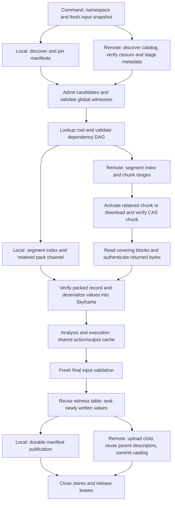

# Local versus remote SkyCache: full-chain trace

Measured 26 October 2026 at `9a25005f547c67bea14581f45f80b731155679b8`,
after witness-table reuse and bounded parallel final validation.

**The next focused experiment is reusable, bounded file-channel access in
`RemoteSkyCache.readCachedBytes`.** Retained remote chunks eliminate metadata
payload downloads, but remote still takes **4.643 s / 29.0% longer** than local.
Most of this gap appears during candidate use, dependency validation and value
restoration. Remote repeatedly opens chunk files and authenticates covering blocks
where local reads already-open pack channels.

This investigation changes no production code. The descriptor-cache results below
are a sizing simulation, not an implemented or measured latency improvement.

## Controlled command comparison

| Same binary and publication seed | Median command | Observed range | Metadata payload downloaded |
| --- | ---: | ---: | ---: |
| Local publication files | 16.026 s | 16.023–16.903 s | 0 |
| Remote, retained chunks | 20.670 s | 20.373–22.408 s | 0 |
| Remote, empty retained cache | 30.299 s | 28.779–32.198 s | 1,463,742,717 bytes |

Three observations per arm; primary results connect directly to the metadata
worker. Warm remote adds 4.643 s over local. Empty retained storage adds a further
9.629 s over retained remote, or 14.272 s over local. These differences of medians
describe these runs; they are not isolated estimates of network service time.

The same two remote publications were reconstructed through production
`RemoteSkyCache.hydrate()` into the local seed. Both arms therefore use identical
publication IDs, pack layout and contents, rather than separately primed caches:

- `8652fa3dd160648c9ef554246c1276e97285e979e6838d96d569bfd00d47312b`
- `b4ccc9cd71517502343c82d337b16370ce4eb8a86e63b8a2a79a6f1bd24d6c34`

The reconstructed files total 1,520,486,839 bytes. Every timed invocation starts
with a fresh JVM, empty Skyframe graph and cleared action cache, uses a private
publication catalog/cache, and builds the same six Datadog binaries plus a fresh
tiny genrule that forces publication. Source, tool identity, inherited repository
environment and ordinary action/output-cache settings are fixed. Commands use
minimal output download. The order is L/W/C, C/W/L, W/L/C after an excluded local
warmup.

The fresh server is started by untimed clean/dump commands. Timed command latency
covers the build invocation through finalization/exit, including beforeCommand,
but excludes server startup, seed copying and backend warmup RPCs. JVM startup
and cache preparation are therefore outside this comparison's timing boundary.

All nine primary runs restored 18 configured-target and 11 execution entries,
matched every original and probe output digest, and successfully published.
Every run reused 103 witness blocks. All warm remote runs downloaded zero
metadata payload bytes. A local run's `committed=false` field means the remote
commit log was absent; `local-skycache.published=true` confirms local publication.

[Primary comparison](comparison-direct.json),
[complete primary run records](direct-runs/results.json.gz),
[readable run records](direct-runs/results.json),
[seed file hashes](preparation.json.gz).

## Where the gap occurs

The following are **arithmetic means**, so phase deltas add to the whole-command
delta. The headline table uses medians. Phase medians do not necessarily add.

| Measured interval | Local mean | Retained remote mean | Remote increment |
| --- | ---: | ---: | ---: |
| `LocalSkycacheModule.beforeCommand` | 0.400 s | 0.875 s | +0.475 s |
| Remaining time through build-complete message | 13.155 s | 17.094 s | **+3.939 s** |
| Build-complete message to command exit | 2.763 s | 3.181 s | +0.418 s |
| Whole command | 16.317 s | 21.150 s | +4.833 s |

The middle interval accounts for **81.5% of the mean warm gap**. It includes
command overhead, candidate admission, dependency checks, restoration, analysis
and execution; it is not a pure deserialization timer. Command/message intervals
use a monotonic clock. The before-command duration comes from Bazel's profile.
Message delivery introduces small boundary uncertainty.

Separate warmed diagnostic runs support the attribution:

| Normal-return method boundary | Local | Retained remote |
| --- | ---: | ---: |
| Largest `refreshCandidates()` call | 4.561 s | 4.699 s |
| Fresh final `isUnchanged()` | 2.214 s | 2.172 s |
| `writeWitnesses()` | 0.364 s | 0.348 s |
| `finish()`, including nested work | 2.815 s | 3.182 s |
| Remote `prepareExclusive()` | — | 0.587 s |
| Remote `publishPending()` | — | 0.445 s |
| Remote `close()` | — | 0.031 s |

These are instrumented observations, excluded from primary timing statistics.
Nested calls, overloads and concurrent thread durations must not be added.
The large common admission and final-validation costs remain relevant to both
modes, but do not explain the remote-specific gap in this matched comparison.

## The complete chain

The arrows describe logical dependencies. Demand reads, dependency validation and
deserialization interleave across threads; this is not a serial wall-time chart.

1. **Command setup and namespace.**
   [LocalSkycacheModule.java](../../../../src/main/java/com/google/devtools/build/lib/skyframe/serialization/local/LocalSkycacheModule.java#L103)
   constructs the fresh input snapshot and local cache session in both modes.
   Remote additionally constructs transport and calls
   [prepareExclusive](../../../../src/main/java/com/google/devtools/build/lib/skyframe/serialization/local/RemoteSkyCache.java#L710):
   bounded catalog discovery, bundle/scope/closure verification, authenticated
   manifest/witness staging and root-index inventory. In this fixture, remote
   decodes witness tables during preparation and again during admission.

2. **Candidate admission.**
   [LocalCacheSession.refreshCandidates](../../../../src/main/java/com/google/devtools/build/lib/skyframe/serialization/local/LocalCacheSession.java#L595)
   pins publications, reads headers/witnesses, checks fresh global evidence and
   repository bindings, opens segmented stores and requires complete parent
   closures. Local stores are file-backed; remote stores use `FileSource`.
   Exact witness-list reuse avoids repeating identical admission work.

3. **Root lookup and dependency proof.**
   [LocalAnalysisCacheClient.lookup](../../../../src/main/java/com/google/devtools/build/lib/skyframe/serialization/local/LocalAnalysisCacheClient.java#L139)
   parses the root envelope and invokes the shared
   [LocalDependencyValidator](../../../../src/main/java/com/google/devtools/build/lib/skyframe/serialization/local/LocalDependencyValidator.java).
   Typed witnesses and transitive dependency records are checked before accepting
   a root; memoization and concurrent-request coordination are shared. Both modes
   check 182,455 witnesses and approximately 603,428 dependency records. Tiny
   record-count differences and scheduling-dependent memo hits do not indicate
   less validation in one mode.

4. **Physical record access: the main divergence.**
   Both use
   [SegmentedFingerprintValueStore](../../../../src/main/java/com/google/devtools/build/lib/skyframe/serialization/local/SegmentedFingerprintValueStore.java)
   and lazy segment indexes.
   [Local openSegment](../../../../src/main/java/com/google/devtools/build/lib/skyframe/serialization/local/PackedFingerprintValueStore.java#L118)
   keeps a pack `FileChannel` open for positional reads. Remote
   [FileSource](../../../../src/main/java/com/google/devtools/build/lib/skyframe/serialization/local/RemoteSkyCache.java#L106)
   translates offsets to chunk ranges. First access pins and verifies a retained
   chunk, or downloads and verifies its CAS digest, then builds trusted 4 KiB
   block hashes. Later reads take a lifecycle/read permit, locate the file,
   open it, validate size, read covering blocks, close it and hash the covering
   bytes against those trusted hashes.
   [readCachedBytes](../../../../src/main/java/com/google/devtools/build/lib/skyframe/serialization/local/RemoteSkyCache.java#L222)
   and
   [readCachedRange](../../../../src/main/java/com/google/devtools/build/lib/skyframe/serialization/local/RemoteSkyCache.java#L282)
   contain this repeated work.

5. **Record integrity, restoration and execution.**
   Both paths enter
   [PackedFingerprintValueStore.readRecord](../../../../src/main/java/com/google/devtools/build/lib/skyframe/serialization/local/PackedFingerprintValueStore.java#L466):
   bounds, key, header and value checksum, followed by the same shared-value
   codecs and Skyframe restoration. The ordinary remote action cache and output
   download mode are identical across arms. SkyCache transfers graph metadata;
   executable output downloads are a separate part of the chain.

6. **Final validation and publication.**
   [LocalCacheSession.finish](../../../../src/main/java/com/google/devtools/build/lib/skyframe/serialization/local/LocalCacheSession.java#L851)
   records bindings, registers inherited witnesses, freshly validates inputs
   with bounded workers, copies a matching authenticated witness table or
   regenerates it, and seals new values. Local publication writes a durable
   manifest under its catalog lease. Remote
   [publishPending](../../../../src/main/java/com/google/devtools/build/lib/skyframe/serialization/local/RemoteSkyCache.java#L932)
   uploads the new child and reuses remote parent descriptors before committing
   the catalog; it does not hydrate the parent packs to publish the child.
   Stores, pins, transport and private staging are then closed/released.

## What the read trace establishes

These counters come from the separate warmed V2 diagnostic pair, not the timed
commands. Counts include invocation activity; overloaded methods are kept
distinct in [stages.json](stages.json).

| Work | Local | Retained remote |
| --- | ---: | ---: |
| Packed data reads | 795,954 | 795,953 |
| Packed bytes requested | 305,923,940 | 305,923,812 |
| Local pack segment opens | 131 | — |
| Cached chunk range reads, each currently opening/closing a channel | — | **794,923** |
| Remote FileSource bytes requested, including indexes/metadata | — | 406,031,416 |
| Cached covering-block bytes read | — | **3,568,554,652** |
| Distinct covered bytes in those range reads | — | 607,309,193 |
| 4 KiB block digest calls, activation plus range authentication | — | **1,228,987** |

Packed demand is essentially identical at about 306 MB. Remote reads roughly
3.57 GB of covering ranges, including repeat coverage, in addition to the
**1.464 GB of whole retained chunks activated and verified**. Distinct coverage
is calculated per CAS chunk/block; it is neither unique packed-value demand nor
a proof that all other chunk bytes can be omitted under the current protocol.

Activation touched 1,613 retained chunks. Its instrumented calls total 3.578
thread-seconds across concurrent work, not 3.578 seconds on the critical path.
The authentication-hash cache held 11,649,120 accounted bytes with **zero
evictions**. Enlarging it would not remove an eviction cost in this trace.

Low-frequency JFR sampling independently sees path resolution, SHA finalization,
file open/close, stat, allocation and read stacks in the remote range path.
The original low-frequency profile records only about 0.039 overlapping
thread-seconds of range-path monitor waiting. It does not establish that the
authentication map's lock is the bottleneck. V2 adds a global lock for its LRU
simulation and must not be used to infer product lock contention.

Samples are qualitative stack evidence, not wall-time percentages. Native samples
can represent blocked I/O. Neither the counters nor JFR prove how much of the
4.643 s gap will be recovered by removing channel opens; a controlled
implementation comparison is required.

## Focused next optimization

Start at `RemoteSkyCache.readCachedBytes`, leaving wire formats and validation
semantics intact.

1. **Bounded reusable channels and resolved paths.** Compare 128 and 256 cached
   descriptors with the existing implementation. Use leases/reference counts so
   eviction and close cannot invalidate active readers. Keep I/O outside a global
   cache lock, define behavior when all slots are busy, and bound both retained
   and transient open descriptors. Continue fresh no-follow type/size checks,
   detect path replacement, and retain per-read block authentication. Use the
   existing safe open/read path if reliable file identity is unavailable.
2. **Then isolate buffer/digest construction overhead.** There are 1.23 million
   block digest calls. Test bounded/scoped reuse of SHA-256 engines and temporary
   buffers while hashing every required byte. Do not combine this with the first
   experiment, so any gain remains attributable.
3. **Then reduce cold demand amplification.** Empty retained storage fetches
   1,613 chunks/1.464 GB, almost the reconstructed 1.520 GB publication size.
   Compare smaller chunks or access-local packing against the extra RPC,
   inventory and authentication costs. This becomes the first priority instead
   if deployment is dominated by machines with empty retained storage.
4. **Smaller follow-ups.** Measure reuse of already-verified witness decoding
   between remote prepare and admission. Publication is about 0.4 s of the warm
   gap here; upload batching remains conditional on measured latency and bytes
   on the actual remote service.

The observed concurrent chunk-reference sequence gives this **LRU simulation**:

| Cached descriptor capacity | Simulated hit fraction | Simulated misses / opens |
| ---: | ---: | ---: |
| 16 | 14.2% | 682,365 |
| 32 | 23.2% | 610,379 |
| 64 | 36.8% | 502,360 |
| 128 | 55.5% | 353,888 |
| 256 | 76.7% | 185,346 |

At 256 entries the trace avoids 609,577 hypothetical opens. This sizes a prototype;
it does not predict a 76.7% latency reduction. The simulation does not model pinned
readers, descriptor limits, file replacement or the schedule induced by a real
cache. [Simulation data and caveats](descriptor-simulation.json).

A useful cost model is:
`read cost = opens × open/close cost + fresh path checks + covering-byte I/O +
block hashing + record verification + coordination`.
Descriptor reuse attacks only the first term and some path construction; the
remaining terms still need measurement. The additive phase accounting above is
an Amdahl-style constraint: optimizing the roughly 0.4 s publication increment
cannot explain away a roughly 4.8 s average command gap.

Recent research reinforces measuring cache-hit work, rather than choosing an
eviction algorithm from hit ratio alone. Qiu, Yang and Harchol-Balter analyze
how hit-path contention can lower throughput in
[Why increasing the hit ratio can hurt cache throughput, Queueing Systems,
20 April 2026](https://link.springer.com/article/10.1007/s11134-026-09986-1).
That motivates a low-contention channel design; it is not evidence that our
current map lock is slow. Chen et al.'s
[Demystifying and Improving Lazy Promotion in Cache Eviction, PVLDB 19(4),
August 2026 arXiv version](https://arxiv.org/html/2608.29993v1)
also studies maintenance work on cache hits. An eviction-policy replacement is
not justified by this trace's zero authentication-cache evictions.

Acceptance for the first implementation:

- Repeat the same direct-endpoint rotated comparison with fresh private caches
  and unchanged local control; require a repeatable whole-command warm-remote
  improvement, unchanged hit/output/publication results, and no cold regression.
- Count actual opens/closes and peak live descriptors; demonstrate bounds under
  concurrent reads, eviction, exceptions, cancellation and final close.
- Preserve corrupt covered-block rejection, forged-record-checksum rejection,
  missing/truncated/symlinked/replaced scratch handling, authentication eviction,
  cache-only behavior and blocked-download cancellation. A record checksum is
  not a substitute for CAS-derived block authentication.
- Preserve formats, witness semantics and fresh final validation. Re-run the
  focused remote reader and lifecycle tests before accepting performance claims.

## Measurement limits and reproduction

The direct cohort is the primary comparison. An earlier Python gRPC forwarding
proxy measured local/warm/cold medians of 17.659/22.702/46.488 s. Direct endpoints
gave 16.026/20.670/30.299 s. The much larger cold change shows the proxy cohort is
not suitable for cold throughput conclusions; cohorts also ran at different
times, so the entire difference cannot be assigned quantitatively to the proxy.
The warm gap is consistent in both cohorts. They are not pooled.

The metadata server is loopback with warmed backend/OS caches. “Cold” means an
empty client retained-chunk directory, not cold storage throughout the system.
A 2 GiB metadata transfer budget and 600 s timeout were used; this is not a
default-limit success claim. Three samples per arm do not establish tail latency
or WAN behavior. Retained activation still reads and authenticates local files
on each invocation.

Initial local diagnostic runs after a WSL restart took roughly 54–59 s from cold
filesystem/source caches. They are excluded. The V2 diagnostics explicitly run
an uninstrumented local warmup first. Every JFR/counter/simulation run is excluded
from primary performance statistics. Probe timings cover normal returns only;
no transform errors occurred in the analyzed diagnostic pair.

The archived harnesses are fixture-specific, with explicit paths, hashes and
environment identity. They need the existing private fixture, previous benchmark
seed/results, JDK 25, Python gRPC environment and reachable action cache. They
are not a standalone benchmark for a clean checkout.

- [direct-runs/harness.py](direct-runs/harness.py): primary direct endpoints;
  an instantiated proxy is bypassed and its RPC logs must remain empty.
- [runs/harness.py](runs/harness.py): original proxy timing/low-frequency profiles.
- [warm-diagnostics/harness.py](warm-diagnostics/harness.py):
  warmed JFR, method counters and descriptor reference simulation.
- [HydrateSkycacheSeed.java](HydrateSkycacheSeed.java) and
  [prepare_chain.py](prepare_chain.py): authenticated identical seed construction.
- [SkycacheReadProbeV2.java](SkycacheReadProbeV2.java): diagnostic-only Java agent,
  compiled with JDK 25 and the premain manifest archived as
  [read-probe-v2-manifest.mf.gz](read-probe-v2-manifest.mf.gz). Decompress the
  manifest before packaging the agent; production jars are unchanged.
- [analyze_skycache_chain.py](analyze_skycache_chain.py) with `--direct` computes
  primary statistics; without arguments it computes the proxy cohort.
  [summarize_chain_stages.py](summarize_chain_stages.py) summarizes raw counters.
- [provenance.json](provenance.json): cohort invariants, binary hash, native
  profile/JFR locations and hashes, cleanup checks.
  [evidence-index.json](evidence-index.json): archived evidence file hashes.

Use a new non-existing run directory under the pinned experiment root; the
harness refuses an existing one and takes the shared measurement lock. Never
run timed cohorts concurrently. Per-invocation raw monotonic timelines and
diagnostic stage records are stored as deterministic gzip files beside the
readable results. Large profiles/JFR and seeds remain in the native experiment
directory; JFR startup environment values are not exported into this archive.

The transient genrule package and fixture server PID file were removed. Source
states and frozen binary hashes were unchanged by all four cohorts. No production
code was edited and no new product test run was needed for this investigation;
the source commit's preceding verification remains **626 cases across 23 targets**.
