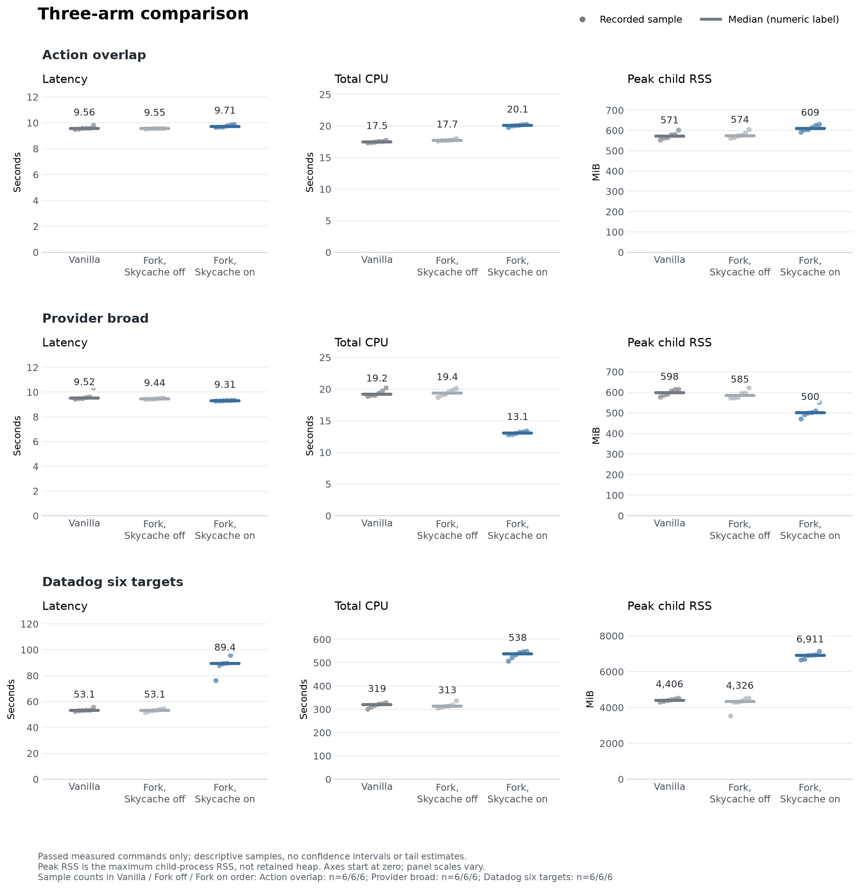

# Quiet comparison: vanilla, fork without Skycache, fork with Skycache

28 October 2026. Product checkpoint `3afc50c9766916072de1ae99d9726e61cad56feb`; measured executable contains the product changes through `e4dcbf9a35`. This increment changes measurement tools and documentation only.

**Current Skycache loses on the real six-target Datadog workload.** Relative to the same fork with Skycache disabled, the enabled arm has 68% higher median complete-command latency, 72% more CPU and 60% higher peak process RSS. Vanilla and the disabled fork have almost identical median latency. The provider fixture demonstrates useful avoided computation, but its producer and retained heap prevent treating consumer RSS savings as an overall memory win.

These are descriptive observations from six commands per arm, with all six arm-order permutations. Percentages are ratios of arm medians. They are not p95 estimates, confidence intervals or a claim about every Bazel workload.



## Real workload

The six Datadog executables are `//cmd/agent:agent`, `//cmd/cluster-agent:cluster-agent`, `//cmd/process-agent:process-agent`, `//cmd/trace-agent:trace-agent`, `//cmd/security-agent:security-agent`, and `//cmd/system-probe:system-probe`. The ordinary remote action cache is read-only in every arm; all six executable SHA-256 values match across commands. The source snapshot is `0cde96beb70963d0838119c308b9d0422ee66be0`, with its existing `MODULE.bazel.lock` modification recorded and unchanged. Baseline analysis covers roughly 237,112 configured targets and 7,141 packages.

| Arm | Median latency (s) | Observed latency range (s) | Median CPU (s) | Median peak RSS (GiB) |
|---|---:|---:|---:|---:|
| Vanilla upstream ancestor | 53.09 | 52.32–55.48 | 319.27 | 4.30 |
| Current fork, Skycache off | 53.10 | 51.59–54.29 | 313.20 | 4.22 |
| Current fork, Skycache on | 89.38 | 76.18–98.69 | 538.29 | 6.75 |

Every enabled-arm latency exceeds every control latency in this sample. The comparison measures the enabled local Skycache policy as deployed in this fork: **analysis reuse plus portable execution-metadata reuse**, including end-of-command publication. `LocalSkycacheModule` sets `async_bidi` and disables analysis-only mode at software-requirement priority; a CLI analysis-cache mode of `off` does not undo that local-module override. The ordinary remote action cache is a separate, identical service in all arms. Remote network Skycache is disabled, so these results do not attribute costs to a remote Skycache server.

## Synthetic workloads

Action overlap requests 512 writers and eight overlapping roots, producing 4,096 FileWrite outputs. Provider broad requests eight roots over a 4,096-node provider graph. Exact output hashes and positive configured-target restoration are mandatory; the controls must have zero restoration hits.

| Workload | Arm | Median latency (s) | Median CPU (s) | Median peak RSS (MiB) |
|---|---|---:|---:|---:|
| Action overlap | Vanilla upstream ancestor | 9.564 | 17.48 | 571.4 |
| Action overlap | Current fork, Skycache off | 9.547 | 17.71 | 574.0 |
| Action overlap | Current fork, Skycache on | 9.709 | 20.08 | 609.2 |
| Provider broad | Vanilla upstream ancestor | 9.518 | 19.16 | 598.3 |
| Provider broad | Current fork, Skycache off | 9.442 | 19.37 | 584.7 |
| Provider broad | Current fork, Skycache on | 9.307 | 13.08 | 500.3 |

Against the disabled fork, action overlap is 1.7% slower, uses 13.4% more CPU and 6.1% more peak RSS. Provider broad is 1.4% faster, uses 32.5% less CPU and 14.4% less peak RSS. The latter is evidence of useful reuse on this fixture, not evidence that the real workload or general retained memory improves. No predeclared promotion gate is closed by choosing whichever metric improved.

### Producer accounting

Each synthetic arm also has one separately measured producer, with equal target demand. Initialization warmups are excluded. These are single observations; the totals below are arithmetic for the recorded sequence, not an inferred future break-even point.

| Workload | Arm | Producer latency (s) | Producer CPU (s) | Producer peak RSS (MiB) |
|---|---|---:|---:|---:|
| Action overlap | Vanilla upstream ancestor | 9.668 | 18.02 | 551.5 |
| Action overlap | Current fork, Skycache off | 9.606 | 17.80 | 579.0 |
| Action overlap | Current fork, Skycache on | 10.016 | 20.08 | 606.7 |
| Provider broad | Vanilla upstream ancestor | 9.611 | 19.70 | 591.6 |
| Provider broad | Current fork, Skycache off | 9.534 | 18.88 | 596.2 |
| Provider broad | Current fork, Skycache on | 10.945 | 55.44 | 2359.2 |

For provider broad, producer plus all six consumers costs 66.78 s and 133.79 CPU-s with Skycache, versus 66.26 s and 135.26 CPU-s with it disabled. The enabled sequence's maximum RSS is 2,359.2 MiB, versus 621.2 MiB for the disabled sequence. The expensive producer largely consumes the consumer CPU savings and dominates peak memory. This accounting excludes initialization and seed-copy setup; it does not model a shared cache's service cost or future reuse frequency. Datadog preparations include cold dependency setup and contention, so they are archived but not used as a matched producer-economic experiment.

## Retained-server diagnostics

Each synthetic arm has one initial build followed by six unchanged requests in the same server. The initial enabled build must restore configured targets. These are separate sequential arm series, not a balanced latency experiment. Warm requests largely reuse resident Skyframe and therefore answer a different question from fresh-process Skycache restoration.

| Workload | Arm | Warm median (s) | After-series RSS / PSS (MiB) | Post-requested-GC used heap (MiB) | Post-GC RSS / PSS (MiB) |
|---|---|---:|---:|---:|---:|
| Action overlap | Vanilla upstream ancestor | 0.288 | 672.3 / 669.2 | 37.34 | 560.4 / 558.2 |
| Action overlap | Current fork, Skycache off | 0.269 | 661.0 / 657.9 | 37.11 | 545.4 / 544.3 |
| Action overlap | Current fork, Skycache on | 0.312 | 768.0 / 764.7 | 45.09 | 678.1 / 676.5 |
| Provider broad | Vanilla upstream ancestor | 0.166 | 652.7 / 649.9 | 58.33 | 619.1 / 617.5 |
| Provider broad | Current fork, Skycache off | 0.163 | 643.1 / 639.6 | 58.12 | 605.7 / 604.2 |
| Provider broad | Current fork, Skycache on | 0.168 | 620.4 / 617.1 | 62.03 | 593.0 / 591.8 |

The requested full GC and heap diagnostics run only after timed requests. Both commands succeed in every final arm; the aggregator parses the JDK 27 `total reserved ..., committed ..., used ...` format from checksum-verified raw output. Native metadata recorded an unavailable heap value because its older parser did not recognize this format; those immutable records remain unchanged. Offline parsing provenance is explicit in the aggregate.

Post-GC used heap is a process-level observation, not an object retained-size census or an attribution to a particular cache. RSS includes native memory, committed pages and other mappings; PSS apportions shared mappings. The provider on-arm has lower RSS but higher post-GC used heap (62.03 versus 58.12 MiB for off), demonstrating why these metrics must remain separate. No Datadog retained-server experiment was run. All servers created by these supplemental runs were shut down and their exit verified.

## Conditions, provenance and exclusions

- **Quiet window:** the user stopped the parallel benchmark. Our runs acquired its advisory benchmark lock at 11:09:14 UTC, also serialized through our host lock, and released the reservation at 11:51:44 UTC. All 54 primary measured commands and both final retained series are inside that window. This controls the identified competing benchmark; it is not proof of an otherwise activity-free operating system.
- **Fresh batch state:** every primary command starts a new JVM/output base. All three arms share the same frozen workload and environment, `--jobs=6`, and byte-identical embedded Java 27 runtimes. Synthetic heap is 2 GiB; Datadog heap is 6 GiB. Installation and repository caches are warmed and shared according to the recorded per-binary bindings. OS page cache is uncontrolled. Independent on-arm consumers receive copies of the same seed; copying is outside command time.
- **Timing/CPU/memory:** latency is monotonic elapsed time for the full Bazel child command, including startup and finalization. CPU is summed child user+system CPU. Linux child `ru_maxrss` is the largest child-process RSS, not a simultaneous process-tree total or live heap. Samples/ranges are archived; six observations do not support a robust tail estimate. Retained-server CPU uses server-boundary deltas and is not directly comparable to batch total CPU.
- **Vanilla:** clean upstream ancestor/merge-base `a5c50fcb65841b505ec72840d83381a704e70afa`, not a released Bazel 9.3.1 or the latest upstream. Binary SHA-256 `34a95ea73a865b8382e433ec616369fec24e51e69f7c02c148dd30097dd5863b`.
- **Candidate:** binary SHA-256 `d4a533a7d79708e9681181d334035a59a960fda0984bbea6fa921af3ef9b3a51`. Existing native build provenance binds product changes through `e4dcbf9a35`; `3afc50c976` adds documentation/fixtures. Runtime equality covers all 341 embedded JDK files, aggregate manifest `056e94ed00c2e2027a01db3d1c85d2343191dd11b6cd7157431e70d6a4ac7088`. Build JDK and runtime JDK are distinguished in provenance. The source snapshot records the new untracked measurement helpers honestly; tracked product sources did not change.
- **Remote actions:** Datadog uses the same existing read-only remote action cache, uploads/BES disabled and top-level downloads. This is not a clean compile-from-source experiment. Synthetic workloads disable ordinary remote/disk action caches.
- **Excluded contention:** `compare-actions-01` and `compare-provider-01` ran alongside the peer and are preserved under `contended/`. They do not enter the chart or primary table. Datadog's first four preparations were contended; its fifth preparation was quiet but remains excluded. All 18 measured Datadog commands were quiet and use the same frozen seed from the excluded preparation. This measures reuse of that seed; the cost and resulting contents of a fully quiet Datadog producer were not tested. The peer did not finish its original matrix; the user stopped it.
- **Excluded failed setup:** `retained-actions-01` restored zero configured targets because the helper changed physical `bazel_tools` and `platforms` repository bindings. The cache conservatively rejected reuse. That failure and its witness diagnosis remain under `failures/`. The corrected helper reuses producer bindings; both `-02` series passed unchanged hit/output gates. No cache validation was weakened.
- **Scope of correctness:** exact declared outputs and positive restoration gates pass. The known strict provider-identity failures remain unresolved; these measurements do not widen reuse eligibility or replace semantic tests. No product code changed in this measurement increment.

## Measured client work

The six final enabled Datadog consumers have configured-target hit rates of 18.37%, 4.59%, 57.14%, 1.99%, 12.72% and 21.69% (median 15.54%). These divide terminal reported hits by hits plus misses, not by the BEP configured-target total or publication root count. Portable execution-metadata hit rates range from 62.33% to 94.94% (median 92.38%).

Despite those hits, every consumer offers 1.17-1.31 GB of serialized values across 1.13-1.66 million put calls. Those bytes are offered before storage deduplication; they are neither network traffic nor unique disk growth. Final publication takes 3.25-7.02 s of inclusive wall time (median 5.31 s), with nested validation taking 2.48-5.21 s. Do not add these nested times or subtract them from CPU as exclusive attribution. The remainder of the regression still needs attribution. Validation-root rejections total 11 across six commands, with no per-root identities/reasons recorded; they are not eleven missed top-level targets. The [final cost summary](evidence-comparison/analysis/comparison-final-cost-summary.json) records raw counters, denominators, source hashes and limits for all six final consumers. The older [source/cost notes](evidence-comparison/analysis/comparison-cost-notes.json.gz) include preparation-only explanatory observations, explicitly excluded from primary comparisons.

## What the result changes

The next optimization should target demonstrated client publication/admission/serialization costs and retain a complete-command control. Consumer hit counts alone are not an acceptance criterion. Keep action conflict checks and execution deduplication authoritative; the previously removed repeated traversals/comparisons do not establish a command-level speedup in this comparison. A local/cache race must also budget duplicate CPU and memory; the present real-workload result does not justify enabling speculative overlap by default.

Before changing admission policy, add rejection reasons and admission timing so repository/materialization misses can be distinguished from genuinely invalid publications. Then measure publication delta/reference reuse and producer cost separately, preserving identity and durability rules. The paper's full ownership unification, paging and dual-candidate transaction remain gated proposals.

## Reproduction and evidence

The [evidence index](evidence-comparison/index.json) maps original logical paths to stored files, SHA-256 values and byte lengths. Larger text evidence uses deterministic gzip; the original decompressed hash is recorded. It includes frozen helpers, all completed primary/supplemental/contended commands, the failed setup, build/source provenance, raw BEPs/logs, output digests, host/lock records and current analysis code. Native binaries, output bases, repository/cache contents and historical environment JFR files are deliberately excluded. Original absolute paths identify the capture host and must be remapped on another host; the Datadog environment requires its original dependencies/service access. This is an auditable capture, not a hermetic one-command Datadog redistribution.

Validation completed with 84 passing pure Python tests. Test logs and status are archived; Java/native product tests were not rerun because this increment contains no product changes. The native workload gates and archived-result validation described above all passed.

Primary arithmetic is in [summary.json](evidence-comparison/analysis/aggregate-02/summary.json), [metrics.csv](evidence-comparison/analysis/aggregate-02/metrics.csv), [producer.csv](evidence-comparison/analysis/aggregate-02/producer.csv), and [rows.json](evidence-comparison/analysis/aggregate-02/rows.json). The plotting script displays every observation and the median; it uses no interpolated percentiles or uncertainty claims.

Use Python 3.11+ for the stdlib native harness/aggregator and the recorded matplotlib environment for the plot. The archived dispatchers contain the exact run flags and host-lock use. `compare_three_arms.py --help`, `compare_datadog.py --help`, and `measure_retained_server.py --help` describe path inputs; run directories must be fresh. `aggregate_comparisons.py` checks complete run counts, frozen identities, raw hashes, BEPs, outputs, positive cache hits and server shutdown before emitting results. The evidence-package verifier checks stored and decompressed hashes and exact index coverage without launching Bazel.

```sh
python3 -m unittest discover -s docs/jsgette/measurements/skycache-unified-analysis-2026-10-28 -p 'test_*.py'
python3 docs/jsgette/measurements/skycache-unified-analysis-2026-10-28/evidence-comparison/reproduction/package_comparison_evidence.py \
  --verify docs/jsgette/measurements/skycache-unified-analysis-2026-10-28/evidence-comparison
```
