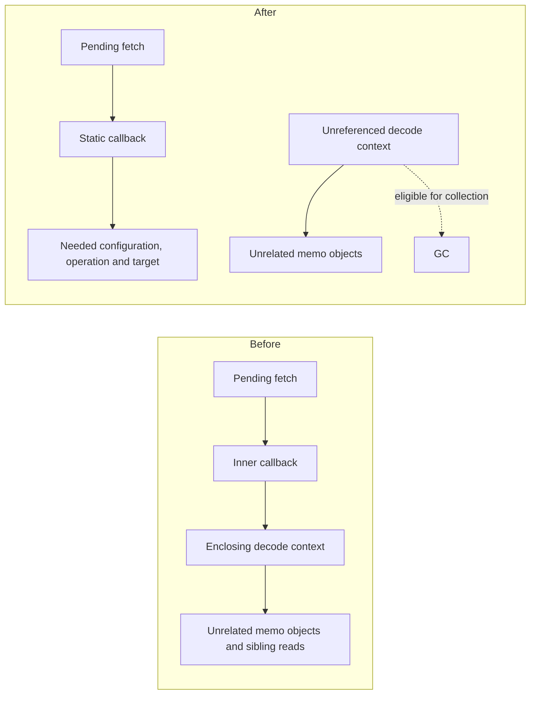

# Shared decode retention correction and broader cost evidence

28 October 2026. This increment fixes a demonstrated ownership defect, adds
command-finalization timing, and expands the synthetic workload coverage.
**It does not establish a whole-build memory or latency improvement.** The P00,
P01 and P02 acceptance gates remain incomplete.

## Ownership correction

A pending `SharedBytesProcessor` was a nonstatic inner object and retained its
enclosing `SharedValueDeserializationContext`. That kept unrelated memoized
objects and sibling read state alive while a shared fetch or dependent decode
was pending. The completion callable also captured the processor through its
instance fields.

The processor is now static. It keeps the configuration/services, output target,
setter and operation it needs. A fresh child memo context is allocated after
bytes arrive. The deferred completion captures its target and setter directly.
The shared-operation claim protocol, weak `NOT_LINKED` cache, compression,
chunk handling, lookup collector and debug fingerprint behavior are preserved.

The original dirty retained-v8 worktree was left untouched. This was a reviewed,
isolated promotion of the earlier two-file retention experiment, with fresh
native red/green proof against the foundation branch. It does not import the
other retained-v8 listener, filesystem, string, admission or transport changes.

The [baseline regression run](evidence-retention/retention-red-01/result.json)
executed exactly two variants; both failed on the expected ten-second GC
reference-clear timeout. One held the first fetch pending; the other completed
that fetch but held a dependent fetch pending. The tests keep the output targets
and shared future alive, require unrelated outer/child memo state to be
collectible, then complete the reads and verify one shared result and no extra
fetch. The [final green run](evidence-retention/retention-green-02/expanded-tests.json)
passed **626 cases across 17 native Java targets**, including both regressions,
the serialization suite, NestedSet suites and local cache/validation tests.
GC is deliberately forced only in those correctness tests, not the workload runs.

## Finalization timing that survives profiler shutdown

Ordinary JSON trace scopes were tried first and did not appear in the native
trace. `BuildSummaryStatsModule.buildComplete` intentionally stops the trace
before module `afterCommand` to avoid a BES artifact-upload deadlock. The first
candidate's successful runs and missing timing evidence are preserved; that
instrumentation was replaced before this increment was committed.

The final implementation captures whether Bazel's profiler is active when the
session is constructed. It records at most six elapsed-nanosecond scalars and
writes `local-skycache-phases.json`. Disabled sessions allocate no timing array
and read no phase clock. Unexecuted phases are null; repeated finish calls keep
the first completed sample. Deterministic-clock tests cover success, disabled
recording, skipped work, repeated finish and failure cleanup.

Publication excludes lock acquisition and store cleanup, includes its nested
validation/encoding/seal/install phases and any remote-parent publication, and
excludes the module's later remote export. These are inclusive wall times, not
exclusive CPU costs. The profiler's original shutdown order is unchanged.

In the final retained-provider broad producer, the report recorded:

| Phase | Elapsed milliseconds |
| --- | ---: |
| Publication, including nested phases | 141.288 |
| Final input validation | 5.977 |
| Witness/manifest encoding | 7.411 |
| Store seal | 121.610 |
| Local install | 2.153 |
| Store cleanup, outside publication | 0.291 |

These are one command's observations, not a cost model or latency distribution.
The async upload path does not supply the synchronous BEP upload-phase timings;
exclusive attribution of its serialization work remains open.

## Workload coverage and observations

The [generator](fixtures/README.md) produces eight disjoint partitions with
4,096 analysis nodes, 15,360 node dependency edges, and eight output roots.
Sparse demand requests one 512-node partition from a seed produced by all eight.
The harness now accepts a separate producer manifest in the same frozen fixture
directory and validates producer and consumer outputs against their own oracles.

Two fixture forms are deliberately distinguished. The initial form exposes only
small root output state; its cached broad run read about 43 KB. The retained form
exports the child-provider graph, with string depset leaves, through the roots.
Its cached broad runs perform 4,033 CAS gets and read about 1.11 MB of encoded
values. Sparse demand performs 645 gets and reads 167,075 bytes. This establishes
that the retained fixture exercises materially more hydration. Exact output
digests pass, but the root-output oracle does not independently verify restored
child alias identity or arbitrary mixed restoration.

All **30 native workload commands across six cohorts** passed their exact output
checks. The final Python checks passed **52 tests**: 28 harness, nine extraction,
seven generator, and eight identity-runner tests.

| Retained-provider cohort | Producer seconds | Pair 0 off / on seconds | Pair 1 on / off seconds |
| --- | ---: | ---: | ---: |
| Foundation control, broad demand | 16.860 | 9.889 / 9.350 | 9.299 / 9.411 |
| Final candidate, broad demand | 13.269 | 9.662 / 9.872 | 9.781 / 9.730 |
| Final candidate, sparse demand from broad seed | 13.140 | 9.079 / 9.180 | 9.185 / 9.302 |

Each cohort has a separately timed producer, balanced consumer order, independent
seed copies, fresh batch JVMs and output bases, and a 2 GiB maximum Java heap.
Repository/module initialization, network behavior and OS pages remain sources
of variation. Executable cohorts ran sequentially. The sample is too small to
attribute the differences to this correction or estimate tails.

Producer maximum child-process RSS was 2,101,452 KiB for the retained control and
2,520,808 KiB for the final broad candidate. Final candidate broad consumers used
536,680–553,648 KiB with cache and 605,648–618,220 KiB without it. These are raw
process maxima, not retained heap, and they do **not** demonstrate an overall
memory reduction from the correction. In particular, the reader-side ownership
fix does not address the large producer footprint.

## Next decision and remaining proof

The retained broad candidate producer reports 98,119,912 CAS put-value bytes.
Its cache-hit consumers store no new values, while their ten put requests
totaling 268 value bytes are deduplicated. Final publication
after serialization accounts for only about 141 ms in that producer observation.
The next cost investigation should therefore prioritize asynchronous producer
serialization/allocation and record duplication before assuming that final
manifest encoding is the dominant cost. CAS counters include protocol/record
bytes; comparing them with constructed payload characters is not a proof of
physical storage duplication or reclaimable heap.

Broad and sparse consumers both retain about 0.8 MB of accounted candidate
metadata despite requesting eight versus one roots. This gives P07 a concrete
sparse-demand case, but is not yet evidence that index/witness restructuring
would repay its complexity. Root-map counts and witness counts are not cloned
SkyValue counts. P03/P06/P07 still require measured, semantically eligible scope.

The [identity investigation](provider-identity/IDENTITY.md) explains why content
interning cannot repair the missing wrapper-origin information. A fresh
[post-fix identity run](evidence-retention/identity-retention-02/result.json)
still has two passing controls and exactly two expected failures. No restoration
eligibility was widened. P04/P05 prefetch, full racing, generic paging, the broad
Datadog workload, mutation matrices, action-key equivalence, idle-release/recovery
and second-operator reproduction remain unfinished.

## Reproduction and provenance

The isolated code commits are `a71600d779` (decode-context ownership) and
`a8f74c6c3a` (finalization timings).

The control binary is the previously built `de588ece3ce8f0397bff1f4f9da6dfd6476f01c7`
executable (SHA-256 `473bf57e400e3ddd72c592ee5a002ecbc4d1117bf998f7de672bf9d9437783f7`).
The final executable has SHA-256
`454d6846af69c4d1a873020f511caf474ade3f538f94300b1019c753435a36d6` and was built
from `0127165a8822c98fdaf8cb31715ca3f4f8121139` plus the archived
[`src/` patch](evidence-retention/retention-green-02/source.diff). That patch was
verified byte-for-byte against the final source changes before packaging.
Intermediate candidate runs used the separately recorded earlier binary.

[Observations](evidence-retention/observations.json), per-cohort manifests,
commands, summaries, profiles, GC logs, diagnostics, cost/ownership CSVs, exact
fixture inputs, Java test XML/logs and Python results are archived alongside
[SHA-256 checksums](evidence-retention/SHA256SUMS.json). Original failures and
intermediate observations were not rewritten. The old tiny-fixture evidence
remains separate. Full executables, outputs and cache populations remain at
`/home/jgett/REPOS/.work/skycache-analysis-foundation-evidence/` outside Git.
