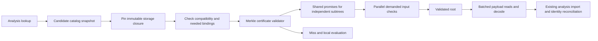

# SkyCache v2: Merkle certificates and concurrent block storage

Status: proposed implementation, 2026-10-24. No v2 performance results yet.

A minimal [idle-retention prototype](skycache-idle-retention-prototype-2026-10-24.md) now
implements the analysis-retention flag against v1. It compiles and passes focused tests;
the capped runtime experiment did not produce a valid A/B result. The remaining v2 design
and separate action-cache-metadata flag are unimplemented.

Build an optional analysis cache around **dependency-scoped Merkle certificates,
shared in-flight validation, selective asynchronous publication, and batched immutable
storage**. Every Bazel server can read and write concurrently. Keep each server's graph
in RAM during active work and the configured warm-retention interval; optionally release
recomputable state after sustained idle time. Retain the existing evaluator and action-cache
semantics.

The performance objective is lower complete-command latency and higher completed-build
throughput under simultaneous worktree builds. Hit count, serialized size, and storage
bandwidth are diagnostic metrics, not the objective. Keep caching disabled for workloads
where validation and import cost more than the computation they replace.

## Research baseline and decisions

The reviewed documentation snapshot is `jsgette/master` at
`8f4ec5307f553018d00a2be926868c530678f5ef`: 325 files under `docs/jsgette`, including
28 Markdown documents and 248 JSON artifacts. The research review follows the current
reports, historical roadmap, development steps 1–63, related paging/JVM investigations,
and their public measurement summaries. All JSON artifacts were parsed for inventory;
that is not an independent audit of every recorded measurement. Private raw archives
referenced by the reports were not available in this session.

Source inspection used `jsgette/skycache-concurrent` at
`6f451b2dc6f783dda879ff3c7ed3fc8146d0f410`. Experiments remain separate at
`e29c37affc2fdcbeb42c3beefcba5368ee0ac4af`. Do not accidentally base implementation on
the docs branch or assume the experiments are production code.

| Evidence | Design consequence |
|---|---|
| Matched optimization batch: off 19.348 s, reader 25.285 s, writer 33.766 s; identical action-hit counts and outputs. | Require an end-to-end performance gate before broadening implementation. The current reader is 30.7% slower. |
| Reader imports 312,793 CAS values / 336.8 MB and traverses 163,377 dependency records; 4,501 target hits. | Reduce proof and import work, not just syscall count. CAS and packed storage already exist. |
| Validator holds one monitor across proof traversal and blocking reads; store futures are returned after synchronous I/O. | Replace global validation serialization with bounded asynchronous tasks and shared promises. |
| E3 fixed-batch certificate: validation 541.050 → 129.174 ms; allocation 776.224 → 153.002 MB. Admission still about 2.13 s. | Compact certificates are a useful mechanism lead; remove broad admission separately. E3 has no full-build speedup or usable PSS measurement. |
| E4 frontier: 58% smaller writer pack and 56.3% fewer reader logical payload bytes, but worse latency and a 6.514 s synchronous serialization tail. | Select units before serialization and overlap work; do not adopt E4's synchronous frontier path. |
| E1 scan avoidance did not improve full-command time; E2 whole-pack loading was inconclusive and used more memory. | Neither deleting the source scan nor loading every pack is the design. Demand-read bounded blocks. |
| Earlier 64-stripe put-lock pool contended behind file-backend I/O; 4,096 stripes restored baseline-range writer time. | No unrelated-key lock held across hashing, I/O, or fsync. This historical result is not a measurement of current packed-store contention. |
| Runfiles/provider diamonds, independently published halves, warm graph composition, and late continuations failed during development. | Preserve semantic producer identity and original evidence, including cancellation and mixed imported/local objects. |
| Go paging: unchanged builds about 40× slower and post-warm live heap +54%. JVM micro-optimizations do not establish general whole-build gains. | No graph paging, Rust evaluator, or sidecar RPC on graph hot paths. |

The architecture experiments have only a few ordered samples, a 10.9% final-control drift,
an E1 inventory-boundary qualification, and a failed E3 memory sampler. The older capped
concurrent run contains 14 passes and two timeouts, with storage/cohort differences.
None establishes scalable throughput or a v2 speedup. The earlier idle-retention claim
was retracted: inherited command cleanup already clears session/client references.

## 1. What the Merkle DAG buys us

Use a DAG because targets share inputs and dependencies. Keep three identities distinct:

```text
N = H(project identity, format, Bazel installation/codec identity, semantics, compatibility policy)
L = canonical logical analysis key (configured target or aspect, configuration included)
I = Merkle root of the complete input certificate for L
P = content root of serialized value blocks and their references
U = H("analysis-unit-v2", N, L, I, P)
```

Use domain-separated, length-delimited canonical encodings. Initially use SHA-256 for new
certificate/block identities; preserve existing codec fingerprints inside payloads.
Changing hash algorithms is a later measured format decision. These are corruption and
identity checks in the existing trusted same-user scope, not authentication.

An input leaf contains its observation kind, logical root/path, relevant metadata and
expected content/result digest. Internal nodes commit to typed, ordered child identities.
Canonical ordering applies to sets only; preserve ordering wherever Bazel semantics depend
on it. A candidate binds `L`, its exact certificate `I`, payload `P`, schema, and required
storage closure. A publication groups candidates for durability; it is not their shared
validity boundary.

**A matching current input root allows the entire proof subtree to be skipped.** A matching
stored root alone does not. Two unchanged certificates can describe inputs that have since
changed on disk. Distinguish immutable-byte integrity from current-worktree validity.

| Available evidence | Work that can be skipped |
|---|---|
| Exact certificate subtree already valid in this command's observation view | All descendants of that proof subtree; concurrent consumers join the same result. |
| Verified immutable input tree with an enforced lifetime/version contract | Descendant input checks while that contract remains valid. A content-addressed directory name alone is insufficient. |
| Complete, trustworthy change tracking from a validated base | Unaffected input subtrees; update changed leaves and their affected ancestors. |
| Fresh mutable worktree, watcher gap, unknown repository state | No assumed content reuse: check the demanded closure's relevant inputs. |
| Same Git revision or unchanged mtimes | Candidate ranking only; no proof-subtree skip. |

The existing dependency records are already fingerprinted and successes memoized. Merkle
hashing alone therefore adds little. The improvement must come from compact proof structure,
scoped admission, reuse of trusted current observations, and avoiding serialized proof replay.

Do not mirror every Skyframe node into a second disk graph. Build a compact certificate DAG
of observation leaves and shared unions. Eliminate unary wrappers and identical unions;
intern shared blocks. Avoid expanding a transitive witness array separately for every target.
The reader processes each unique demanded proof node/edge at most once per view, rather than
once per target. It still pays for those distinct edges on first validation.

For a balanced input tree, changing `k` leaves costs approximately the changed observations
plus their affected ancestor paths, not a full-tree rehash. In a general dependency DAG,
many ancestors may depend on one changed leaf; work is proportional to that affected closure,
not unconditionally `O(k log n)`. Fresh mutable-worktree validation remains proportional to
the demanded unique inputs and their bytes unless an authoritative observation source helps.

Proof skipping also does not mean zero object reconstruction: a target hit still requires
the action/provider data consumed by ordinary Bazel. Demand decode and block prefetch address
that separate cost; the design does not promise to skip every dependent Java object.

For example, targets A and B can both reference certificate subtree S for an unchanged
library. A's lookup starts validating S; B's concurrent lookup joins that same promise.
Once S is valid, later consumers skip its descendants. A change in A's private input branch
does not invalidate S. This sharing is within one worktree's validation view: a second mutable
worktree must establish its own current observations, even when it uses the same stored S.
Cross-process sharing of immutable proof bytes is safe; cross-worktree sharing of a positive
validation result requires an actual shared immutable-input contract.

## 2. Bind certificates to what analysis actually consumed

This is the first implementation gate. Today `LocalInputSnapshot` captures filesystem
evidence during serialization, potentially after evaluation consumed different bytes. Its
whole-source start/end guard cannot simply be removed.

Introduce an `ObservedInputProvider` at existing file/dependency-tracking boundaries:

```text
ObservationRef = (local evaluation generation, kind, logical locator, observed digest)
CertificateRef = (schema, immutable root digest)
ValidationView = (worktree identity, command epoch, binding/observation generations)
```

The local evaluation generation is a provenance handle, never a portable cache identity.
When a completed analysis value is considered for publication, its transitive observations
must come from the evaluated dependencies which produced that value. Directory membership,
absences, symlink resolution, repository bindings and environment reads participate too.

The observation contract must cover:

- File existence, type, relevant permissions and consumed content. A digest from actual
  evaluation bytes is ideal. A metadata-only `FileStateValue` is not automatically sufficient.
- Complete directory membership used by glob/package discovery, including additions,
  deletions and unchanged-content renames; relevant lookup absences and containing paths.
- Symlink text, resolution parents, intermediate links and final referents, including links
  crossing workspace/external roots. No path-only or target-only shortcut.
- BUILD/.bzl/module inputs and repository-name mappings, plus effective environment,
  configuration, toolchain/platform and stamp inputs relevant to the unit.
- Supported generated or external inputs with a known observation and binding contract.
  Missing coverage makes the unit ineligible; source-file names alone do not establish it.

For byte consumers lacking an existing reliable digest, add a narrow capture hook around
the read or use a verified versioned input view. Merely rereading at serialization time
cannot manufacture provenance. Every leaf kind must have an explicit coverage test before
it can participate in the fast path. Capture only necessary side metadata and measure its
cost on cache misses and ordinary evaluation; a hook which hashes irrelevant action inputs
could cost more than it saves.

For the initial implementation, continue fresh final checking of the **selected union** of
observations against their evaluation-bound values before publication. This final pass has
its own memo/generation; it cannot reuse initial positive checks as proof of no mutation.
Bounded parallel hashing and per-pass inode/content reuse are allowed with the existing
identity guards. Check every path's own metadata/link evidence even for aliased content.

Only switch off the whole-workspace guard for fully covered v2 units. Keep v1 behavior
isolated for unsupported units, or skip their publication. Never let incomplete v2 evidence
authorize a v1 payload. Retain Bazel's stable-inputs-during-command assumption; this is not
an atomic filesystem snapshot and does not claim protection against arbitrary input ABA.

A later optimization can maintain an input Merkle index across commands/worktrees using
verified immutable bases and worktree overlays. Require complete coverage of untracked and
ignored inputs, links, mounts, external trees, watcher overflow and restart. Until that
contract exists, watcher/Git information may prioritize checks but cannot justify positive
validity. Do not put a mandatory watcher daemon into the first implementation.

## 3. Representation: selective logical roots, larger physical blocks

The first logical reuse unit is an eligible configured-target/aspect envelope at the existing
analysis-cache boundary, retaining the existing codecs and shared-value references. Physical
blocks can contain records for many units. This gives selective validity without one filesystem
operation, Java task, or allocation family per tiny record.

```text
CandidateDescriptor
  namespace, logical key, certificate root, payload root, codec version
  certificate/payload block locations, explicit storage parents, cost hints

CertificateBlock
  schema, bounded node/edge counts, interned logical-root/path table
  observation leaves, compact adjacency/union arrays, subtree hashes/ranks

PayloadBlock
  schema, record directory, existing codec records, cross-block references
  encoded/decoded sizes, content digest
```

Canonical proof identity is independent of pack offsets and publication IDs. Location tables
are checksummed and authenticated by their publication's integrity structure. Validate full
keys after index lookup; Bloom filters and short hash prefixes can only avoid negative probes.
Keep logical key-to-candidate mappings multiversion: two worktrees may legitimately publish
different input roots for the same target.

Use compact integer references inside blocks and content identities between blocks. Physical
co-location does not add witnesses to a unit's logical certificate. Decode block metadata
once, validate only reachable leaves, and measure any unavoidable read amplification.
Internal references use a validated topological order; cross-block proof edges require
strictly decreasing bounded ranks. Verify rank and hash consistency before scheduling
children, so malformed cyclic data cannot produce futures waiting on each other forever.

Starting tuning ranges, **not established optima**: 64–256 KiB certificate blocks,
256 KiB–1 MiB payload blocks, and 16–64 MiB sealed segments. Oversized records use explicitly
bounded extents. Batch by bytes and count, and flush underfilled demand batches promptly.
Compare uncompressed versus low-level Zstd on real payloads; independent block compression
must not require decoding a whole pack. Avoid a wholesale codec rewrite until profiling
shows reconstruction remains the dominant expense.

Do not load all packs into heap. Start with positional reads into bounded reusable buffers;
the OS page cache naturally shares file pages between processes. Test mmap later, with explicit
unmapping/lifetime and corruption behavior, rather than treating it as zero-cost decoding.

## 4. Parallel read and validation path



1. Consult a bounded immutable catalog snapshot. Refresh is single-flight and runs outside
   lookup locks; lookups can continue using the previous snapshot. A new publication becomes
   visible on a bounded refresh cadence, including to servers started before the writer.
2. Obtain the existing lease protection before reading an advertised closure. Validate
   structural compatibility and only that unit's required repository/environment bindings.
   Stop promoting all external witnesses to publication-wide admission guards.
3. Resolve its certificate root through `validate(root, view)`. Cache the promise by full
   certificate identity and view, not just by target name or path.
4. Already-valid subtree: return immediately. In-flight subtree: subscribe. New subtree:
   decode its compact metadata, schedule independent children in batches, and complete the
   parent only when all required children and local observations validate.
5. Coalesce identical leaf observations in the same view. Key by kind, logical binding/path
   and expected digest, not digest alone. Validate resolution/binding parents before children.
6. Batch needed payload reads by pack and offset; merge adjacent extents within a byte/read
   amplification cap. Verify fetched block content, then decode using existing shared-value
   machinery. Small bounded prefetch can overlap proof validation, but no value becomes
   visible before its certificate and payload dependencies are ready.
7. A stale candidate may yield to another bounded candidate version; corruption, missing
   blocks, unsupported data, deadline or capacity exhaustion falls back to local evaluation.

Use asynchronous continuation composition. Do not block a bounded validation worker waiting
for a child queued to the same pool. Filesystem I/O may block dedicated I/O workers, but futures
must return before that work is performed on the caller. CPU decode/hash work and blocking I/O
have separate bounded admission, with one overall CPU/byte budget to prevent oversubscription.
The compatibility `FingerprintValueStore.get` adapter can submit singleton requests; a new
`getMany`/block layer and a prefetch plan are necessary to achieve real batching.

No validator-wide monitor surrounds traversal. Concurrent maps only install/complete small
state records; no hashing or file operation inside `compute` or while holding an unrelated-key
lock. Use shared promises at root/subtree/batch granularity, not one heavyweight future for
every tiny witness. Bound proof nodes, edges, depth, bytes, tasks and decode expansion.

Publication discovery, candidate validity and input observation state are separate generations.
A catalog addition need not invalidate positive content checks. A relevant repository rebinding
or observation-view change must invalidate affected checks (initially the whole affected view).
Late materialization may retry a prior miss in a new binding generation; negative results are
neither permanent nor promoted to positives by a timestamp hint.

Consumer cancellation detaches that consumer; it does not cancel a shared task still needed by
another consumer. Command cancellation closes the view, prevents late import/publication, cancels
queued work and releases pins after running users finish. Preserve the existing continuation
eviction fixes. Retained-value validation uses a command-lifetime local batch path, not the
remote dispatcher's short submission deadline; cancellation still propagates.

## 5. Parallel writers without a global append bottleneck

Any server can publish. Reading does not imply writing: expose distinct read, write, read/write
and off policies. Read-only mode must bypass serialization scheduling, not encode and discard
the result as E1 could. Read/write mode should usually publish nothing on a fully reused build.

Select units before encoding using a `PublicationPlanner`. Start with audited frontier candidates
and measured expensive rule families, then use sampled evaluation/encode/validate/decode costs
and observed reuse. Estimate marginal avoided work across overlapping closures; do not add
inclusive target timings and count a shared dependency repeatedly. Unknown cost gets a bounded
exploration budget, not unlimited publication.

```text
eligible completed units
  -> budgeted selection and certificate construction
  -> parallel codec/hash/compression tasks
  -> independent append lanes, each with a private segment and index builder
  -> drain complete selected closures
  -> fresh parallel final observation check
  -> seal + fsync segments/indexes in parallel
  -> durable manifest publication
```

Begin with 1–4 append lanes per server; sweep 1/2/4/8 in tests. A lane owns its buffers, append
position and index construction. Different lanes and different servers never share a mutable
pack. Batching replaces per-record writes; durability is per sealed segment/publication, not
per put. Lane serialization is local ordering, not a global writer lock. The existing packed
store already reserves disjoint offsets; multiple lanes must earn their extra files/metadata
against a batched single-pack implementation in measurement.

Within a command, same-key requests use a short atomic reservation and shared completion.
Hash/encode/write outside map locks. Preserve read-your-writes and explicit completion ordering;
consumers cannot see a reserved but incomplete record. Canonical CAS keys are content-addressed;
logical analysis keys are versioned candidate records, not mutable global KV entries.

Before serialization, skip a unit already available with validated equivalent input evidence.
After encoding, deduplicate against pinned verified blocks if cheaper than writing. Concurrent
writers may independently create identical private segments; allowing bounded temporary
duplication is preferable to making one build wait for another build's encoder or fsync.
Later reclamation can remove redundant publications. Do not implement a mandatory global
single-writer service or per-target distributed build lock.

Same immutable record key with different bytes is an error, never an overwrite. Distinct
candidates for the same logical key and different certificates are normal. If equal complete
input identity yields conflicting semantic payloads, report nondeterminism or incomplete
evidence and reject the detected conflict; do not resolve it by last-writer-wins. Opaque codec
records retain their full-key/byte conflict checks within their explicit publication scope.

Serialization overlaps evaluation only for completed supported values with stable observation
handles. Do not move all frontier traversal to the synchronous command tail or re-evaluate
already completed nodes to find serialization candidates. Keep payload closure completion and
successful-command publication as barriers initially. Deadlines/budgets may abandon optional
unfinished publications, but may never advertise a partial closure.

Avoid unbounded post-command work. Initial v2 drains selected work within a configurable cache
budget; missed budget means discarded unpublished work. Report discarded CPU/bytes and all
publication tail time. Later background publication needs an explicit retained observation
and resource-lifetime contract, and its work must still count in throughput/CPU accounting.

## 6. Publication, discovery and collection

Reuse the existing OS-held leases, crash behavior, explicit parent closure and conservative
collector. Isolate v2 in a new namespace/layout so old clients cannot collect its data.
Keep the metadata catalog coordination initially; it is not a lock over normal reads/writes.

Publication ordering:

1. Under brief catalog coordination, register/pin the private publication and needed parents.
2. Construct, validate and durably seal data/index/certificate files outside catalog coordination.
3. Write and fsync a complete temporary manifest outside coordination.
4. With parents still pinned, atomically install the immutable manifest using no-replace
   publication under catalog coordination, then sync the publication directory before durable
   success is acknowledged. Existing files must match, never be silently replaced.
5. Release writer pins after publication ownership is established; readers hold their own pins.

The final directory sync is metadata I/O within the coordinated commit boundary and can serialize
publishers briefly. Measure its hold/wait time; do not call the protocol entirely lock-free.
Only introduce sharded catalogs if this commit boundary demonstrably limits throughput, with
an explicit cross-shard pin/GC protocol. Most work should happen before that boundary.

A manifest's parent references protect storage, not broad input validity. A reader can use an
unaffected unit from a publication containing another stale unit. It still verifies all storage
closure metadata it relies on. Missing parents or incompatible formats cause a miss.

Use an immutable sorted per-publication candidate index with Bloom filters and compact block
locations. Maintain a bounded hot-key locator across pinned indexes rather than an all-history
heap map. Refresh appends validated descriptors to a new local snapshot without global input
scans. Negative lookup caches expire or are catalog-generation scoped. Optional catalog index
compaction can follow later; initial bounded scans must remain observable under long histories.

Readers discover/pin through the existing catalog/lease handshake, closing the discover-versus-GC
race. Collection removes child manifests before parents and respects active transitive pins;
never delete old packs merely because a newer candidate exists. Unknown layouts remain untouched.
Crash before publication leaves reclaimable private data; interrupted commit is either absent
or a fully interpretable manifest, with durability acknowledgement only after directory sync.
Retain conservative recovery for torn files, failed fsync, ENOSPC and corrupt closure metadata.

Do not add foreground pack compaction to v2's first slice. Any later relocation publishes a new
immutable mapping, preserves old reader leases, and retires old files only after readers release.
Disk quotas remain soft when live pins protect data.

## 7. Warm graphs, object identity and resource bounds

Attach the original `CertificateRef` to every imported key. On the next command, validate that
original certificate, never a newer candidate for the same key. Propagate evidence through
explicitly understood configuration-forwarding aliases; unknown aliases remain conservative
invalidations, as in the existing five-key case.

Retain compact proof metadata within a separate budget, or reopen its immutable storage under
a new pin next command. If GC removed required evidence and it was not retained locally,
invalidate/recompute the affected imported value. Do not pin all historical packs for the
entire life of a warm server just to preserve potential future hits.

Keep the existing Runfiles/SymlinkEntry producer-key, creation-ordinal and command-epoch guards;
provider/depset type metadata; aspect/transitive-package support; repository mapping sharing;
and typed workspace/output relocation. Content equality alone cannot merge identity-sensitive
objects. Arbitrary user strings containing paths remain untouched. A unit with unsupported
host-specific state is a miss.

Suggested initial tunables for experiments, all independent of graph size:

| Resource | Initial policy |
|---|---|
| I/O concurrency | Start at 4 reads and 2 writes per server; sweep against device and simultaneous server count. |
| Encode/hash/decode CPU | One shared budget, initially at most 4 workers per server and no more than available CPU allocation. |
| In-flight encoded buffers | 64 MiB per server, with separately metered proof/index memory. |
| Proof/index state | Start with a 64 MiB explicit budget plus bounded task/reference counts; measure actual retained object overhead. |
| Decode residency | Reserve from a distinct transient-byte budget before decode; cap expansion and fall back if unavailable. Imported graph objects remain ordinary graph memory. |
| Demand versus optional work | Demand reads/validation get priority with bounded fairness for writes; background discovery/GC receives the remaining budget. |

These are tuning seeds, not safe total-memory guarantees or claimed optimal values. Existing
record/decompression limits remain until deliberately revised. Buffers, indexes, proof state,
queued closures, temporary objects and JVM graph memory must be measured separately.

For multiple servers, benchmark at a fixed total CPU/RAM allocation, then repeat at fixed
per-server limits to show saturation. Static per-server configuration is sufficient initially.
A future cooperative host budget can distribute coarse permits among live servers; never take
a cross-process lock for every read/hash. Scheduling cannot make storage bandwidth or memory
unlimited. Reduce optional publication before allowing it to starve a demand reader or action.

## 8. Configurable idle retention and disk-backed recovery

Add **`--experimental_analysis_cache_idle_retention=<duration>`** as an opt-in command
option, for example:

```sh
bazel build //app:app \
  --experimental_local_skycache=/home/me/bazel-cache/skycache \
  --experimental_analysis_cache_idle_retention=5m
```

This flag has a minimal v1 prototype linked above; the full contract below remains the design.
It keeps
analysis warm during bursts of work and releases its memory after a continuous idle interval.
The next command loads demanded compatible units through the normal SkyCache validation/import
path and recomputes misses. The JVM remains alive, preserving runtime/JIT warmth. This is
idle eviction of recomputable state, not paging an authoritative live graph onto disk.

### Separate the two caches

Here, analysis state includes configured targets, aspects, providers and action objects reachable
through the graph. Bazel's **action-result cache** is different: `CompactPersistentActionCache`
already saves execution metadata under the output base's `action_cache` directory. SkyCache
does not replace those records or the action-output CAS. The research's local analysis reader
deliberately omits execution-value uploads/lookups it cannot use.

For the literal action-cache memory requirement, also specify an independent optional
**`--experimental_action_cache_idle_retention=<duration>`** with the same duration convention.
It saves any dirty action-cache metadata and releases the in-memory cache/index references;
`BlazeWorkspace.getOrLoadPersistentActionCache()` reloads them on demand. It does not delete
entries, outputs, or the on-disk action cache. No cross-worktree sharing of that output-base
cache is introduced. Either flag can be enabled independently; using the analysis flag alone
does not silently unload the action-result cache.

The existing `--action_cache_gc_idle_delay` / `--action_cache_gc_max_age` flags govern stale
entry collection, not RAM retention. Keep the proposed flags distinct from those disk policies.

### Option contract

| Property | Defined behavior |
|---|---|
| Default | `0`: disabled, preserving existing warm-server behavior. |
| Enabled duration | Positive whole-second durations such as `30s`, `5m`, `1h`; reject negative and fractional-second values rather than silently truncating them. |
| Clock | Monotonic continuous server-idle time, measured after command completion hooks and selected publication work have finished. This is a minimum delay, not a hard deadline. |
| Scope | Server/output-base memory policy, not a build-configuration input, action key or SkyCache compatibility component. Changing it must not itself invalidate analysis. |
| Command lifecycle | Register both options with common command options. Each completed command's resolved options govern the next idle period; commands such as query interrupt the timer and then establish a fresh policy/period. Put the flag under `common` in `.bazelrc` for consistent behavior across commands. |
| Analysis prerequisite | An enabled readable local v2 SkyCache and a completed, durable publication containing eligible units for the current graph generation, or verified pinned publications backing imported units. No suitable backing means skip analysis offload and report why. |
| Action-cache prerequisite | A successful save of any dirty execution metadata before releasing its references. This operation does not require SkyCache. |
| No new work | No periodic wakeups or repeated serialization of unchanged state. Run at most once per idle generation for each enabled policy. |
| Disabled idle tasks / batch mode | No idle-retention work; report an ineffective configured policy when applicable. |
| Existing discard/clean/shutdown | Immediate discard and no-state modes take precedence; clean cancels obsolete work; shutdown does not wait for an optional new analysis upload. |

Example `.bazelrc` policy, once implemented:

```text
common --experimental_analysis_cache_idle_retention=5m
common --experimental_action_cache_idle_retention=5m
```

Suggested analysis-flag help text:

> Minimum time the server must remain idle before releasing retained analysis state backed
> by local SkyCache. The next command validates and reloads eligible analysis from disk and
> recomputes misses. Zero disables idle eviction. May increase the next command's latency.
> Does not evict action-result cache entries or action outputs.

The implementation must document if its initial reset also drops loading state, as described
below; that behavior belongs in the actual flag help before shipping.

### Persist before releasing; never serialize a stale idle graph

Normal successful-command publication already performs bounded parallel encoding, fresh input
checks and durable commit. Reuse that result. Do not retain the entire `CommandEnvironment`,
session, futures or graph through the timer closure. Create a small immutable retention ticket:
`(graph generation, policy generation, compatible namespace, backing publication IDs)`.
Keep only the necessary publication pins until offload completes or the ticket is cancelled;
this prevents idle GC from deleting the backing data before the drop decision.

At expiry, verify that the server is still idle, the ticket still refers to the current graph,
and suitable backing remains present. Files can change while idle: that does not invalidate
the already published historical cache entry, but the next command must check its current
inputs before reuse. Do not create new certificates by rereading inputs for old graph values
after the command has ended. Missing/failed publication skips offload instead of launching an
unbounded serialization sweep at timeout.

Selective SkyCache publication does not back every graph node. State that explicitly: supported
published analysis can be imported; unsupported, unselected or evicted units are recomputed.
There is no guarantee of a complete disk graph snapshot. Record coverage and recovery cost so
the offload policy can be evaluated honestly. After memory release, publication pins may be
released; ordinary disk quotas can later evict entries, in which case wake-up recomputes them.

### Safe idle-to-busy transition and memory release

Use an `AnalysisCacheIdleRetentionTask` through `CommandEnvironment.addIdleTask`, integrated
with `IdleTaskManager`. The inspected manager runs idle tasks serially, interrupts them on
`busy()`, and **waits for their completion before admitting the command**. That supplies the
exclusive lifecycle boundary, but it also means slow cleanup directly delays the arriving
command. Do not claim idle work is free or automatically cancellable.

State machine: `WARM -> ARMED -> CHECK_BACKING -> RELEASE -> COLD`; command arrival before
release cancels the ticket and retains the graph. All expensive preparation must be interruptible.
Once graph release begins, finish the coherent reset before admitting a command; never leave
partially detached values for an arriving build. Record the duration of this non-interruptible
boundary and any wake-up wait. Invalidate old identity/observation generations and serialization
references along with the graph, so new imports cannot reconnect to stale producer identities.

Do not just call `clearAnalysisCache()` from a timer: in the inspected source, its normal
incremental path uses `ANALYSIS_REFS_ONLY`. Nor is `dropConfiguredTargetsNow()` sufficient by
itself: its contract warns that legacy caches need cleanup before the next build.

Implement a dedicated, lifecycle-audited release operation. The first correctness baseline can
use the existing coherent evaluator-reset machinery, including analysis-view/cache cleanup and
interner ownership. **That drops loading state too**, so account for repository/module setup on
wake-up. Prefer a narrower analysis/action-state release only after proving that dependent graph
nodes, reverse dependencies and non-graph references remain consistent. Do not claim that a
safe, narrowly scoped idle-release API already exists. Keep the full-reset and narrower variants
separate in measurement; use the fastest one meeting correctness and memory goals.

For action-cache metadata, save first, then detach the owner reference using a lifecycle API;
never call `clearCaches()` or `ActionCache.clear()`, which have destructive semantics. Audit
other references so nulling `BlazeWorkspace.actionCache` actually permits reclamation. Interrupted
or failed saves keep the live cache. Serialize this with existing action-cache trimming, and
skip or reload safely if another idle task finds the cache already unloaded.

After release, schedule/coalesce a GC and interner-shrinking pass. The existing idle GC normally
runs much earlier and cannot reclaim state still retained at that time. GC does not guarantee
immediate OS memory return: distinguish freed live heap, committed heap, process PSS/RSS and
filesystem page-cache residency. Keep GC/interner work outside the graph consistency transition;
measure its potentially non-interruptible contribution to command-arrival delay.

### Acceptance and tradeoff

This feature intentionally trades later build latency for idle memory savings. The earlier
no-regression gate for an actively warm graph does not apply to commands after explicit eviction;
commands arriving before the configured deadline must retain ordinary warm behavior.

Benchmark the same workload in four states: warm retained server, idle-offloaded server recovering
through SkyCache, coherent graph reset with SkyCache off, and a fresh JVM. Measure analysis-only,
action-metadata-only and combined offload. Include actual action execution to prove that preserved
action metadata and outputs still produce correct cache hits. A lower heap count alone is not
an idle-memory success: report live heap and post-idle PSS plus the next command's full latency,
CPU, disk traffic and memory peak.

Add timer-boundary tests, intervening query/configuration/cache-mode changes, failed publication,
source edits during idle, missing/corrupt backing, GC races, interrupted action-cache saves,
command arrival during reset/GC, repeated idle cycles and simultaneous wake-up of several servers.
Use a controllable clock in unit tests and actual processes for lifecycle/lease checks. Require
measurable idle-memory reduction and a preregistered acceptable wake-up-latency budget before
recommending a default timeout. Keep both flags disabled by default until then. V2 may mitigate
graph-cold recovery; current v1 results do not yet justify assuming that it does.

## 9. Integration and implementation order

Keep source changes on a new implementation branch based on `6f451b2dc6`; documentation stays
with the personal docs. Existing experimental code can supply fixtures, not implicit defaults.

| Slice | Concrete integration | Exit condition |
|---|---|---|
| 0. Establish measurements | Instrument `LocalSkycacheModule`, `LocalCacheSession`, `LocalDependencyValidator`, packed store and analysis codecs. Add working process/physical-I/O samplers. | Reproduce matched current/off behavior; distinguish complete command from BEP and tail work. |
| 1. Observation-bound Merkle certificates | Add `ObservedInputProvider`, `InputCertificateBuilder` and `MerkleCertificateValidator` beside `FileOpNodeMemoizingLookup` / `FileDependencySerializer`. Begin with an explicitly audited input/rule subset. | Differential proof completeness, consumption-time mutation tests and corruption bounds pass. Keep the source guard until coverage is proved. |
| 2. Scoped, parallel validation | Integrate with `LocalAnalysisCacheClient`; batch retained validation; replace broad admission in v2 and remove the validator monitor. | Independent subtrees overlap; identical subtrees validate once per view; no promise cycles, stale positives or cancellation leaks. |
| 3. True selective publication | Add `PublicationPlanner` before upstream asynchronous serialization scheduling; decouple read/write policy in `LocalSkycacheModule`. | Read-only does zero encoding/puts; selective writers overlap evaluation without E4's synchronous traversal tail. |
| 4. Block I/O and append lanes | Add `BlockStore.getMany/putMany`, bounded batching adapters for `FingerprintValueStore`, and lane-based packed segments in `LocalCacheSession`. | Compare single batched pack and multiple lanes; retain full integrity, read-your-writes, durable publication and lease conformance. |
| 5. End-to-end selection | Enable only the covered v2 path and run the workload/concurrency protocol below. | Demonstrated latency/throughput benefit; otherwise stop expanding and retain off/selective behavior. |
| 5b. Idle retention | Add the two duration options, retention tickets, lifecycle-audited analysis release and save-before-unload action-cache metadata handling. | Idle/arrival correctness passes; measure actual memory release and SkyCache-assisted wake-up separately from warm-build performance. |
| 6. Optional accelerators | Verified immutable input bases, trustworthy incremental observations, tuned compression, catalog compaction, later network transport. | Each earns its complexity in matched measurements and preserves the same validity/lease contract. |

Slice 1 should first shadow the old validator on the same requested roots, recording mismatches
without accepting new hits. Compare identical leaf semantics and result decisions; E3's
all-or-nothing certificate is only a mechanism fixture. Once soundness is established for the
subset, run a true v2 end-to-end path without charging the old pipeline as well. Do not mix
shadow-mode timings with production-path timings.

Narrow hooks at input observation/completed-value boundaries may be necessary. This is not a
Skyframe scheduler rewrite. If an input family cannot be bound cheaply and correctly, exclude
it and measure the resulting coverage rather than weakening validity.

Local linked worktrees on same-user Linux/ext4 remain the first scope. Keep separate abstractions
for bytes, candidate discovery, input validity and leases so gRPC can follow. Remote use requires
portable project/repository/toolchain identities, authentication and partition-safe fenced leases;
the current absolute Git common-directory namespace is not portable merely because transport is.

## 10. Performance gates and correctness protocol

Register the workload matrix and attempt budget before measurements. Count failed attempts;
do not rerun until a favorable sample appears. First use the existing Datadog revision/target
and an analysis-heavy fixture, then a second real repository. Preserve the same-binary off
control and existing output/action-cache state. Repeated balanced AB/BA blocks must include
fresh output-base readers restricted to another worktree's publications.

Measure these scenarios with 1, 2, 4 and, where memory permits, 8 simultaneous independent servers:

- Cache-off; empty-cache writers; populated-cache readers; mixed readers/writers.
- Identical concurrent writes versus disjoint writes; shared proof subtrees versus disjoint ones.
- Fresh graph versus warm graph; unchanged, source/BUILD/.bzl edits, glob membership edits and reverts.
- Warm filesystem cache and explicitly documented cold/evicted conditions; short and long histories.
- Reader or writer death, simultaneous discovery/publication/GC, restart and post-collection rebuild.

For each simultaneous cohort record makespan, completed builds per second, each command's
latency distribution, total CPU, total participating PSS and host memory/I/O pressure. Do not
derive concurrent throughput by adding sequential timing savings. Use enough independent
repetitions for median uncertainty; report all samples. Tail claims need adequate sample counts,
not a p99 derived from two readers. Keep intrusive profiling separate from timing runs.

Record proof nodes skipped, unique observations checked, memo joins, catalog wait/hold, queue
wait, actual overlap, block read amplification, logical versus physical bytes, duplicate writes,
discarded work, compression/decode cost, transient allocation and publication tail. Count source
capture, repository setup, final validation and work after BEP in complete-command time.

Proposed promotion targets (engineering targets, not measured predictions):

- At least 10% lower median complete-command reader latency on the selected reuse workload,
  with paired confidence intervals supporting improvement. No material warm/incremental regression;
  initially define material as more than `max(2%, 10 ms)` in repeated matched results.
- At least 10% better simultaneous-cohort makespan than off at the same total resources for
  the intended mixed workload; disclose CPU/PSS tradeoffs. Read/write overlap must be observed.
- A writer plus the intended number of readers must beat that many off builds in total cost.
  For homogeneous sequential readers, `W + rR < (r+1)B`; only if `R < B` is there a finite
  break-even reader count `r > (W-B)/(B-R)` when `W > B`. Evaluate CPU separately.
- No unexplained action-cache mismatch, incorrect artifact, stale accepted certificate or
  identity discrepancy. Memory stays within the predeclared host budget; no swap-driven result.

For context, the matched v1 values imply `14.418 + 5.937*r` extra sequential seconds using the
rounded 19.348 s baseline. No number of those slower readers amortizes the writer. V2 has to
change that inequality, not merely increase hits. Repository/module setup shared with cache-off
also limits attainable whole-build speedup; certificate timings cannot be extrapolated alone.

Preserve and extend the existing regression corpus:

- Consumed bytes changing before serialization; edits with restored mtime; mode changes;
  file/directory replacement; symlink chains, intermediate retargets and missing paths.
- Directory additions/deletions/renames; ignored/untracked files; environment/configuration/stamp
  changes; repository regeneration/rebinding, module/toolchain updates and absent-to-present paths.
- Independently published provider diamonds, mixed local/imported Runfiles and symlink identities,
  aspects, configuration aliases, cache-mode changes and deferred execution-time argument expansion.
- Same-root concurrent validation, one cancelled consumer, command cancellation, capacity pressure,
  malformed/cyclic/oversized certificates, missing blocks and conflicting immutable writes.
- Crash/fault injection at each publication durability boundary; readers surviving GC; restart
  after collection; late publication discovery; lost/overflowed change tracking when introduced.

Differentially compare action keys and outputs with cache-off, including cases forcing actual
action execution. Verify selected certificate completeness against the old proof in shadow mode,
and verify the evaluation-to-certificate binding independently; agreement with an old late-capture
validator alone cannot prove that new provenance is sound.

## Source map

- [Implementation handoff](skycache-implementation-summary.md) and [usage](skycache-local-usage.md).
- [Performance diagnosis](skycache-performance-diagnosis-2026-10-21.md),
  [matched optimization batch](skycache-optimization-batch-2026-10-21.md), and
  [architecture reassessment](skycache-architecture-reassessment-2026-10-21.md).
- [Architecture experiments](skycache-architecture-experiments-2026-10-21.md),
  [build table](measurements/skycache-concurrent-2026-10-20/architecture-experiment-builds-2026-10-21.md),
  [certificate measurements](measurements/skycache-concurrent-2026-10-20/architecture-certificate-mechanism-2026-10-21.json),
  and [batch data](measurements/skycache-concurrent-2026-10-20/batch-optimization-2026-10-21.json).
- [Development protocol, steps 1–63](measurements/skycache-concurrent-development-2026-10-20.md):
  steps 11/18 storage and concurrency; 14–23 identity composition; 28–38 evidence/admission;
  39–40 leases/collection; 48–52 hashing and retained values; 55–63 limits and final results.
- [Current local roadmap](plans/skycache_local_backend_f13e5f7f.plan.md),
  [historical roadmap](plans/skycache_local_backend_f13e5f7f.history-through-step49.md), and
  [network transport plan](plans/skycache_network_backend_08dabb5e.plan.md).
- [Skystore prototype](skystore-prototype.md), [tiered-engine design](skyframe-tiered-engine.md),
  [Go paging results](measurements/skyframe-lazy-go-datadog-linux-2026-10-19.md),
  [native genrule results](measurements/skyframe-lazy-genrule-linux-2026-10-19.md),
  [idle-tier results](measurements/skyframe-rust-idle-linux-2026-10-19.md),
  [IPC measurements](measurements/skystore-uds-linux-2026-10-19.md), and
  [JVM optimization findings](skyframe-jvm-optimizations.md). These are adjacent evidence, not v2 wins.
- [Shared-server proposal](plans/shared_bazel_server_plan_a6e6bf4f.plan.md) and
  [earlier pitch](bazel-next-pitch.md) are alternative/historical context. Concurrent immutable
  reuse does not require combining command dispatchers or sharing mutable evaluator state.
- Inspected implementation at the pinned source commit:
  [local package](https://github.com/JSGette/bazel/tree/6f451b2dc6f783dda879ff3c7ed3fc8146d0f410/src/main/java/com/google/devtools/build/lib/skyframe/serialization/local)
  and [analysis serialization](https://github.com/JSGette/bazel/tree/6f451b2dc6f783dda879ff3c7ed3fc8146d0f410/src/main/java/com/google/devtools/build/lib/skyframe/serialization/analysis).
- Idle-retention integration inspected at the same commit:
  [idle task manager](https://github.com/JSGette/bazel/blob/6f451b2dc6f783dda879ff3c7ed3fc8146d0f410/src/main/java/com/google/devtools/build/lib/server/IdleTaskManager.java),
  [GC/interner task](https://github.com/JSGette/bazel/blob/6f451b2dc6f783dda879ff3c7ed3fc8146d0f410/src/main/java/com/google/devtools/build/lib/server/GcAndInternerShrinkingIdleTask.java),
  [workspace action-cache ownership](https://github.com/JSGette/bazel/blob/6f451b2dc6f783dda879ff3c7ed3fc8146d0f410/src/main/java/com/google/devtools/build/lib/runtime/BlazeWorkspace.java),
  [executor reset](https://github.com/JSGette/bazel/blob/6f451b2dc6f783dda879ff3c7ed3fc8146d0f410/src/main/java/com/google/devtools/build/lib/skyframe/SkyframeExecutor.java),
  [analysis discard](https://github.com/JSGette/bazel/blob/6f451b2dc6f783dda879ff3c7ed3fc8146d0f410/src/main/java/com/google/devtools/build/lib/skyframe/SequencedSkyframeExecutor.java),
  and [existing idle options](https://github.com/JSGette/bazel/blob/6f451b2dc6f783dda879ff3c7ed3fc8146d0f410/src/main/java/com/google/devtools/build/lib/runtime/CommonCommandOptions.java).
