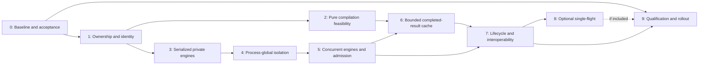

# Native Bazel support for concurrent worktrees: staged implementation plan

Date: 2026-10-31

Status: implementation plan; the architecture and interfaces below are proposed, not implemented

Initial supported commands: `build` and `test`

Initial ownership boundary: one private workspace engine and output base per worktree

## Objective and acceptance contract

Allow multiple worktrees of one repository to build or test simultaneously through a compatible Bazel daemon, while preserving the correctness and isolation of separate Bazel servers. Share selected expensive computations and immutable results where their complete semantic inputs can be expressed explicitly. Measure whether the resulting system reduces the incremental CPU, memory, and latency cost of additional active worktrees.

There are three different milestones:

1. A daemon can retain and route commands to multiple isolated engines while commands remain globally serialized.
2. Different engines can execute commands concurrently under a host-wide resource budget.
3. Engines can reuse completed immutable compilation results with a measured benefit.

The first milestone does not satisfy simultaneous-build support. The second does not eliminate duplicate analysis graphs. The third does not imply that arbitrary analysis values or most graph memory are shared. Qualification must assess the user's actual multi-worktree workload, not JVM count or cache-hit count alone.

Phase 0 has its own [Markdown execution report](multi-worktree-phase0-2026-10-31.md). That report records the checked-out revisions, environment, baseline configurations, measurements, limitations, and acceptance thresholds established before implementation comparisons. This plan describes intended work and must not be read as evidence that any stage has passed.

## Fixed architectural decisions

### Private engines, explicit sharing

The daemon is a supervisor for complete workspace-local engines. Initially, each engine owns its evaluator, module instances, output base, external-repository view, local action cache, and command lifecycle. Commands within an engine remain serialized; different engines may run concurrently after the ownership and resource gates pass.

The implementation should use the existing `BlazeRuntime` / `BlazeWorkspace` separation as a starting point, without assuming that adding a workspace map is sufficient. Names such as `WorkspaceEngine`, `DaemonSupervisor`, `StartupProfile`, and `CompiledProgramCache` in design discussions are proposed abstractions, not existing Bazel APIs.

| Scope | Owned state |
| --- | --- |
| Daemon | Compatible runtime identity, daemon startup/control endpoint, engine registry, admission control, deliberately concurrent services, bounded shared memo store |
| Workspace engine | Workspace/output identity, evaluator and mutable graph, module instances, file observation state, external repository view, local persistent action cache, engine-specific resource and cleanup ownership |
| Invocation | Command options and environment, reporting/BEP, profiler attribution, cancellation, action execution context, command status and completion |
| Shared pure computation | Complete immutable semantic arguments and a completed, deeply immutable result with no workspace-local ownership |

Do not share existing `SkyValue`, `ConfiguredTargetValue`, `Artifact`, `Module`, or mutable graph-node instances merely because their top-level fields appear stable. Existing configured-target values can be cleared in place; artifacts carry physical roots and mutable action ownership; compiled and loaded Starlark currently carry physical filenames or contextual bindings.

### Share pure stages after normal dependency resolution

The requesting engine continues to perform ordinary Skyframe dependency discovery and freshness checking. It may then consult a shared memo for an explicitly supported pure stage whose complete immutable semantic arguments are known.

The initial correctness claim is substitutive equivalence:

```text
memo(function implementation version, complete immutable arguments)
    == direct execution(function implementation version, complete immutable arguments)
```

The shared operation cannot call `Environment.getValue`, read live files or environment variables, register actions, mutate session objects, emit caller-specific events, or retain callbacks/reporters/filesystem handles. An operation with those effects stays private until those effects are separated from the pure stage.

Use typed keys and typed results. Include every semantic input established by the adapter's audit. Unknown or opaque context keeps the enclosing computation private. Java identity, `hashCode`, Git ancestry, or a convenient source digest is not a substitute for complete semantic identity.

This plan does not introduce a generic dependency-certificate system, dynamic dependency-trace replay, or a second global witness validator. It does not change Skyframe into a multi-version shared graph. It does not initially deduplicate in-flight work across worktrees.

### Preserve input and output semantics

Each worktree keeps a distinct output base, execroot, local action-cache state, external-repository view, sandbox/worker ownership, logs, and cleanup domain. Existing action and eligible dependency caches may be shared under their own supported contracts. A common Git directory identifies a repository family; it does not identify a workspace session or justify sharing mutable state.

For the initial pure-stage memo, digest the actual immutable bytes supplied to the computation. Do not reuse a metadata digest that may describe different bytes. The shared memo preserves the requesting engine's ordinary input-freshness semantics; it does not claim that the filesystem was captured atomically or that watcher sequence numbers represent immutable snapshots.

A future snapshot feature would need a separate contract. An explicitly captured manifest can define a build input, but its construction during edits does not prove that it represents the live filesystem at a single instant.

### Compatibility and fallback are part of the design

Daemon identity is separate from output-base identity. Begin with a conservative normalized startup compatibility profile. Exclude a startup setting from that profile only after documenting how it is safely scoped elsewhere. Different binaries, JVM requirements, filesystem implementations, or other incompatible startup semantics must not silently enter one runtime.

No new flag name is committed by this plan. A possible opt-in such as `--experimental_shared_worktree_daemon` would be a **proposed flag**, not an existing or implemented option. Its name and precise command/startup semantics require review in stage 1.

Keep ordinary Bazel behavior as the default during development. Private worker processes may be used as an operational fallback or early routing milestone, but they do not demonstrate shared Java-payload memory savings. Never start a fallback process against an output base still owned by a live engine: drain and transfer ownership, or use a separate output namespace.

## Parallel tracks and stage dependencies

Two tracks allow the main performance hypothesis to be tested before completing the broad runtime refactor:

- **Ownership and concurrency track:** stages 1 → 3 → 4 → 5 → 7.
- **Pure computation sharing track:** stages 1 → 2 → 6 → 7.

Stage 2 and stage 3 can run in parallel after stage 1. Stage 6 needs the audited pure boundary from stage 2 and integrates with the engines and concurrency mechanisms from stages 3–5. Stage 7 closes lifecycle and interoperability qualification across both tracks. Stage 8 is optional. Stage 9 requires stages 0–7, plus stage 8 if that feature is included in the release.



## Stage 0 — Reproducible baseline and acceptance criteria

**Purpose.** Determine the existing cost of additional active worktrees and freeze a fair comparison before choosing performance thresholds.

**Work.**

- Pin the Bazel source/binary revision, compiler/JDK, operating system, filesystem, machine resources, relevant startup/build options, target sets, and workload source revisions.
- Record repository and action-cache configuration. Use a contemporary, supported cache baseline; distinguish analysis, action execution, dependency materialization, and output-storage costs.
- Establish 1/2/4-worktree runs initially, extending to 8 where the available machine permits a meaningful comparison.
- Include cold analysis with a hot action cache, warm no-op builds, source edits, BUILD/`.bzl` edits, and dependency/configuration divergence. Include both identical and different requested targets.
- Record wall time and throughput, CPU including relevant child processes, aggregate process memory and live heap, graph/object categories where feasible, and physical output/cache storage. Distinguish RSS from PSS or private memory; do not double-count shared pages and call that physical memory. Document filesystem limits when measuring shared extents.
- Preserve exact commands and machine-readable results. Keep diagnostic profiling separate from latency cohorts when instrumentation changes the result.
- Define acceptable single-worktree regressions and the multi-worktree improvements required to justify release. Freeze those criteria before evaluating candidate improvements.

**Verification and exit gate.** The baseline can be reproduced from retained instructions; outputs/tests agree across worktrees; repeated observations expose variability; cache state and JVM/OS warming are labeled. The separate Phase 0 report distinguishes completed measurements from blocked or proposed runs.

**Risks and ways forward.** A small toy build may verify harness behavior but cannot establish large-repository performance. Resource constraints may prevent the largest concurrency cohort; report the limit rather than extrapolating. If execution dominates, first quantify what existing action caching or execution scheduling already solves. If analysis and retained graphs dominate, preserve that workload for the native sharing gates.

## Stage 1 — Ownership, identity, and compatibility

**Execution status (31 October 2026):** [request ownership](multi-worktree-stage1-2026-10-31.md)
and [registration/request lifetime](multi-worktree-stage1-registry-2026-10-31.md)
are implemented and tested on the single-engine path. The client carries canonical
workspace/output-base identity and a registration ID. The server checks them
before dispatch/preemption and drains RPC leases before cleanup. Shared discovery,
cross-process registration, startup profiles and filesystem lifetime fencing remain
open; this stage is not complete.

**Depends on:** stage 0 and the architectural contract above. Stage 0 supplies the pinned baseline, workload and compatibility evidence; no later performance claim may bypass its qualification requirements.

**Work.**

- Specify daemon, engine, and invocation identities, including canonical workspace and output-base paths and the startup compatibility profile.
- Design the daemon control directory and startup lock independently of per-output-base state. Preserve supported per-output-base command-lock behavior.
- Specify protocol fields and routing in the C++ client, `command_server.proto`, server request handling, and dispatcher. Fields and public flags remain proposals until implemented and tested.
- Define behavior for explicit output bases, canonical-path aliases, nested workspace discovery, worktree deletion/recreation, incompatible startup settings, and two requests racing to create a daemon or engine.
- Establish supported legacy/shared coexistence. Do not publish the shared daemon PID in a location where a legacy client can kill it in response to one output base's startup mismatch. Use an isolated shared-mode output namespace if safe coexistence is not yet established.
- Specify the minimum lifecycle state machine, ownership transfer, and shutdown scope now, before later stages depend on them. `shutdown` must not accidentally terminate unrelated active worktrees.

**Verification and exit gate.** Unit and client/protocol tests cover canonical aliases, different worktrees at the same commit, explicit output-base collisions, startup mismatch, concurrent daemon creation, command lock waiting, and nonblocking lock failure. The supported compatibility matrix and rejection/fallback behavior are explicit.

**Risks and ways forward.** Overly permissive compatibility can corrupt behavior; overly conservative compatibility only reduces sharing. Start conservative. Legacy clients may not understand a new ownership marker; an undocumented marker alone is not fencing. Keep shared and legacy output namespaces separate until the interaction is proven.

## Stage 2 — Pure compilation boundary and feasibility

**Depends on:** stage 1. **Can run in parallel with:** stage 3.

**Purpose.** Test the sharing hypothesis early without waiting for concurrent command support.

**Work.**

- Audit `BzlCompileFunction`, `BzlCompileValue`, `Program`, compiler context, source locations, and downstream consumers.
- Separate workspace-local source/dependency acquisition and checks from a pure parse/resolve/compile stage and from local result binding/events.
- Define a complete typed input descriptor: immutable source bytes or their verified digest, logical source identity/canonical label, dialect, file/compiler options, relevant Starlark semantics, and versioned compiler/predeclared context. The audit determines the exact fields; the list is not a license to omit hidden context.
- Replace physical-path coupling in the reusable representation with logical locations and caller-local rendering/binding, where semantically valid. Audit any observable use of source filenames beyond diagnostics.
- Define completed immutable output and diagnostic templates. Workspace-dependent checks and required events must still occur on cache hits.
- Initially invoke the pure stage directly and compare it with the original path. Use a bounded experimental memo only to assess the feasibility and potential benefit; the production cache arrives in stage 6.

**Verification and exit gate.** Direct and reused execution agree for successful compilation and failures. Tests vary bytes, label/logical identity, dialect, semantics, compiler context, and source location independently. Diagnostics belong to the requesting worktree. No mutable or workspace-bound state is reachable through an admitted shared result. Measure avoided computation, allocation, retained size, and adapter overhead.

**Risks and ways forward.** A compiled program may be mutated later by typing or other consumers; the output needs a real freeze/ownership contract, not a top-level `final` field. If the boundary cannot be made pure without broad changes, narrow to an audited substage or leave compilation private. If the measured opportunity is immaterial, do not infer that sharing larger values will help: identify and separately justify the next candidate before expanding scope.

## Stage 3 — Multiple complete engines, initially serialized

**Depends on:** stage 1. **Can run in parallel with:** stage 2.

**Work.**

- Introduce the daemon/engine ownership split around `BlazeRuntime`, `BlazeWorkspace`, `CommandEnvironment`, and `BlazeCommandDispatcher`.
- Construct module instances per engine initially. Move only explicitly concurrent, context-independent services to daemon scope.
- Route workspace initialization, command setup, `beforeCommand`, `afterCommand`, `commandComplete`, error paths, and engine cleanup to the correct owner.
- Retain separate evaluators, output bases, external-repository views, local action caches, and execution state.
- Keep the global command lock while validating cross-session ownership. Preserve warm engines between commands under a bounded lifecycle policy.

**Verification and exit gate.** Run A→B→A command sequences with the same labels but different source, module definitions, flags, environments, and expected outputs. Verify return to A preserves valid warm state. Failures and analysis-discarding cleanup in A must not clear or misattribute B's state. Exercise actual module lifecycle, not only registry mocks.

**Risks and ways forward.** Workspace state may be retained through modules, callbacks, executor services, or runtime helper methods. Explicitly trace ownership rather than relying on the request's current thread. Keep serialization until the stage 4 audit and stage 5 readiness tests pass. This milestone is useful routing groundwork but is not concurrent-worktree support.

## Stage 4 — Remove process-global command assumptions

**Depends on:** stage 3.

**Work.**

- Inventory mutable statics/singletons and asynchronous callbacks reachable from the initial supported command set. Classify each as immutable, deliberately daemon-wide, engine-local, or invocation-local.
- Audit graph-backed SkyKey/Label interner pools, profiler service/attribution, runtime environment and exit/crash state, filesystem services, resource managers, executor lifecycle, workers, remote callbacks, event buses, and module cleanup.
- Thread explicit ownership through asynchronous work. A ThreadLocal alone does not establish ownership across executor/RPC callbacks.
- Ensure engine initialization, evaluator reset, cache clearing, completion, or shutdown cannot reset another engine's pools or services.
- Document the remaining shared failure domain: JVM GC and process termination remain daemon-wide even when command state is isolated.

**Verification and exit gate.** Component tests interleave initialization/reset/cleanup of two engines. Event/BEP/profile records and exit status remain attributed correctly. One invocation's cancellation or ordinary failure cannot finish, clear, or misreport another. Review findings have explicit owners and resolution; unresolved global command state blocks in-process concurrency.

**Risks and ways forward.** An optimization may depend on a single graph owning a global pool. Disable it in the prototype if necessary, then account for its performance cost; do not call that the final memory-efficient solution. Unsupported features may remain disabled in shared mode. Separate processes remain the fallback if safe in-process ownership cannot yet be established.

## Stage 5 — Concurrent engines with host-wide admission

**Depends on:** stage 4. Requires the basic cancellation, ownership, and cleanup invariants specified in stages 1–4; stage 7 expands fault qualification rather than postponing those basics.

**Work.**

- Replace global command serialization with per-engine serialization. Allow different engines to run commands concurrently.
- Add daemon-wide admission and resource budgets before admitting parallel commands. Account separately for analysis concurrency and action execution; per-command `--jobs` is not a host budget.
- Integrate `ResourceManager`, analysis executors, and quiescing-executor ownership without allowing one command to reset another's limits.
- Start with a bounded active-engine count, explicit queueing, JVM headroom, and idle-engine eviction. Do not claim precise per-build heap enforcement from estimates alone.
- Define fairness, oversized-request handling, queued cancellation, active leases, and pressure behavior. Resource requests must not deadlock through partial acquisition.

**Verification and exit gate.** Two different engines must both reach an execution barrier before either is released, proving overlap rather than inferring it from elapsed time. Same-engine commands still serialize. Test concurrent conflicting sources/dependencies/configurations, success plus failure, queued and running cancellation, and basic cleanup isolation. Scheduler tests cover fairness, rejection of impossible requests, cancellation removal, and bounded admission.

**Risks and ways forward.** Parallel analysis can exhaust memory before action limits take effect. Reduce admission and evict idle engines first; queue or reject additional work explicitly. If races appear, fall back to globally serialized multi-engine mode while retaining completed ownership work. Do not mask concurrency bugs by weakening test workloads.

## Stage 6 — Bounded shared compilation cache for completed results

**Depends on:** stage 2; integrates with stages 3–5.

**Work.**

- Implement the typed completed-result memo for the audited compilation stage. Version its semantic key by implementation and relevant compiler/runtime inputs.
- Admit only complete, frozen results. On misses, compute privately and atomically publish; simultaneous equal misses may compute more than once.
- Keep graph wrappers, source-location binding, events, and workspace-dependent checks private. No existing mutable `SkyValue` or rooted artifact is inserted in the shared store.
- Bound retained entries/bytes, define accounting and eviction, and expose useful hits, avoided computation, duplicate misses, retained bytes, and eviction metrics.
- Keep live users' references valid when entries are evicted. Do not retain whole workspace engines through cached closures or diagnostic objects.

**Verification and exit gate.** Equal complete keys produce equivalent results under concurrent misses; any semantic key change prevents reuse. Eviction during use, producer failure/cancellation, and one engine's shutdown do not affect other consumers. Stress tests enforce the store's bound and inspect retention. End-to-end results and diagnostics match direct computation.

**Risks and ways forward.** A bounded entry count may still retain unbounded object graphs; measure deep retained size and remove owner back-references. Cache lookup/key construction may cost more than compilation for small units; bypass low-benefit cases based on measured policy. Disable the shared memo independently of concurrent engines if it fails its correctness or performance gate.

## Stage 7 — Lifecycle, failure recovery, and legacy interoperability

**Depends on:** stages 5 and 6.

**Work.**

- Complete lifecycle state transitions for initialization, idle/running engines, draining, eviction, and closure. Specify leases held by invocations, background tasks, materializers, workers, and queued requests.
- Qualify `clean`, analysis-discarding modes, engine-scoped shutdown, daemon idle shutdown, abrupt client disconnect, failed engine initialization, and worktree deletion/recreation.
- Exercise output-base ownership transfer and supported legacy/shared client interactions. Never let one client's compatibility or cleanup action kill the shared daemon unintentionally.
- Define recovery after process failure and partial output/control-state creation. Treat daemon crashes as a shared failure domain with ordinary output recovery, not transparent continuation.
- Validate fallback paths. A fallback process either receives a fully drained/transferred output base or uses a distinct output namespace.

**Verification and exit gate.** Fault-injection tests cover cancellation at each lifecycle boundary, engine reset while another engine runs, interrupted initialization, active-cache use during eviction, cleanup with background work, client death, and daemon restart. Output-base locks and control records cannot leave two owners or permit destructive cross-engine cleanup. Unsupported legacy interactions are explicitly excluded or use isolated namespaces.

**Risks and ways forward.** Background tasks may outlive command completion; establish ownership and join/cancel rules rather than relying on timeouts alone. Windows file/handle semantics and other platform differences need separate qualification. Limit initial platform support when necessary; a Linux pass does not establish portability.

## Stage 8 — Optional in-flight deduplication

**Depends on:** stages 6 and 7. **Not required for the first release.**

**Purpose.** Consider coalescing concurrent identical pure-stage misses only if stage 6 shows duplicate misses are material.

**Work.**

- Permit single-flight only after every semantic argument is already established and identical. Do not deduplicate arbitrary Skyframe evaluation or worktree-specific dependency discovery.
- Give shared computation a daemon-owned task context independent of the first caller. Track consumers explicitly and define when last-consumer cancellation may stop production.
- Bound in-flight memory and work, preserve fairness, and define whether transient failures are shared only with current consumers or retained at all.
- Keep publication and cancellation races explicit: one caller's timeout cannot corrupt the completed memo or cancel work still required by another caller.

**Verification and exit gate.** Tests cover two consumers, first-consumer cancellation, last-consumer cancellation, new arrival during cancellation, producer failure, publication races, eviction, and pressure. Demonstrate additional benefit over the completed-cache design, including scheduling and bookkeeping overhead.

**Risks and ways forward.** This adds distributed task ownership inside one process and can introduce leaks or head-of-line blocking. Omit the feature if its benefit is small. The completed-result cache remains a valid design without single-flight.

## Stage 9 — Performance qualification and controlled rollout

**Depends on:** stages 0–7, plus stage 8 if included.

**Work.**

- Run the frozen baseline matrix against ordinary independent servers, the shared daemon with memo disabled, and the shared daemon with memo enabled. Include the optional single-flight variant only if it is shipping.
- Retain identical targets/configurations/cache conditions and record source/binary provenance. Alternate or randomize comparison order and distinguish warmups, diagnostic runs, failures, and excluded observations.
- Evaluate aggregate throughput, per-command latency distribution, CPU, retained and peak memory, physical storage, and additional-worktree cost. Measure publication/keying/lookup costs, not only avoided compiler work.
- Run differential correctness and long interleaving tests for the supported build/test matrix, including remote/local execution and relevant worker modes. Expand other commands and platforms only after their ownership paths are qualified.
- Roll out behind an explicit opt-in with independent disable paths for shared memoization and concurrent admission. Preserve ordinary-server fallback with correct output ownership.
- Publish supported modes, incompatibilities, resource behavior, recovery behavior, and the benchmark evidence. Record any threshold changes as a new decision before rerunning comparisons.

**Verification and release gate.** Outputs/tests agree with independent-server controls; isolation and lifecycle qualification pass; the predefined single-worktree regression budget and multi-worktree benefit criteria pass on the intended workload. A lower JVM count or a high hit rate is not sufficient. Results must state their machine/workload limits.

**Risks and ways forward.** Larger graphs may expose a different bottleneck than the first compilation prototype. If duplicated evaluator topology or opaque configured-target payloads remain dominant, record that limit and make a separate design decision about the next pure stage or a larger representation change. Do not quietly turn this plan into generic graph sharing or revive global witness validation to rescue a missed performance goal.

## Cross-stage invariants and review checklist

- A worktree's source, options, repo mappings, toolchains, and outputs cannot be confused with another's even when target labels and Git commits coincide.
- Each invocation has exactly one command owner; asynchronous callbacks retain explicit ownership.
- Engine invalidation, graph clearing, action registration, output cleanup, and local action-cache updates remain private.
- Shared results are complete and deeply immutable; their keys describe all semantic arguments of the pure stage.
- Shared-cache eviction cannot invalidate a result still held by a consumer; cache contents cannot retain an engine accidentally.
- No watcher generation or worktree-local revision number is treated as a cross-worktree semantic certificate.
- Concurrent execution is admitted under explicit host budgets, including analysis pressure; active engines cannot be evicted beneath their users.
- Per-output-base command locks and daemon-start locks have distinct purposes and verified lifecycle rules.
- Fallback, legacy interoperability, and shutdown cannot create simultaneous output-base owners or destroy another engine's state.
- Phase completion distinguishes implemented behavior, test evidence, performance evidence, and still-proposed work.

## Evidence informing the plan

The following source observations motivate the ownership and purity gates. They do not establish the performance of the proposed implementation.

- [`BlazeWorkspace` anticipates a future 1:N runtime/workspace relationship](https://github.com/bazelbuild/bazel/blob/9a2ababbd5cf113c31450fbe9214b501be8c58a2/src/main/java/com/google/devtools/build/lib/runtime/BlazeWorkspace.java).
- [`AbstractConfiguredTargetValue` can clear retained target/package state in place](https://github.com/bazelbuild/bazel/blob/9a2ababbd5cf113c31450fbe9214b501be8c58a2/src/main/java/com/google/devtools/build/lib/skyframe/AbstractConfiguredTargetValue.java#L27).
- [`Artifact` stores physical roots and derived-artifact ownership changes during analysis](https://github.com/bazelbuild/bazel/blob/9a2ababbd5cf113c31450fbe9214b501be8c58a2/src/main/java/com/google/devtools/build/lib/actions/Artifact.java#L207).
- [`BzlCompileFunction` supplies a physical filename to the parser](https://github.com/bazelbuild/bazel/blob/9a2ababbd5cf113c31450fbe9214b501be8c58a2/src/main/java/com/google/devtools/build/lib/skyframe/BzlCompileFunction.java#L190), and [`BzlLoadFunction` retains filename and repository context](https://github.com/bazelbuild/bazel/blob/9a2ababbd5cf113c31450fbe9214b501be8c58a2/src/main/java/com/google/devtools/build/lib/skyframe/BzlLoadFunction.java#L864).
- [`InMemoryGraphImpl` installs process-global interner pools](https://github.com/bazelbuild/bazel/blob/9a2ababbd5cf113c31450fbe9214b501be8c58a2/src/main/java/com/google/devtools/build/skyframe/InMemoryGraphImpl.java#L89).
- [`BlazeRuntime` command completion](https://github.com/bazelbuild/bazel/blob/9a2ababbd5cf113c31450fbe9214b501be8c58a2/src/main/java/com/google/devtools/build/lib/runtime/BlazeRuntime.java#L831), [`Profiler`](https://github.com/bazelbuild/bazel/blob/9a2ababbd5cf113c31450fbe9214b501be8c58a2/src/main/java/com/google/devtools/build/lib/profiler/Profiler.java#L57), and [`RemoteModule`](https://github.com/bazelbuild/bazel/blob/9a2ababbd5cf113c31450fbe9214b501be8c58a2/src/main/java/com/google/devtools/build/lib/remote/RemoteModule.java#L144) expose command/runtime ownership assumptions that must be addressed before concurrency.

Buck2, Pants, and Bonanza informed the separation of mutable request/workspace state from reusable computation, complete input identity, and explicit concurrency ownership. Their architectures are inspiration, not proof that Bazel can share its existing Java graph unchanged. This plan deliberately retains ordinary Skyframe dependency resolution and validates each pure sharing boundary separately.
