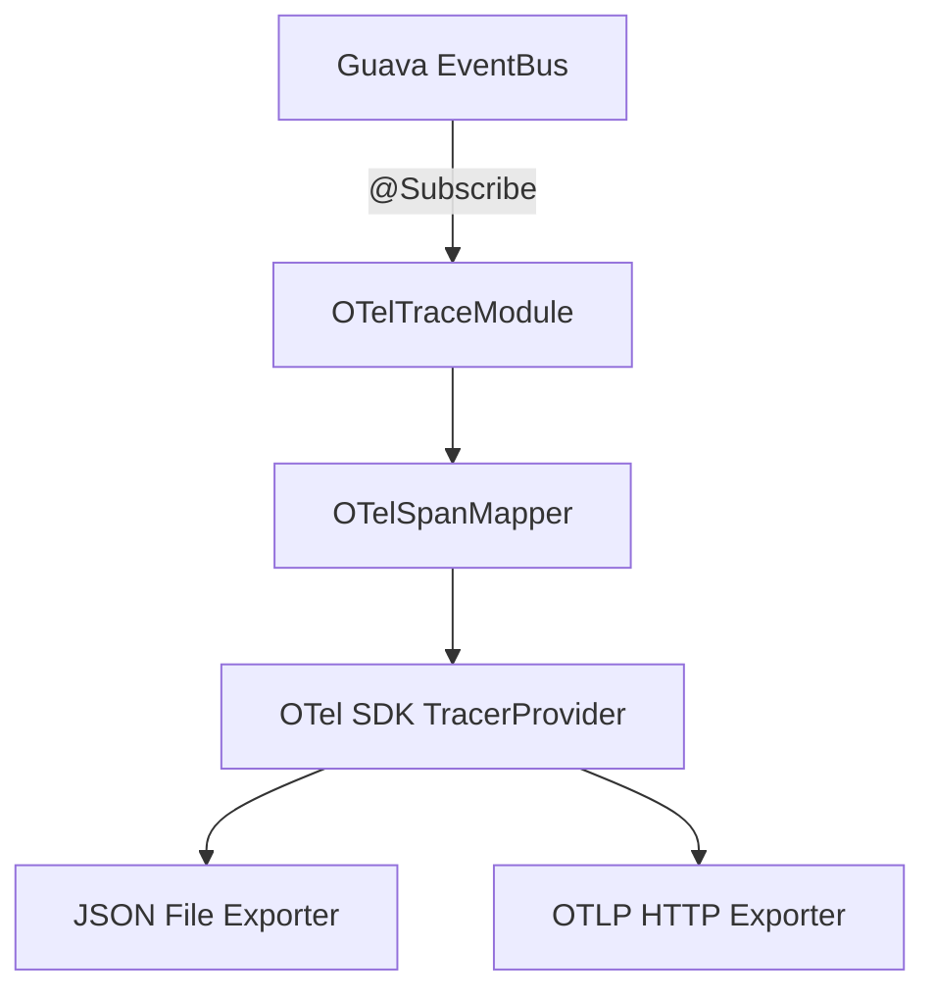
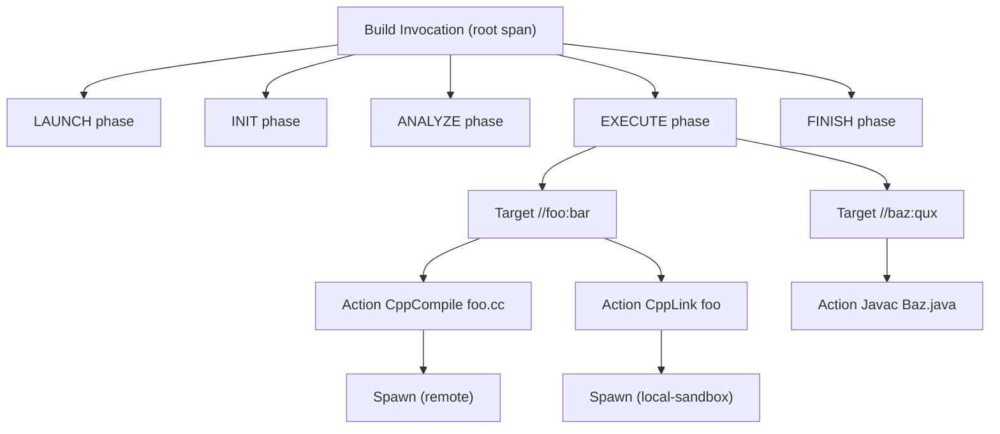

# OTel Traces Support in Bazel

## Architecture Overview

The approach creates a new `BlazeModule` (`OTelTraceModule`) that subscribes to Bazel's EventBus to receive build events, maps them to OpenTelemetry spans forming a hierarchical trace, and exports them via file (JSON) or OTLP HTTP endpoint.



## Trace Hierarchy Design

The OTel trace represents a full build as a hierarchical span tree:



### Span Attributes (key data from BEP + profiling + execution logs)

- **Build span**: `bazel.invocation_id`, `bazel.command`, `bazel.workspace`, `bazel.exit_code`, `bazel.build_request_id`
- **Phase spans**: `bazel.phase.name`, duration
- **Target spans**: `bazel.target.label`, `bazel.target.rule_kind`, `bazel.target.success`, `bazel.target.configuration`
- **Action spans**: `bazel.action.mnemonic`, `bazel.action.primary_output`, `bazel.action.target_label`, `bazel.action.cache_hit`, `bazel.action.exit_code`, `bazel.action.runner` (strategy)
- **Spawn spans**: `bazel.spawn.runner`, `bazel.spawn.cache_hit`, `bazel.spawn.exit_code`, detailed metrics (`remote_queue_time`, `upload_time`, `execution_wall_time`, etc.)

## Implementation Plan

### 1. Add OTel Java SDK dependencies

Add to [`MODULE.bazel`](MODULE.bazel) `maven.install` artifacts list (around line 141):

```
"io.opentelemetry:opentelemetry-api:<version>",
"io.opentelemetry:opentelemetry-sdk:<version>",
"io.opentelemetry:opentelemetry-sdk-trace:<version>",
"io.opentelemetry:opentelemetry-exporter-otlp:<version>",
"io.opentelemetry:opentelemetry-semconv:<version>",
```

Then run `bazel mod deps --lockfile_mode=update` to update the lockfile.

### 2. Create `OTelTraceOptions` -- flag definitions

Create a new file: `src/main/java/com/google/devtools/build/lib/oteltracing/OTelTraceOptions.java`

Following the pattern in [`BuildEventStreamOptions.java`](src/main/java/com/google/devtools/build/lib/buildeventstream/transports/BuildEventStreamOptions.java) and [`ExecutionGraphModule.ExecutionGraphOptions`](src/main/java/com/google/devtools/build/lib/runtime/ExecutionGraphModule.java):

```java
public class OTelTraceOptions extends OptionsBase {
    @Option(
        name = "experimental_otel_trace_json",
        defaultValue = "null",
        documentationCategory = OptionDocumentationCategory.LOGGING,
        effectTags = {OptionEffectTag.AFFECTS_OUTPUTS},
        metadataTags = {OptionMetadataTag.EXPERIMENTAL},
        converter = OptionsUtils.EmptyToNullPathFragmentConverter.class,
        help = "Write OTel trace as JSON to the given file path.")
    public PathFragment otelTraceJsonFile;

    @Option(
        name = "experimental_otel_trace_endpoint",
        defaultValue = "null",
        documentationCategory = OptionDocumentationCategory.LOGGING,
        effectTags = {OptionEffectTag.AFFECTS_OUTPUTS},
        metadataTags = {OptionMetadataTag.EXPERIMENTAL},
        help = "OTLP HTTP endpoint for exporting traces (e.g., http://localhost:4318).")
    public String otelTraceEndpoint;
    
    @Option(
        name = "experimental_otel_trace_all_actions",
        defaultValue = "false",
        documentationCategory = OptionDocumentationCategory.LOGGING,
        effectTags = {OptionEffectTag.AFFECTS_OUTPUTS},
        metadataTags = {OptionMetadataTag.EXPERIMENTAL},
        help = "Report all actions as spans, not just failed ones.")
    public boolean otelTraceAllActions;
}
```

### 3. Create `OTelTraceModule` -- the BlazeModule

Create: `src/main/java/com/google/devtools/build/lib/oteltracing/OTelTraceModule.java`

Follows the same lifecycle pattern as [`BuildEventServiceModule`](src/main/java/com/google/devtools/build/lib/buildeventservice/BuildEventServiceModule.java) and [`ExecutionGraphModule`](src/main/java/com/google/devtools/build/lib/runtime/ExecutionGraphModule.java):

- **`getCommonCommandOptions()`** -- registers `OTelTraceOptions`
- **`beforeCommand(CommandEnvironment env)`** -- reads options, initializes OTel SDK `TracerProvider` with configured exporters, registers an event listener on `env.getEventBus()`
- **`afterCommand()`** -- ends the root build span, flushes the `TracerProvider`
- **`commandComplete()`** -- shuts down the `TracerProvider`

Key event subscriptions (via EventBus `@Subscribe` methods):

- `BuildStartingEvent` -> Root build span (start)
- `BuildCompleteEvent` -> Root build span (end) with exit code
- `AnalysisPhaseCompletedEvent` -> Analysis phase span
- `ExecutionStartingEvent` -> Execution phase span start
- `TargetCompleteEvent` -> Target span
- `ActionExecutedEvent` -> Action span (failed + all if flag set)
- `SpawnExecutedEvent` -> Spawn span with detailed metrics (from `AbstractSpawnStrategy`)
- `ActionCompletionEvent` -> Action span (succeeded)
- `CachedActionEvent` -> Cached action span
- `TestAttempt` -> Test attempt span

### 4. Create `OTelSpanMapper` -- event-to-span translation

Create: `src/main/java/com/google/devtools/build/lib/oteltracing/OTelSpanMapper.java`

Manages the OTel `Tracer` and maps events to spans. Key responsibilities:

- Maintains a map of active spans keyed by target label / action key for parent-child linking
- Creates hierarchical spans: Build -> Phase -> Target -> Action -> Spawn
- Sets span attributes from event data (see attribute list above)
- Handles span lifecycle (start/end) driven by event arrival
- For `SpawnExecutedEvent`: extracts `SpawnMetrics` timing breakdown as span events or child spans

### 5. Export Strategy: Hybrid (stream to endpoint, dump to file)

The two export paths use different strategies:

- **`--experimental_otel_trace_endpoint`** (OTLP): **Streamed in real-time.** Uses `BatchSpanProcessor` so spans are exported to the endpoint as they complete during the build. This gives real-time observability -- you can watch spans arriving in Jaeger/Datadog while the build is still running.

- **`--experimental_otel_trace_json`** (JSON file): **Dumped at the end.** Spans are collected in memory via a custom `InMemorySpanExporter` (or a buffering `SpanProcessor`), then written as a complete, ordered JSON snapshot in `afterCommand()`. This ensures the file is a coherent, self-contained trace with all spans present.

Both flags can be used simultaneously -- the `TracerProvider` is configured with two `SpanProcessor` instances:

```java
TracerProvider provider = SdkTracerProvider.builder()
    .addSpanProcessor(BatchSpanProcessor.builder(otlpExporter).build())   // stream
    .addSpanProcessor(SimpleSpanProcessor.create(inMemoryExporter))       // collect
    .build();
```

In `afterCommand()`, the module calls `inMemoryExporter.getFinishedSpanItems()` and writes them to the JSON file.

#### `OTelJsonFileExporter`

Create: `src/main/java/com/google/devtools/build/lib/oteltracing/OTelJsonFileExporter.java`

A helper class that takes the collected spans from `InMemorySpanExporter` and writes them to the specified file path in OTLP JSON format. Called once at build end from `afterCommand()`.

### 6. Wire into Bazel

- **Add to `BAZEL_MODULES`** in [`Bazel.java`](src/main/java/com/google/devtools/build/lib/bazel/Bazel.java) (line ~84, before BES module):
  ```java
  com.google.devtools.build.lib.oteltracing.OTelTraceModule.class,
  ```

- **Create BUILD target** at `src/main/java/com/google/devtools/build/lib/oteltracing/BUILD`:
  ```
  java_library(
      name = "oteltracing",
      srcs = glob(["*.java"]),
      deps = [
          "//src/main/java/com/google/devtools/build/lib/runtime:blaze_module",
          "//src/main/java/com/google/devtools/build/lib/buildeventstream",
          "@maven//:io_opentelemetry_opentelemetry_api",
          "@maven//:io_opentelemetry_opentelemetry_sdk",
          "@maven//:io_opentelemetry_opentelemetry_sdk_trace",
          "@maven//:io_opentelemetry_opentelemetry_exporter_otlp",
          ...
      ],
  )
  ```


### 7. Key Design Decisions

- **Hybrid export**: OTLP endpoint gets real-time streaming (spans flow as they complete); JSON file gets a complete dump at build end. Both can run simultaneously via dual `SpanProcessor` setup.
- **No OTel SDK dependency at runtime if unused**: The module is a no-op (returns immediately from `beforeCommand`) if neither flag is set, avoiding any OTel SDK initialization overhead.
- **Thread safety**: The `OTelSpanMapper` uses `ConcurrentHashMap` for active span tracking since events arrive from multiple threads.
- **Span correlation**: Use `bazel.invocation_id` as the OTel trace ID (or derive a deterministic trace ID from it) so all spans in one build share a single trace.
- **Backpressure**: For OTLP endpoint export, use the SDK's built-in `BatchSpanProcessor` with configurable queue size.
- **Graceful degradation**: If the OTLP endpoint is unreachable, log a warning but don't fail the build (similar to how BES handles `fully_async` mode).

### 8. Key Files Reference

- [`BuildEventServiceModule.java`](src/main/java/com/google/devtools/build/lib/buildeventservice/BuildEventServiceModule.java) -- Primary pattern to follow for module lifecycle
- [`ExecutionGraphModule.java`](src/main/java/com/google/devtools/build/lib/runtime/ExecutionGraphModule.java) -- Pattern for subscribing to action/spawn events
- [`BuildEventStreamOptions.java`](src/main/java/com/google/devtools/build/lib/buildeventstream/transports/BuildEventStreamOptions.java) -- Pattern for flag definitions
- [`Bazel.java`](src/main/java/com/google/devtools/build/lib/bazel/Bazel.java) -- Where module is registered (line 43-105)
- [`MODULE.bazel`](MODULE.bazel) -- Where Maven deps are declared (line 140-258)
- [`SpawnLogContext.java`](src/main/java/com/google/devtools/build/lib/exec/SpawnLogContext.java) -- How spawn details are extracted
- [`Profiler.java`](src/main/java/com/google/devtools/build/lib/profiler/Profiler.java) -- Existing profiling span model
- [`ProfilerTask.java`](src/main/java/com/google/devtools/build/lib/profiler/ProfilerTask.java) -- Task types available for profiling