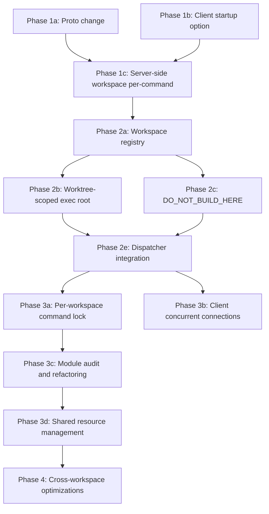

# Shared Bazel Server Across Git Worktrees

> Status revised 2026-10-19: retained as an alternative design, not the selected implementation.
> The current requirement is independent Bazel servers running simultaneously in separate worktrees.
> Follow [Concurrent SkyCache across worktrees](skycache_local_backend_f13e5f7f.plan.md) for that work.
> Sharing immutable analysis does not require merging command execution or mutable evaluator state
> into a single JVM.

## Problem Statement

When N git worktrees of the same repo run Bazel, today you get N independent server JVMs, each consuming 1-4GB of heap, competing for CPUs, and duplicating identical analysis/loading work. For agentic development workflows this is the common case.

## Design Principles

- **Incremental**: each phase is independently shippable and useful
- **Backward compatible**: default behavior unchanged; opt-in via a new startup flag
- **Minimal Skyframe changes**: no workspace-tagged SkyKeys in this scope; workspaces get independent `SkyframeExecutor` instances

## Key Architectural Insight

The codebase already has the conceptual split:

- `BlazeRuntime` = server-level (modules, rule classes, product config)
- `BlazeWorkspace` = workspace-level (SkyframeExecutor, directories, action cache)

The `BlazeWorkspace` javadoc explicitly says:
> "the introduction of this class is a step towards allowing 1:N relationships"

([BlazeWorkspace.java](src/main/java/com/google/devtools/build/lib/runtime/BlazeWorkspace.java) line 65)

But today `BlazeRuntime.workspace` is a single field, and `workspace_directory` is a JVM startup argument, not a per-command parameter.

---

## Phase 1: Protocol and Client — Workspace Per-Command

**Goal:** Make the server accept a workspace directory per gRPC invocation instead of at JVM startup.

### 1a. Proto change

Add `workspace_directory` to `RunRequest` in [command_server.proto](src/main/protobuf/command_server.proto):

```protobuf
message RunRequest {
  // ... existing fields ...
  string workspace_directory = 10;
}
```

### 1b. Client startup option

Add `--experimental_shared_server` startup option in [startup_options.h](src/main/cpp/startup_options.h) / [startup_options.cc](src/main/cpp/startup_options.cc). When set:

- `output_base` is computed as `md5("shared:" + <canonical_repo_root>)` instead of `md5(workspace_path)`. The canonical repo root can be detected via `git rev-parse --git-common-dir` or passed explicitly.
- The client populates `RunRequest.workspace_directory` with the actual worktree path.
- The exclusive `fcntl` lock on `$OUTPUT_BASE/lock` ([blaze.cc](src/main/cpp/blaze.cc) line 294) remains exclusive per-client but acquisition uses **wait mode** (existing `--block_for_lock` behavior). True concurrent client connections come in Phase 3.

### 1c. Server-side: parse workspace per-command

In [CommandServer.java](src/main/java/com/google/devtools/build/lib/server/CommandServer.java) `run()` method (line 424): extract `workspace_directory` from `RunRequest` and pass it through to `dispatcher.exec()`. Add it as a parameter on [`CommandDispatcher.exec()`](src/main/java/com/google/devtools/build/lib/runtime/CommandDispatcher.java).

If the server was started with `--workspace_directory` (legacy mode), ignore the per-command field and behave as today.

---

## Phase 2: Multi-Workspace Runtime — Workspace Registry

**Goal:** `BlazeRuntime` manages a map of `BlazeWorkspace` instances, creating them lazily on first command from a new worktree.

### 2a. Workspace registry in BlazeRuntime

In [BlazeRuntime.java](src/main/java/com/google/devtools/build/lib/runtime/BlazeRuntime.java), replace:

```java
// Line 204-205
private BlazeWorkspace workspace;
```

with:

```java
private final ConcurrentHashMap<Path, BlazeWorkspace> workspaces = new ConcurrentHashMap<>();
private volatile BlazeWorkspace primaryWorkspace; // first workspace, for backward compat
```

Add `getOrCreateWorkspace(Path workspaceDir)` that:
1. Returns cached workspace if exists
2. Creates new `BlazeDirectories` with shared `ServerDirectories` but different `workspace` path
3. Calls `module.workspaceInit()` for each module
4. Builds `BlazeWorkspace` via `WorkspaceBuilder`
5. Each workspace gets its own `SkyframeExecutor` instance

### 2b. Worktree-scoped exec root

Today `workspaceName` is hardcoded to `"_main"` in [BazelRuleClassProvider.java](src/main/java/com/google/devtools/build/lib/bazel/rules/BazelRuleClassProvider.java) line 237. All workspaces share `outputBase/execroot/_main/`.

Introduce a **worktree ID** (short hash of the worktree source path) to partition exec roots:

```
outputBase/
  execroot/
    _main/           # legacy (single workspace mode)
    wt-<hash8>/      # worktree-specific exec root (shared server mode)
      bazel-out/
      external/
      <symlink forest pointing to worktree source>
```

This avoids touching `runfilesPrefix` ("_main"), which affects runfiles layout and is deeply embedded. The exec root partition is purely a directory layout concern.

Changes needed in:
- [BlazeDirectories.java](src/main/java/com/google/devtools/build/lib/analysis/BlazeDirectories.java): `getExecRoot()` uses worktree ID when in shared server mode
- [SymlinkForest.java](src/main/java/com/google/devtools/build/lib/buildtool/SymlinkForest.java): plants into the worktree-specific exec root (no cross-contamination, each forest is independent)
- [OutputDirectoryLinksUtils.java](src/main/java/com/google/devtools/build/lib/buildtool/OutputDirectoryLinksUtils.java): convenience symlinks (`bazel-bin`, `bazel-out`) point to the correct worktree-scoped output tree; written to the worktree's own source directory (naturally isolated)

### 2c. DO_NOT_BUILD_HERE

[BlazeWorkspace.java](src/main/java/com/google/devtools/build/lib/runtime/BlazeWorkspace.java) line 444: currently writes one workspace path. Change to write a sentinel per worktree exec root subdirectory, or switch to a directory-based check rather than content-based.

### 2d. Action cache and disk cache

- **Action cache** (`outputBase/action_cache/`): shared across workspaces. This is fine — action keys include the full output path, so actions from different worktree exec roots won't collide.
- **Disk cache** (`--disk_cache`): already shareable, content-addressed.
- **Repository cache**: already shared via `--repository_cache`.

### 2e. BlazeCommandDispatcher integration

In [BlazeCommandDispatcher.java](src/main/java/com/google/devtools/build/lib/runtime/BlazeCommandDispatcher.java) `exec()`:

1. Resolve the workspace directory from the command arguments
2. Call `runtime.getOrCreateWorkspace(workspaceDir)`
3. The workspace creates `CommandEnvironment` via `workspace.initCommand()` (already per-command)
4. Keep the **global** command lock for now (Phase 3 lifts this)

---

## Phase 3: Per-Workspace Concurrency

**Goal:** Commands from different worktrees execute concurrently. Commands within the same worktree still serialize.

### 3a. Per-workspace command lock

Replace the single `commandLock` in `BlazeCommandDispatcher` with a per-workspace lock:

```java
private final ConcurrentHashMap<Path, WorkspaceLock> workspaceLocks = new ConcurrentHashMap<>();

static class WorkspaceLock {
    final Object lock = new Object();
    String currentClientDescription;
}
```

### 3b. Client-side concurrent connections

The C++ client currently takes an exclusive `fcntl` lock on `$OUTPUT_BASE/lock`. For shared server mode:
- Change to a **shared** lock (multiple readers) for the output_base
- Add per-worktree lock files: `$OUTPUT_BASE/worktree-locks/<worktree_hash>.lock` (exclusive per worktree)

This allows multiple clients (one per worktree) to connect to the same server simultaneously while preventing two commands on the same worktree.

### 3c. Module audit and refactoring

This is the largest single work item. The problem: `BlazeModule` instances are singletons, but many store per-command state in instance fields. Two concurrent `beforeCommand()` calls would race.

**Strategy:** move per-command mutable state from module fields into `CommandEnvironment` extensions.

Add a typed extension mechanism to `CommandEnvironment`:

```java
// In CommandEnvironment.java
private final Map<Class<?>, Object> extensions = new ConcurrentHashMap<>();
public <T> void putExtension(Class<T> key, T value) { ... }
public <T> T getExtension(Class<T> key) { ... }
```

**Critical modules to refactor (ordered by risk):**

| Module | Fields to move | Effort |
|--------|---------------|--------|
| `RemoteModule` | `env`, `remoteOptions`, `actionContextProvider`, `actionInputFetcher`, `outputService`, `tempPathGenerator`, `remoteOutputChecker` | High - stores gRPC channels, executor services |
| `BazelRepositoryModule` | `fetchDisabled`, `overrides`, `injections`, `moduleOverrides`, `registries`, `vendorDirectory`, `allowedYankedVersions`, `repoEnvSupplier` | High - many fields, SkyFunction instances mutated |
| `SandboxModule` | `env`, `sandboxBase`, `spawnRunners`, static `firstBuild` | Medium - static field needs special handling |
| `WorkerModule` | `env`, `workerPool` (shared by design) | Medium - pool sharing is intentional |
| `BuildEventServiceModule` | `bepOptions`, `reporter`, `streamer`, `outErr`, transports | Medium |
| `BuildSummaryStatsModule` | `reporter`, `eventBus`, `criticalPathComputer`, timing fields | Low - pure per-command |
| `DynamicExecutionModule` | `executorService`, `reporter` | Low |
| `SpawnLogModule` | `spawnLogContext`, `outputPath` | Low |

Modules that are already safe (stateless or server-level only): `BazelFileSystemModule`, `BazelStartupOptionsModule`, `BazelRulesModule`, `BuiltinCommandModule`, `NoSpawnCacheModule`, `NoOpConnectivityModule`, platform modules.

Modules with intentionally shared state (keep as-is, add synchronization): `CredentialModule` (credential cache), `WorkerModule.workerPool`.

### 3d. Shared resource management

Replace per-command `ResourceManager` creation in [BlazeWorkspace.initCommand()](src/main/java/com/google/devtools/build/lib/runtime/BlazeWorkspace.java) line 324 with a shared `ResourceManager` at the server level. This is the mechanism that naturally prevents CPU oversubscription — a single pool of CPU/RAM resources shared across all concurrent builds.

Also: `quiescingExecutors.resetParameters()` (line 346 in `initCommand()`) mutates a shared executor pool config. This needs to either become per-workspace or take the union/max of all active workspace configs.

---

## Phase 4: Cross-Workspace Optimizations (Optional)

**Goal:** leverage the shared JVM for more than just resource pooling.

### 4a. Shared external repositories

External repos (`outputBase/external/`) are already per-output-base. In shared server mode, all workspaces naturally share the same fetched repos (since they share the output base). No changes needed — this is a free win.

### 4b. Skycache cross-pollination

If `--experimental_remote_analysis_cache_mode=upload` is configured, each workspace's `SkyframeExecutor` uploads its analysis frontier to the same backend. A second worktree doing a similar build auto-hits the cache via `--experimental_remote_analysis_cache_mode=download`. This works today with separate servers but benefits from the shared JVM reducing total memory.

### 4c. Shared action graph (future, out of scope)

Would require workspace-tagged SkyKeys. Explicitly out of scope for this plan.

---

## Phasing and Dependencies



## Risk Assessment

- **Phase 1-2** are low risk: additive changes behind a flag, no existing behavior affected
- **Phase 3c** (module refactoring) is the riskiest: touches 10+ modules with subtle per-command state contracts; needs extensive testing
- **Exec root partitioning** (Phase 2b) changes the output directory layout, which affects remote caching key computation and any tooling that assumes the path structure

## Testing Strategy

- **Unit tests:** for workspace registry, worktree ID computation, exec root partitioning
- **Integration tests:** subclass `BuildIntegrationTestCase`, create two `BlazeWorkspace` instances with different workspace directories under one `BlazeRuntime`
- **Shell tests:** in `src/test/shell/integration/`, test that two worktrees sharing a server produce correct and isolated outputs
- **Existing test suite:** must pass unchanged when `--experimental_shared_server` is not set
