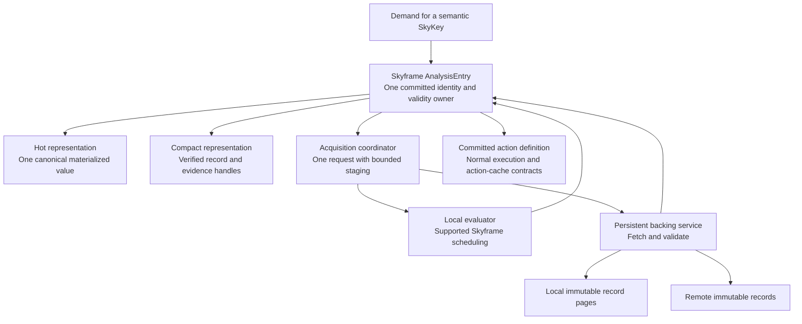
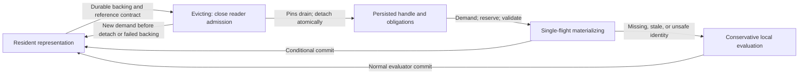
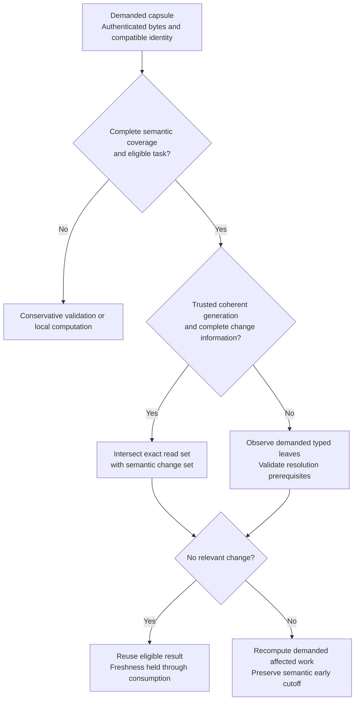
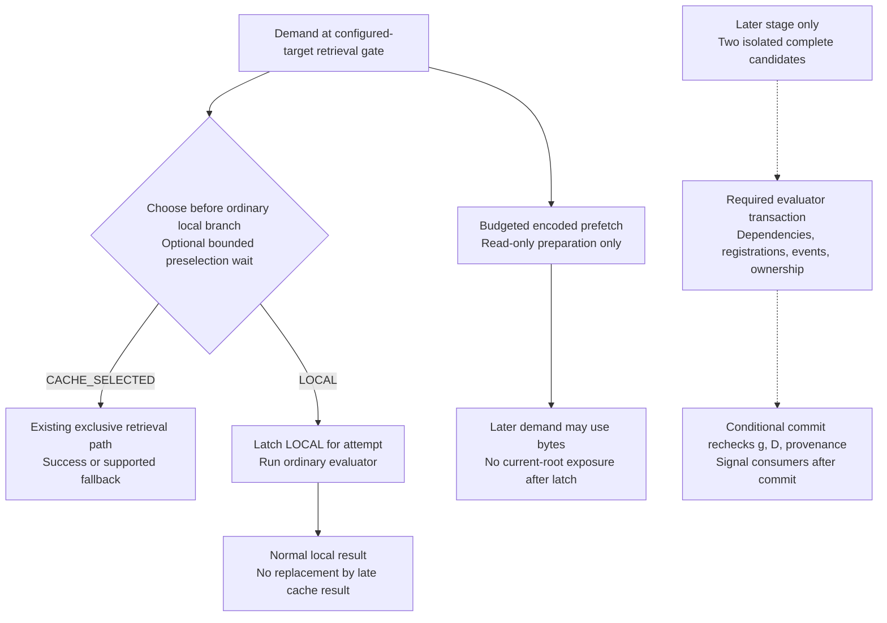
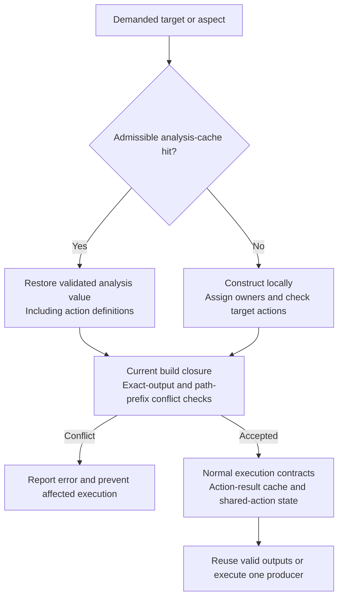

# Skycache unified analysis architecture

Design proposal · 28 October 2026 · Revision 2, incorporating architecture review

Repository edition. See the [implementation plan](skycache-unified-analysis-implementation-2026-10-28.md) for the staged work and [evidence provenance](skycache-unified-analysis-implementation-2026-10-28.md#evidence-provenance). Code links use repository paths; the cited local measurement archives are not included in this branch. The plan identifies mechanisms already implemented and targets their measured residual costs.

## Abstract

**Make Skycache the persistent backing of Skyframe’s analysis store, with cache retrieval and local computation as alternative producers of one authoritative value.** Keep archived state compact and queryable; reconstruct Java objects only where a consumer needs them. Validate reuse through exact observations and shared evidence blocks instead of repeatedly rebuilding a dependency proof. First establish where client time and retained memory go. Then test reference publication and bounded prefetch independently; full result races require a new conditional commit protocol. Completed Java values remain resident unless their references and identity permit safe release. This combines recent research on incremental view maintenance, selective decoding, buffer management, online decisions, and memory-aware scheduling. It is a proposed architecture, not a measured speedup or a claim that those papers prove Bazel correctness. Its success criterion is lower complete-command cost than ordinary computation, including publication and speculative work.

The recommendation reflects research available on **28 October 2026** and the retained local v8 implementation. Native v8 observations completed the selected Datadog workload in **110.409 and 140.895 seconds**, with roughly **16 GB process memory** and occupied heap approaching the full **14 GiB limit**. A contemporary cache-off control took **36.302 seconds** and 12.13 GB RSS, but used v9 classes and is only one observation. These are not a paired v8 slowdown estimate. The earlier matched six-target comparison is clearer: optimized remote reuse took 21.965 seconds versus 12.964 seconds for vanilla, despite using about 49% less measured CPU. The redesign must preserve useful avoided computation while removing the work that prevents it becoming a latency or memory gain. ([Latest measurements](skycache-unified-analysis-implementation-2026-10-28.md#evidence-provenance), [matched comparison](skycache-unified-analysis-implementation-2026-10-28.md#evidence-provenance))

## One evaluator owns each analysis result

The architectural unit should be an evaluator-owned `AnalysisEntry`, keyed by the full semantic SkyKey and configuration, with generation/version checks. Skycache becomes its storage, transport, and evidence service. The entry owns one committed result, its current validity, and the references required by the evaluator. Local disk and remote CAS contain physical representations of that result; neither maintains a competing semantic authority. The ordinary action-result cache remains separate because it maps actions to execution outputs. Sharing transport and immutable bytes is useful; merging unlike validity contracts is not.

This extends an existing seam. Today, `ConfiguredTargetFunction` already accepts a retrieved SkyValue or falls through to local computation, while `SkyValueRetriever` manages retrieval futures and state. There are not two completely independent completed Skyframe graphs waiting to be deleted. Consolidation is justified only where an ownership inventory demonstrates repeated work or removable retained structures. It must not add a second coordinator beside an existing one or delete necessary invalidation evidence. Dependency versions, reverse edges, dirty states, cycle handling, and scheduling remain necessary evaluator data. ([ConfiguredTargetFunction](../../../src/main/java/com/google/devtools/build/lib/skyframe/ConfiguredTargetFunction.java), [SkyValueRetriever](../../../src/main/java/com/google/devtools/build/lib/skyframe/serialization/SkyValueRetriever.java))

The proposed entry separates validity, residency, acquisition, and provenance rather than overloading “cached”:

```text
AnalysisEntry
  semantic identity: key, configuration, evaluator/codec capability
  validity: unvalidated | valid for input token g and dependency revisions D | dirty
  residency: absent | persisted | materializing | resident | evicting
  invalidation provenance: computed edges | restored evidence | verified mixed imports
  acquisition: idle | fetching/proving | evaluating | permitted overlap
  ownership: revision, dependency obligations, reader pins, backing lease, reservations

Resident valid value ──────────────────────────────────► return it
Demanded absent/dirty entry ─► acquisition coordinator ─► one commit
                                      │                    │
                         cache fetch/proof + local work    └► shared value
                                      │
                              bounded private staging
```

Only demanded entries need active acquisition coordinators; retained evaluator nodes still carry their required metadata. Archived indexes remain paged. A materialized entry can hold a persistent record handle, allowing later publication to reuse its original representation. A resident valid hit returns immediately without a second restore or serialization pass. Materialization is single-flight across readers. Compact bytes and a hot Java object can coexist, and racing adds temporary overlap, but those are charged representations of one entry rather than two permanent value caches. Releasing an entry's strong reference is useful only if no other owner keeps its object graph alive.



**Figure 1. Proposed unified ownership.** Memory, local storage, and remote storage are representations and locations under one semantic owner. Arrows back to the entry require its commit protocol; they do not authorize independent writers. Existing evaluator graph metadata remains.

This ownership model draws on demand-driven incremental computation and explicit computation naming. Adapton repairs demanded computations; Nominal Adapton separates logical names from incidental storage locations. Their consistency results belong to their formal languages, not arbitrary Java or Starlark code. They motivate an explicit ownership contract, not a shortcut around Bazel’s semantics. ([Hammer et al., PLDI 2014](https://matthewhammer.org/adapton/adapton-pldi2014.pdf), [Hammer et al., OOPSLA 2015](https://research.cs.queensu.ca/home/jana/papers/noma/Hammer15_names.pdf))

## Retain, release, and reload without losing identity

### Existing retention is the baseline

Completed SkyValues normally remain strongly held by Skyframe for reuse. Temporary computation state is removed when evaluation completes; memory-pressure cleanup does not constitute general paging of completed values. Analysis-discard and nonincremental modes have different semantics and costs. `--discard_analysis_cache` releases analysis data after analysis while preserving information required for execution; `--notrack_incremental_state` avoids retaining incremental edges; `--nokeep_state_after_build` requests release after the command; that final reset cannot reduce the preceding analysis peak. This fork also uses the setting for limited earlier node/reverse-edge deletion during frontier serialization, so upload-phase peak effects must be measured separately. Retrieval mode in this fork also restricts analysis discard. These controls must be recorded for every benchmark. ([Node storage](../../../src/main/java/com/google/devtools/build/skyframe/AbstractInMemoryNodeEntry.java), [Temporary-state cleanup](../../../src/main/java/com/google/devtools/build/skyframe/AbstractParallelEvaluator.java), [Analysis discard](../../../src/main/java/com/google/devtools/build/lib/skyframe/SkyframeExecutor.java), [Upload reclamation](../../../src/main/java/com/google/devtools/build/lib/skyframe/serialization/analysis/FrontierSerializer.java))

The fork already offers `--experimental_analysis_cache_idle_retention=<duration>`, disabled by its zero default. After a successful build with usable retained local publication backing, newly published or previously imported, and the configured idle period, its idle task rechecks and pins the backing before resetting the whole evaluator, including loading state. This releases retained graph ownership; it does not guarantee immediate return of pages to the operating system. The next build reloads eligible analysis and recomputes misses; the JVM, action-result cache, and outputs remain. This is an existing command-boundary mechanism, not per-entry eviction during evaluation. Compare both steady idle residency and the next build's recovery cost against it before claiming a new offloading benefit. ([Idle option](../../../src/main/java/com/google/devtools/build/lib/skyframe/serialization/local/LocalSkycacheOptions.java), [Idle reset integration](../../../src/main/java/com/google/devtools/build/lib/skyframe/serialization/local/LocalSkycacheModule.java), [Backing lease](../../../src/main/java/com/google/devtools/build/lib/skyframe/serialization/local/AnalysisCacheIdleRetentionTask.java))

### Proposed per-entry lifecycle

Validity and residency are independent. Persisted means recoverable backing exists; it does not mean current inputs validate that backing. The initial release-capable family is bounded encoded record and witness/index pages whose consumers use explicit pins or scoped primitive views. Opaque `ConfiguredTargetValue` and provider graphs keep their current lifetime. During-build release of those Java values is a later interface change, not a property obtained by adding a persistent handle.

1. **Resident to evicting:** require a complete durable record/import closure, a lease or equivalent storage-retention guarantee, no in-flight commit, and a proven reference contract. Close admission of new readers under the entry lock; readers already admitted hold pins. If dependants expose raw Java references or identity-sensitive aliases outside the contract, mark the value non-evictable. Do not infer safety from a zero coordinator-reader count alone.
2. **Evicting to persisted:** after pins drain, atomically replace the releasable representation with its verified record handle. Retain the key, semantic and provenance revisions, invalidation obligations, and required graph metadata. A new reader either cancels eviction before detachment or waits for persisted state. Detachment removes ownership; actual heap reclamation still depends on reachability and GC. If persistence or lease acquisition fails, keep the resident representation. Perform I/O and waits outside evaluator locks; delayed callbacks must match the current attempt and residency revision.
3. **Persisted to materializing to resident:** one request obtains a backing lease, checks current validity and imports, and reserves decode capacity. Concurrent readers join this single flight. For a future persisted-only SkyValue, install one canonical representative only through the conditional commit protocol. Missing backing, a stale revision, decode failure, or identity ambiguity abandons the attempt and follows the conservative local path. No waiter may observe a partial object. Initial encoded-page reload is simpler: publish into the page pool under content-ID, lease, slot-revision, and pin checks, without creating or committing a SkyValue. Current semantic restoration keeps ordinary evaluator completion; only future persisted-only values need the stronger conditional transaction.
4. **Invalidation in any residency state:** mark the revision dirty and reject in-flight tickets before admitting it as current. Eviction does not erase invalidation obligations. Old readers follow the input-consistency contract below; an old object is never relabeled as a new revision. Leases prevent physical deletion, not semantic staleness.



**Figure 2. Proposed release and reload lifecycle.** Only representations with controlled references can take the eviction edge. Dirty/valid state is orthogonal to every box. Opaque Java values retain their current lifetime; the initial bounded-page scope does not claim to reduce the live graph's memory floor.

For example, if parents `A` and `B` retain direct references to the same child object `C`, clearing `C`'s entry neither frees the child nor permits a second representative with different identity. Keep `C` resident. A future handle-based interface can let both parents hold `C`'s logical handle and acquire temporary pins. Once both scopes close and no alias escapes, `C` can be detached; the next demand creates one representative shared by both. An identity-sensitive cohort can be released only as a proven closed unit. This example is the acceptance model, not a claim that current provider APIs already offer handles.

### Invalidation provenance belongs to the entry

Current code deliberately distinguishes an ordinary computed SkyValue from an otherwise-equal `DeserializedSkyValue`: the former has evaluator dependencies for bottom-up invalidation; the latter requires restored-evidence validation. Equality of outputs does not make their obligations equivalent. Record `computed-edges`, `restored-evidence`, or `verified-mixed-imports` provenance, with the exact dependency/evidence revisions and coverage capability. The mixed state is eligible only for an audited import contract; it preserves all obligations not proven redundant. ([Representative selection](../../../src/main/java/com/google/devtools/build/skyframe/IncrementalInMemoryNodeEntry.java), [External invalidation](../../../src/main/java/com/google/devtools/build/lib/skyframe/SkyframeExecutor.java))

Restore to local recomputation installs the newly observed edge set atomically before retiring obsolete restored obligations. Computed to restored installs its validated evidence and required imports before removing obsolete computed edges. Eviction preserves provenance; reload revalidates it. If a persisted record cannot reconstruct complete evaluator dependencies, reload remains restored-evidence mode even when the original producer computed locally. A provenance revision changes on these transitions even if the value's semantic version is unchanged, so pending commit tickets cannot rely on the old invalidation mode. Test restore, equal local recomputation, eviction, reload, and a subsequent input change as one sequence.

There is a required API migration before any completed SkyValue becomes persisted-only: current `getValue()` returns a concrete value, and external invalidation discovers restored nodes by inspecting `DeserializedSkyValue`. Move restored-node discovery and invalidation obligations into explicit entry metadata before allowing that value to be absent. Preserve the current behavior when retrieval is disabled, including removal or revalidation of restored entries lacking complete graph dependencies. Otherwise offloading would hide entries from invalidation rather than save memory safely.

## Validate exact observations without reconstructing every proof

Treat validity as a query over persistent typed evidence. An observation identifies a repository and logical path, the operation performed, and resolution prerequisites. File contents, directory listings, missing paths, symlink resolution, modes, repository bindings, configuration, environment, and toolchain inputs are distinct observations. A file path alone is not sufficient: adding a previously absent file or a glob member can change dependency discovery without changing any previously read file.

A persistent record binds its semantic key, result digest, dependency/import references, schema capability, and complete observation evidence. Shared evidence remains factored into immutable blocks. Selected expensive roots can carry exact sorted-ID or bitmap summaries; do not flatten the entire transitive input set of every node. That can turn shared structure into quadratic writer work and storage. The existing 27 October proposal already suggests selective guards and exact certificates. The new contribution here is to make them queries owned by the unified analysis store, coupled to persistent input generations and the acquisition planner. ([Existing proposal](https://github.com/JSGette/bazel/blob/42cda8355fe246f80cdb8780dc3623252d41cafc/docs/jsgette/future-improvements/skycache-demand-driven-optimization-2026-10-27.md))

Let `R(k)` be the complete set of observations supporting a result validated at generation `g0`, and `Δ(g0,g1)` the complete set whose semantic values changed. Then the useful acceptance rule is:

```text
same semantics and compatible identity
AND coherent inputs and complete captured dependencies
AND deterministic evaluation under the captured observation model
AND R(k) ∩ Δ(g0,g1) = ∅
    ⇒ reuse the result at g1
```

The difficult work is establishing completeness, coherent inputs, and eligible task semantics, not performing the intersection. Nondeterministic behavior requires an explicit validity contract; unsupported hidden or nonhermetic effects retain conservative evaluator behavior. A warm trusted generation can share exact changed-ID sets and memoize validation of evidence blocks once per generation. A cold clone or uncertain generation must observe the demanded leaves directly. A Merkle root authenticates a stored map; it does not establish that the map matches today’s mutable filesystem. Ordinary watcher silence cannot serve as that proof. Unsupported roots, gaps, overflow, or ambiguous identity force reconciliation or the existing conservative path.



**Figure 3. Proposed validity paths.** Warm reuse avoids repeated observations only with complete trusted change information. A cold or uncertain input state retains exact demanded-leaf checks. Changed evidence triggers computation, not an assumption that the final value must differ.

Begin with immutable external repositories or toolchains whose complete trees can be pinned. Their names alone are not evidence of immutability: pin the complete observation domain, including relevant bindings and configuration. A controlled source snapshot with an explicit overlay is a stronger future basis than generic filesystem notifications. The first prototype retains ordinary Bazel's mutable-workspace behavior and final publication checks; it does not claim transactional snapshots for external edits. A final publication check can prevent publishing unstable evidence, but cannot undo a result already consumed. New generation-based acceptance is therefore limited to pinned domains until a real snapshot or writer-coordination protocol exists. A child publication records the actually consumed evidence and references existing immutable blocks; speculative downloads alone do not count as semantic consumption.

The mathematical distinction is between checking a complete deep trace and recomputing intermediate values. Mokhov, Mitchell, and Peyton Jones show why deep constructive traces can skip intermediates, but lose intermediate early cutoff. Therefore retain both paths: use a direct certificate when unchanged, and ordinary demanded recomputation when changed; if an intermediate result is semantically unchanged, stop propagation there. ([Build Systems à la Carte, JFP 2020, §§5.2–5.4](https://simon.peytonjones.org/assets/pdfs/build-systems-jfp.pdf))

There is no general constant-time validation result hiding in newer algebra. Anderson, Blelloch, Baweja, and Acar obtain change-propagation bounds in terms of computation distance under restricted parallel structure. The September 2026 semiring-IVM preprint gives conditional bounds for specified queries, semirings, and update sequences, including insert-only assumptions. Skyframe’s dynamic control and arbitrary deletions do not automatically satisfy those models. Use factoring and exact set operations; do not import their asymptotic guarantees. With `n` independent relevant mutable inputs and no trustworthy change information, an exact validator can still require inspecting all `n`. ([SPAA 2021](https://www.cs.cmu.edu/~blelloch/papers/3409964.3461799.pdf), [Chmielewski et al., September 2026 preprint](https://arxiv.org/html/2606.07795v2))

## Store queryable records and publish immutable references

The storage format should distinguish the semantic reuse unit from the transfer, I/O, and decoding units. Call the semantic unit a capsule: a result with sufficient evidence and imports to be accepted independently. A capsule need not occupy one page. Tiny records can share a page, large payloads can span pages, and transfer ranges can batch adjacent pages. A compact directory identifies required fields and witness blocks before loading payloads. Validation and routing operate on IDs, offsets, and primitive arrays, without allocating one Java object or future per proof edge.

Recent storage research makes this distinction practical. F3 separates metadata, I/O, encoding, and dictionary units. FastLanes supports partial decompression and small batch execution. Predictive Translation retains page-ID indirection while reducing its cost, illustrating a portable alternative to intrusive pointer swizzling. These support a bounded page pool and selective views; their database speedups do not predict Skycache performance. Start with plain arrays and dictionary IDs, then justify compression or specialized lookup kernels from measured access patterns. ([Zeng et al., PACMMOD 2025](https://db.cs.cmu.edu/papers/2025/zeng-sigmod2025.pdf), [Afroozeh and Boncz, PVLDB 2025](https://ir.cwi.nl/pub/35881/35881.pdf), [Zinsmeister et al., SIGMOD 2026](https://db.in.tum.de/people/sites/zinsmeister/papers/predictive-translation.pdf))

Keep strings encoded until an interface requires a Java String. Expose compact witnesses, root metadata, and supported action fields as views. Whole-object hydration is a compatibility path. A wrapper that simply hydrates the entire old closure on its first field access does not achieve the intended saving. Some SkyValue consumers will need new typed interfaces; arbitrary providers cannot become efficiently disk-backed by changing the serializer alone. Java buffers are a sensible first implementation. A different language is justified only if profiling later identifies a kernel that benefits after boundary costs.

**Publication should write the delta, not reserialize the reconstructed past.** When a committed value came from an unchanged persistent record, publish its authenticated record reference and required evidence. Locally computed new values produce new records. Validate referenced ancestry and retain leases; missing ancestors remain misses or publication failures. This avoids a reverse map for every reconstructed object, which can itself become a large heap structure. Current v8 profiles show millions of reads and roughly a million attempted puts, mostly deduplicated at the store, even with no remote Skycache endpoint. Those counters motivate removing logical work before changing server implementation. ([Profile evidence](skycache-unified-analysis-implementation-2026-10-28.md#evidence-provenance))

Identity is the hard boundary. Content identity deduplicates bytes. An origin token preserves aliases captured in a publication. A semantic SkyKey identifies the current computation. These are different relations. Equal-content NestedSet wrappers can be observably distinct; the existing focused reproductions demonstrate duplicate providers across restored/recomputed branches. A canonical per-key entry alone does not fix wrappers embedded independently inside parents. ([Identity reproduction](skycache-unified-analysis-implementation-2026-10-28.md#evidence-provenance))

Supported codecs must preserve explicit origins and expose cross-capsule imports through defined interfaces. One invocation resolves a verified origin to one live representative, without merging distinct originals by content. Recomputed subobjects require a semantic export contract; an old object ordinal cannot identify a newly executed allocation by assertion. Until such correspondence is proven, reject the affected capsule family or recompute its identity-sharing region. This limits coverage, but prevents a memory optimization changing Starlark equality or linker inputs.

## Race acquisition within one resource and commit protocol

The hybrid proposal has two stages. **The first is bounded prefetch alongside ordinary local evaluation, with a one-way ownership gate.** Its concrete integration point is the existing `ConfiguredTargetKey` retrieval branch before `ConfiguredTargetFunction` enters its ordinary local branch (`State` acquisition at line 288 and `computeTargetAndConfiguration` at line 291). Retrieval itself already uses evaluator state; the boundary is not "before any environment access." Start with transport of encoded records and read-only evidence preparation for the existing configured-target retrieval family, retaining the current validator and codec eligibility. Provider combinations affected by the known identity reproduction remain excluded. This does not require speculative configured-target materialization.

At the gate, choose `CACHE_SELECTED` to finish through the existing exclusive evaluator-scheduled retrieval path, or latch `LOCAL` before entering ordinary evaluation. A cache-first policy may wait a bounded interval before selection; that deadline does not bound hydration or import lookup after restoration has been selected. An already complete admissible result can return through the existing path. Before `CACHE_SELECTED` falls back into ordinary analysis, it transitions irreversibly to `LOCAL` for that attempt through its supported local transition. The ownership decision belongs to the evaluator entry and evaluation attempt, survives temporary compute-state eviction and restarts, and resets only when that attempt is invalidated or finished. Once `LOCAL` is latched, no arriving cache result replaces this root's local progress. Fetching can continue only within a prefetch budget to serve later demand or descendants that have not crossed their own gates. It exposes no candidate dependencies, actions, or events. A non-consuming proof needs an explicitly read-only interface; any validator that mutates session consumption state remains on the existing accepted-retrieval path. If retrieval has already installed incompatible state, the gate must finish or unwind that state under the existing evaluator contract before starting local evaluation; it cannot simply bypass an arbitrary pending future.

This first stage does not promise `min(cache time, local time)` for the running root. Measure request start, fully admissible cache-ready time, the `LOCAL` latch, and local completion. Report cache adoption before the latch, prefetch bytes subsequently used, wasted bytes, and local slowdown separately. If useful later demand is rare or resource interference erases the gain, disable prefetch for that cohort. A later in-progress adoption point requires its own named adapter and effect contract; none is assumed here. ([Current retrieval boundary](../../../src/main/java/com/google/devtools/build/lib/skyframe/ConfiguredTargetFunction.java))

**The later stage races complete analysis candidates.** Both producers use the same input generation and produce isolated candidate revisions. The evaluator commits one value together with the required dependency revision set and staged registrations. A compare-and-set winner flag is necessary coordination, but is not a transaction over dependency/reverse-dependency state, action registration, events, and ownership. Current SkyFunctions request and record dependencies while running. Full races therefore require an evaluator transaction or a restricted adapter; placing the existing SkyFunction on another executor is insufficient. Workers perform bounded I/O and proof preparation, while environment access and result publication stay within supported evaluator scheduling.

### Conditional commit is the visibility boundary

The following is a required future evaluator API, not an API already provided by the fork. A candidate carries a ticket `(key, epoch, attempt, g, D, p, capability)`: evaluation epoch; per-key attempt incarnation; coherent input token `g`; dependency/import readset `D`; provenance revision `p`; and validated codec/identity capability. Rewind, reset, cancellation, or entry replacement invalidates the attempt even if the command's graph version is unchanged. Each required dependency must be DONE at its recorded canonical incarnation and identity representative, with the validity/provenance state used by the proof. An unchanged native `lastChanged` version alone is insufficient. Record input evidence and dependency/import revisions when the producer consumes them, then freeze that readset into its ticket. Candidate completion must not substitute then-current revisions for those actually consumed. `D` contains direct dependencies and canonical imports; committed children and factored evidence establish the transitive closure without flattening it. An input token names an actual pinned snapshot or immutable observation domain. Incrementing a counter cannot freeze external filesystem writes.

`tryCommit(ticket, candidate)` is serialized with invalidation and competing commits through evaluator-owned locking or an equivalent optimistic transaction. The implementation must choose and document that mechanism before enabling full races. Under its commit protection it rechecks entry ownership, input-token validity, every imported dependency revision, and provenance; validates prospective edges, cycles, conflicts, and staged registrations; and installs one result revision plus its complete obligations. All required bytes and proof results are prepared beforehand; no network access, waiting, or large decode belongs inside the commit boundary. Only after that logical commit does it signal parents or make actions eligible. Rejected candidates expose no value, actions, or candidate-specific user events. Readers and invalidators observe either the old revision or the complete new revision. Merely performing an atomic pointer swap after an earlier validation does not satisfy this contract.

For an input or dependency transition, order it against commit: if invalidation wins, reject the ticket and retry through the supported evaluator path. If commit wins, later invalidation marks the result and affected dependants dirty before they can be admitted as current under the new token. Readers already holding an older pinned snapshot may finish only within that snapshot's semantics; otherwise the evaluation aborts/restarts before externally visible results are accepted. A mutable workspace without a snapshot or coordinated writer cannot provide this stronger guarantee, so it does not use the new generation shortcut or transactional race. Ordinary conservative evaluation remains available.

For eligible isolated candidates, the future protocol is:

```text
acquire(key, generation):
    join the evaluator-owned entry; return a valid resident value immediately
    choose local-only, cache-first, or bounded overlap from current evidence
    start the primary through its supported execution contract
    start a secondary only after reserving its incremental resource budget

on candidate ready:
    freeze ticket from evidence and revisions captured when consumed
    tryCommit(ticket, candidate):
        serialize against invalidation and competing commits
        recheck ticket and install value + obligations + registrations atomically
        expose result and signal readers only after successful logical commit
    if committed: notify readers; withdraw the loser's private subscriptions
    drain owned losing work before releasing its pins and reservations

on optional cache miss, stale proof, timeout, or budget exhaustion:
    preserve or start local progress
on generation change:
    order invalidation against commits; reject stale tickets
    propagate dirtiness; prevent current-token consumption of old revisions
```

Shared dependencies have one coordinator and multiple subscribers. A losing root cannot cancel a child still required elsewhere. Late completion must be generation-aware and harmless. Do not publish uncommitted losing candidate state or its speculative user-visible effects; independently committed shared children retain their own validity and publication eligibility. Analysis must commit before its actions become eligible, and normal conflict, compatibility, runfiles, discovered-input, and missing-CAS rewind contracts remain. Optional cache failures may fall back; semantic errors follow evaluator policy. If completed supposedly equivalent results disagree, quarantine the cached revision and surface a correctness diagnostic.



**Figure 4. Prefetch first, transactional racing later.** Once the initial local gate closes, late cache work can benefit other demand but cannot win the current root. The dashed path is a distinct future evaluator protocol. A complete admissible result includes validation and required hydration, not merely downloaded bytes.

Action racing is a separate supported mechanism. Bazel already provides dynamic local/remote action execution with output ownership and failure semantics. It requires remote execution rather than merely a cache endpoint. Reuse that path after committing one action definition; do not execute actions from two speculative analysis worlds or silently replace its error policy with “first successful result.” ([Bazel dynamic execution](https://bazel.build/remote/dynamic))

For the later full race, under ideal independent resources, let `C` be time to a fully admissible cache result, `L` local time, and `τ` the local launch delay. Completion is `min(C, τ + L)`. This formula does not describe prefetch after the local latch. In the real client, both times depend on the policy, contention, shared dependencies, allocation, and GC. The useful optimization is therefore:

```text
minimize expected critical-path delay
       + λcpu × CPU-seconds + λio × I/O bytes
       + λmem × retained byte-seconds + λcleanup × losing-work cleanup
subject to enforceable admission budgets and semantic eligibility
```

The weights express deployment priorities and resource scarcity, not mathematical constants. Under weak evidence, start the reliable local path immediately and allow only a small fetch/proof hedge. For established expensive-local, compact-cache cohorts, allow cache-first operation with a bounded local delay. Reconsider at meaningful events such as proof completion or a decode batch. Disable new hedges under heap or I/O pressure. A local-first race can still slow local computation through interference, so this does not guarantee “never slower than either.”

Dean and Barroso’s delayed hedging motivates avoiding unnecessary duplicate work; Primorac, Argyraki, and Bugnion show why redundancy can instead worsen congestion. Kim and Fan’s March 2026 ski-rental preprint motivates clamping learned waiting thresholds to a robust interval, but its cost model is not a theorem about shared-memory Skyframe races. Use measured cohorts and bounded exploration, initially with simple histograms or quantile sketches. Cancelled losers are censored observations, not measured completions; progress-dependent cancellation can bias naive estimators. Calibrate policies with explicit matched trials rather than inventing counterfactual speedups. ([The Tail at Scale, 2013](https://barroso.org/publications/TheTailAtScale.pdf), [When to Hedge, NSDI 2021](https://www.usenix.org/conference/nsdi21/presentation/primorac), [Kim and Fan, 2026 preprint](https://arxiv.org/abs/2603.29233))

Memory and scheduling require one controller. Reserve encoded buffers, decode batches, temporary identity state, task slots, and speculative credits together. Keep a baseline progress reserve that hedges cannot consume. A parent waiting on children must release runnable CPU capacity and cannot pin every decode permit: spill private staging, service a reserved child, or abandon the cache arm. Unknown codec expansion requires incremental charging and suspension before the next allocation. An unsplittable restore that exceeds its budget falls back; ordinary Bazel computation is not thereby guaranteed to fit the same heap.

Papp, Böhnlein, and Yzelman’s ICPP 2025 model shows that choosing parallelization and memory management separately can be linearly worse than joint optimization. Its optimal solutions for small DAGs are not a practical million-node scheduler. Use bounded ready-frontier heuristics with critical-path urgency, release benefit, and starvation protection. The enforceable bound initially covers owned cache buffers and staging. The live evaluator graph, Java runtime, native memory, and page cache remain separately measured; a 512 MiB metadata setting or larger disk quota cannot establish a total-RSS bound. ([ICPP 2025](https://arxiv.org/html/2507.17411v1))

## Reuse analysis while preserving action conflict checks

An accepted analysis-cache hit returns a configured target or aspect with its action definitions. It bypasses that target's local construction, including the owner assignment and action checks performed by its builder. It does not establish that those actions are compatible with every other target requested in this build. When conflict checking is enabled, the current build still needs exact-output and path-prefix conflict checks across its restored and locally computed closure. The execution action cache has a different job: reuse valid outputs for an action definition, or execute that action. ([Retrieval return](../../../src/main/java/com/google/devtools/build/lib/skyframe/ConfiguredTargetFunction.java), [Aspect retrieval](../../../src/main/java/com/google/devtools/build/lib/skyframe/AspectFunction.java), [Builder checks](../../../src/main/java/com/google/devtools/build/lib/analysis/RuleConfiguredTargetBuilder.java), [Global conflicts](../../../src/main/java/com/google/devtools/build/lib/skyframe/IncrementalArtifactConflictFinder.java))



**Figure 5. Analysis reuse and action execution remain separate decisions.** The middle check covers the actual combination of restored and computed actions; an individual hit cannot certify that combination. Existing execution sharing prevents a second producer from rewriting outputs while downstream actions read them. This is not a global analysis barrier: merged analysis/execution can run an accepted root while another root is still being checked, and a later conflict can fail the build after some actions have executed.

The selected changes remove two concrete repetitions without adding a long-lived action map. In `Actions.assignOwnersAndThrowIfConflictMaybeToleratingSharedActions`, skip the second compatibility check only when the previously seen output is the **same artifact object** just checked; retain the foreign-owner check and every check for a distinct artifact. In `IncrementalArtifactConflictFinder`, claim a starting root in the existing visited set so it is not traversed again after an earlier root or dependency visit. A pruned root still joins the ordered completion chain, waits for its predecessor, and reruns with fresh traversal state when a prior conflict requires its own report. `MapBasedActionGraph` already stops after proving that an alias shares all outputs. ([Owner assignment](../../../src/main/java/com/google/devtools/build/lib/actions/Actions.java), [Root traversal](../../../src/main/java/com/google/devtools/build/lib/skyframe/IncrementalArtifactConflictFinder.java), [Existing alias shortcut](../../../src/main/java/com/google/devtools/build/lib/actions/MapBasedActionGraph.java))

General memoization of a positive action comparison would be unsafe here. For distinct derived artifacts, owner equality initially tolerates a matching target owner while a generating key is unset; once both keys are assigned, the action indexes participate in equality. Two nonshareable actions can therefore compare equal before the first assignment and conflict at a later output. The selected shortcut stays within one iteration with no intervening ownership change. Action definitions retain their evaluator lifetime; the existing per-build execution-sharing map clears at `executionOver`, and conflict-checking scratch state clears after analysis. These changes neither add an action-key cache nor alter those lifetimes. ([Artifact owner equality](../../../src/main/java/com/google/devtools/build/lib/actions/Artifact.java), [Retained action list](../../../src/main/java/com/google/devtools/build/lib/actions/BasicActionLookupValue.java), [Execution sharing and cleanup](../../../src/main/java/com/google/devtools/build/lib/skyframe/SkyframeActionExecutor.java), [Conflict-state cleanup](../../../src/main/java/com/google/devtools/build/lib/skyframe/SkyframeBuildView.java))

A future certified conflict summary would need to bind the exact closure revision, output namespace and configuration, producer/equality semantics, and complete exact-path and prefix coverage. Internal conflict freedom of one cached closure does not prove compatibility with another closure or newly computed actions: every relevant intersection must be checked before admitting execution, with conservative fallback when coverage or revisions are uncertain. This remains proposed work. The selected repetitions and their regression/measurement evidence are recorded in [action-check evidence](../measurements/skycache-unified-analysis-2026-10-28/ACTIONS.md); no command-level speedup is claimed from the source changes alone.

## Prove one useful slice before replacing broad interfaces

### Gate 0: establish owners and costs

The first deliverable is an ownership and critical-path inventory, not a new coordinator. The table below names concrete structures to inspect. Retained sizes and net savings are **unmeasured**; strong references alone do not establish that a structure dominates memory. Distinguish multiple references to the same object from duplicate object graphs. Preserve weak ownership when consolidating metadata.

| Current owner or structure | Existing role and lifetime | Proposed treatment and additional cost |
| --- | --- | --- |
| Skyframe graph and node entries | Strong node/value ownership, dependencies and reverse edges; retained under evaluator lifecycle | Retain required graph data. Add entry handles/provenance only where they replace measured bookkeeping; charge all new fields. |
| Retrieval context | Retrieval state, futures and continuations across SkyFunction restarts within an attempt; cleanup on state disposal | Adapt existing acquisition machinery. Add the durable attempt latch outside evictable compute state; do not create a second coordinator with the same job. |
| `FingerprintValueCache` | Deserialization has weak values; serialization has weak keys and strong fingerprint/future values. Runtime uses `NOT_LINKED` | Retain shared-object deduplication and identity functions. These are not a strongly retained duplicate SkyValue graph; measure wrappers, pending work, and actual reachability. |
| Previous, accepted, and retained root maps | `LocalAnalysisCacheClient` copies root-map tables referencing the same keys/values; module services retain roots across commands | Concrete consolidation candidate: stable entry IDs and a compact provenance table. Compare removed map-table overhead with replacement fields and cross-command index cost. |
| Validator and input-snapshot maps | Validated nodes/witnesses, pending traversal, observed witnesses and admission hints; invocation-owned roles differ | Factor evidence and use compact IDs where useful. Preserve distinctions between observed, validated, admitted, and consumed facts; charge certificates and generation indexes. |
| Codec memo tables and async restoration | Operation-scoped strong references preserve aliases/cycles; callbacks can extend retention | Retain for existing codecs. Reference publication and direct views may avoid creating them; per-key coordination alone cannot eliminate them. Measure callback drain and peak active contexts. |
| Store indexes, publication and transport state | Packed-store index/pending writes, session shared puts, bounded authenticated byte blocks | Keep necessary tier-specific state and existing limits. Measure/page eligible indexes and bound staging; one semantic owner does not remove physical indexes or leases. |

The inventory follows current source ownership: [Fingerprint caches](../../../src/main/java/com/google/devtools/build/lib/skyframe/serialization/FingerprintValueCache.java), [Service construction](../../../src/main/java/com/google/devtools/build/lib/skyframe/serialization/analysis/RemoteAnalysisCacheDeps.java), [Root maps](../../../src/main/java/com/google/devtools/build/lib/skyframe/serialization/local/LocalAnalysisCacheClient.java), [Validator state](../../../src/main/java/com/google/devtools/build/lib/skyframe/serialization/local/LocalDependencyValidator.java), [Input evidence](../../../src/main/java/com/google/devtools/build/lib/skyframe/serialization/local/LocalInputSnapshot.java), [Serialization memos](../../../src/main/java/com/google/devtools/build/lib/skyframe/serialization/MemoizingSerializationContext.java), and [Session publication state](../../../src/main/java/com/google/devtools/build/lib/skyframe/serialization/local/LocalCacheSession.java). Lifetimes must be confirmed by heap reachability at the sampled phase, not inferred from a field being cleared in one owner.

Measure entry counts, retained bytes after controlled collection, allocations, and phase/lifetime boundaries. Attribute lookup, proof, decode, ordinary analysis, publication, runfiles, and GC without summing overlapping wall-time spans. The existing large GET/PUT counts do not rank exclusive decode, serialization, and commit CPU. Choose the first optimization from its measured avoided cost minus added bookkeeping, synchronization, and I/O. A heap inventory may favor root-table consolidation; a publication profile may favor record-reference reuse; neither conclusion is assumed in advance.

### Small independent prototypes before a unified replacement

**Gate 1** tests immutable reference publication and the configured-target prefetch gate as independently switchable experiments, prioritizing whichever Gate 0 supports. Publication reuses an accepted unchanged record only with verified ancestry, consumed evidence, and retention guarantees; otherwise it uses the existing writer. Prefetch retains current value APIs and conservative validation, introduces no competing materializer, and records useful later demand and interference. The `LOCAL` latch must survive restarts and compute-state eviction. Identity-unsafe provider combinations stay excluded. Neither experiment requires general value paging or transactional racing.

**Gate 2** introduces versioned compact record/witness pages, typed observation certificates, and pin-aware views for interfaces that actually consume them. Build certificates alongside existing evaluation and shadow-check their decisions against the current validator under deliberate mutations. Start generation reuse with pinned immutable observation domains; mutable workspace journaling comes later. Demonstrate page release and reload, cancellation drain, and net retained memory after adding indexes. Completed opaque Java values still retain their current lifetime. This slice can succeed even if general per-value paging proves too invasive.

**Gate 3** moves only demonstrated redundant provenance bookkeeping under existing evaluator ownership and introduces handle-aware access for a specifically audited value family. Require metadata-based invalidation without hydration, controlled escaped references, canonical identity, and durable import closure before per-value offload. Full dual-candidate racing is a separate subsequent gate requiring an implemented conditional transaction over dependency/registration ownership. Incr's 2026 work illustrates isolating effects for incremental reuse, but explicitly scopes supported behavior. Its approach motivates the boundary discipline; it does not provide a universal isolation wrapper for Bazel. ([Xie et al., OSDI 2026](https://www.usenix.org/system/files/osdi26-xie-yizheng.pdf))

### Validation and amortization

Run matched local-only, current-cache, unified-cache, and bounded-hybrid arms over hot JVM, cold JVM, warm/cold storage, sparse requests, broad roots, and changed-input cases. Include missed/stale/corrupt cache entries, network stalls, memory underestimates, source edits during evaluation, glob and missing-path changes, repository rebinding, and every completion/cancellation order. Verify exact outputs and target results, dependency behavior, identity-sensitive equality, required child publication, and usable output artifacts. Measure complete-command median and tails, client/service CPU separately, peak RSS, occupancy after all collections, allocation, proof work, logical reads, bytes decoded, publication work, and loser drain time. Three observations cannot establish tail behavior.

Use the same binary, targets, toolchain, cache population, retention flags, and input state for controls; randomize or balance execution order and report repeated-run dispersion. Compare existing idle release enabled and disabled separately from during-build peak reduction, including the next command's reload penalty. For each shipped component obtain an isolated comparison or a removal ablation: provenance consolidation, reference publication, certificate reuse, compact views, and bounded prefetch. Then test combinations to expose interference; do not label a combined gain as proof that each component helped.

Measure a complete producer/consumer sequence: one initially uncached producer, `N` consumers, controlled changes affecting different fractions of inputs, subsequent publication, and retirement. The accounting identity is:

```text
delta sequence cost = delta producer cost
                    + sum(delta cost of each of N consumers)
                    + delta maintenance cost
```

Apply it separately to CPU and summed command elapsed time; if commands overlap, also report the measured sequence makespan. Report peak memory and retained byte-seconds separately rather than adding incompatible units. Vary reader count, hit rate, changed fraction, JVM lifetime, storage warmth, and publication fan-out. Include unsuccessful probes, ancestor checks, evidence/index construction, cleanup, and compaction. Do not amortize construction over an assumed unlimited number of consumers.

The correctness gates require the following adversarial sequences in addition to ordinary output checks:

1. Pause after ticket preparation; invalidate, rewind, or reset the root; resume commit. Reject the old attempt without candidate events or registrations.
2. Dirty or replace an imported dependency, including equal-content replacement with changed identity or provenance. Reject a stale readset even if native `lastChanged` is unchanged.
3. Exercise both commit/invalidation orders. No current-token reader sees a stale DONE revision; committed edges carry subsequent invalidation to parents.
4. Start local evaluation, suspend it, evict temporary compute state, and complete cache retrieval. Restart remains `LOCAL`; deadline/readiness races choose exactly one owner.
5. Race demand, eviction, reload, and invalidation; remove backing; retain an identity-sensitive child through a parent; disable retrieval with restored nodes present. Preserve identity or decline eviction, and discover dirty restored entries without hydration in any future offloaded mode.
6. Mutate workspace inputs during evaluation. Keep mutable generation reuse disabled and verify existing detection/failure/publication behavior. This experiment is not evidence that an evaluator counter supplies snapshot isolation.

Set practical promotion thresholds before each experiment, relative to noise and the workload’s objective. Stop a path on any stale acceptance, duplicate action registration, identity discrepancy, deadlock, unbounded staging, or hidden semantic error. Reject a supposedly faster representation if writer cost or GC erases its command-level benefit. Disable the hedge policy for cohorts that lose to local-only. Enzyme’s 2026 system offers the relevant planning principle: incremental maintenance and full recomputation compete using historical costs and transactional provenance. Skycache should make the same choice explicitly, with latency and memory included alongside CPU. ([Yadav et al., SIGMOD Companion 2026](https://arxiv.org/html/2603.27775v2))

This design is strongest for expensive analysis with compact reusable evidence, trusted immutable input domains, and enough spare resources to hide retrieval. Cheap local analysis, hot resident Skyframe values, broad unique closures, or saturated memory favor direct computation. The implementation sequence allows each workload to keep that reliable option. The proposed merge succeeds when persistence stops being an extra computation wrapped around analysis and becomes a representation and acquisition choice inside the analysis engine.

### Potential benefits and decisive measurements

The expected benefits below are hypotheses with observable mechanisms. None is an estimated speedup. In particular, the design does not predict that Skycache will beat the 36-second control or fit a specific heap before a matched prototype test.

| Proposed change | Potential benefit | Decisive measurement | Main condition or cost |
| --- | --- | --- | --- |
| Measured provenance consolidation and shared materialization | Fewer map tables or repeated operations where duplication exists | Removed versus added retained bytes, allocation, hydration count | Existing weak caches and required graph state remain |
| Exact observation blocks and trusted generation deltas | Fewer repeated hashes and internal proof traversals | Distinct observations, proof records touched, validation CPU | Complete capture and coherent generations |
| Compact views and independently sized I/O/decode units | Lower allocation and less unused materialization | Decoded-to-demanded bytes, allocation, peak RSS, page amplification | Consumers must actually operate on views |
| Immutable reference publication | Fewer serialization attempts and rewritten inherited bytes | Put attempts, encoder CPU, new versus referenced bytes | Valid ancestry, leases, and current evidence |
| Bounded prefetch; later full racing | Earlier preparation for later demand; later races may hide current-root stalls | Useful prefetched bytes, interference, total latency and cleanup | No same-root cache win after LOCAL in the first stage; full races need transactions |
| Joint frontier and memory scheduling | Lower transient cache pressure and fewer GC stalls | Occupied heap, staging bytes, progress under pressure | Bound owned allocations; live graph measured separately |
| Future per-value offload | Lower resident graph memory for audited value families | Reclaimed live bytes, reload cost, alias/provenance correctness | Handle-aware consumers, metadata invalidation, durable backing; opaque families retain current lifetime |

### Research coverage and evidence status

The fourteen primary papers linked above comprise three 2026 published systems papers—Enzyme, Incr, and Predictive Translation—three 2025 published storage/scheduling papers—F3, FastLanes, and Papp et al.—two 2026 preprints—semiring IVM and distributional-advice ski rental—and six foundations: Adapton, Incremental Computation with Names, Build Systems à la Carte, Efficient Parallel Self-Adjusting Computation, The Tail at Scale, and When to Hedge. This is a relevance-based selection, not a ranking of scientists or an exhaustive survey. The proposed unified store, generation contract, representation, and hybrid protocol are a synthesis requiring their own correctness proof and experiments. No paper’s benchmark speedup is used as a prediction for Skycache.

## Bibliography

1. Matthew A. Hammer, Yit Phang Khoo, Michael Hicks, and Jeffrey S. Foster. **Adapton: Composable, Demand-Driven Incremental Computation.** PLDI, 2014. [Author paper](https://matthewhammer.org/adapton/adapton-pldi2014.pdf).

2. Matthew A. Hammer et al. **Incremental Computation with Names.** OOPSLA, 2015. [Extended author paper](https://research.cs.queensu.ca/home/jana/papers/noma/Hammer15_names.pdf).

3. Andrey Mokhov, Neil Mitchell, and Simon Peyton Jones. **Build Systems à la Carte: Theory and Practice.** Journal of Functional Programming 30, e11, 2020. [Author paper](https://simon.peytonjones.org/assets/pdfs/build-systems-jfp.pdf).

4. Daniel Anderson, Guy E. Blelloch, Anubhav Baweja, and Umut A. Acar. **Efficient Parallel Self-Adjusting Computation.** SPAA, 2021. [Author paper](https://www.cs.cmu.edu/~blelloch/papers/3409964.3461799.pdf).

5. Eden Chmielewski, Andrei Draghici, Dan Olteanu, and Haozhe Zhang. **The Role of Semirings in Incremental View Maintenance.** arXiv:2606.07795v2, September 2026; preprint. [Version reviewed](https://arxiv.org/html/2606.07795v2).

6. Xinyu Zeng et al. **F3: The Open-Source Data File Format for the Future.** Proceedings of the ACM on Management of Data 3(4), article 245, 2025. [Author paper](https://db.cs.cmu.edu/papers/2025/zeng-sigmod2025.pdf).

7. Azim Afroozeh and Peter Boncz. **The FastLanes File Format.** Proceedings of the VLDB Endowment 18(11), 2025. [Institutional paper](https://ir.cwi.nl/pub/35881/35881.pdf).

8. Michael Zinsmeister, Lam-Duy Nguyen, Viktor Leis, and Thomas Neumann. **Predictive Translation: High-Performance Buffer Management Without the Trade-Offs.** SIGMOD, 2026. [Author paper](https://db.in.tum.de/people/sites/zinsmeister/papers/predictive-translation.pdf).

9. Jeffrey Dean and Luiz André Barroso. **The Tail at Scale.** Communications of the ACM 56(2), 2013. [Author paper](https://barroso.org/publications/TheTailAtScale.pdf).

10. Mia Primorac, Katerina Argyraki, and Edouard Bugnion. **When to Hedge in Interactive Services.** NSDI, 2021. [USENIX paper and proceedings](https://www.usenix.org/conference/nsdi21/presentation/primorac).

11. Jihwan Kim and Chenglin Fan. **Robust and Consistent Ski Rental with Distributional Advice.** arXiv:2603.29233, March 2026; preprint. [Primary record](https://arxiv.org/abs/2603.29233).

12. Pál András Papp, Toni Böhnlein, and Albert-Jan N. Yzelman. **Multiprocessor Scheduling with Memory Constraints: Fundamental Properties and Finding Optimal Solutions.** ICPP, 2025. [Author version](https://arxiv.org/html/2507.17411v1).

13. Yizheng Xie, Evangelos Lamprou, Jerry Xia, and Nikos Vasilakis. **Incr: Faster Re-Execution via Bolt-On Incrementalization.** OSDI, 2026. [USENIX paper](https://www.usenix.org/system/files/osdi26-xie-yizheng.pdf).

14. Ritwik Yadav et al. **Enzyme: Incremental View Maintenance for Data Engineering.** SIGMOD Companion, 2026. [Full paper reviewed](https://arxiv.org/html/2603.27775v2).
