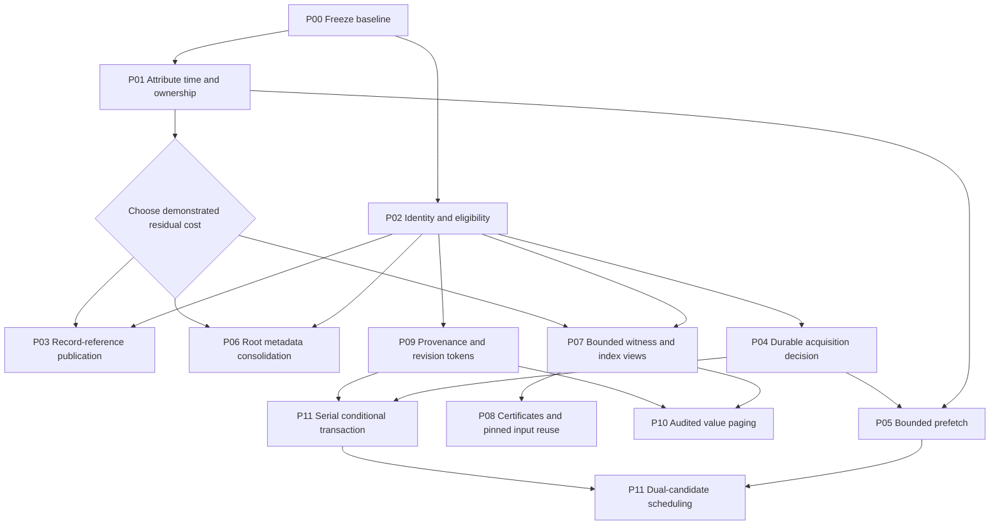

# Skycache unified analysis implementation plan

28 October 2026. Status: implementation started; P00/P01/P02 foundation increments are delivered, but none of their full acceptance gates is complete. See the [implementation evidence and remaining gates](../measurements/skycache-unified-analysis-2026-10-28/RESULTS.md).

Implement the [Revision 2 design](skycache-unified-analysis-design-2026-10-28.md) as small, independently measurable changes. Start by freezing a reproducible baseline and attributing client overhead. Then ship the cheapest demonstrated reduction in publication, retained metadata, or witness materialization. Introduce bounded prefetch only after an evaluator-owned decision can prevent late cache adoption. General value paging and full candidate races remain separate, gated projects.

This plan targets `JSGette/bazel`, based on commit `4f5ab75ca9aeffbbf288de558220fe0bed8c1de7`. The reviewed working tree also contains uncommitted retained-v8 changes and local measurement archives. The first implementation slice uses a separate checkout of the committed baseline; read-only reconciliation found no dirty v8 change required for this slice. Those changes remain separate and require review before any later incorporation. The paper's v8 observations and its v9 control are not a matched performance baseline.

## Current implementation checkpoint

- The [second increment](../measurements/skycache-unified-analysis-2026-10-28/RETENTION.md) fixes shared-decode callback retention with native red/green GC proof; 626 Java cases pass. Six fixed finalization timings survive Bazel's early profiler shutdown. Synthetic 4,096-node broad/sparse and retained-provider cohorts now produce exact output checks and cost/ownership CSVs. Thirty workload commands pass, but the observations do not establish an overall memory or latency improvement. Producer allocation/serialization remains the next cost investigation; no conditional optimization gate is waived.
- P00 now has a paired-run harness, fixture/evidence schemas and a deterministic native fixture. Baseline and instrumented executables each passed a producer plus four paired smoke commands with exact output digests. Broader workloads, action-key comparisons, idle-release/recovery and independent reproduction remain open.
- P01 now emits bounded scalar ownership snapshots before finish and after session close. Focused Java tests and real cache-hit diagnostics verify cleanup and retained-state distinctions. Exclusive phase costs, heap ownership and instrumentation overhead remain unproven.
- P02 now has a manual provider identity conformance target and a strict known-failure runner. Both controls pass; the two cross-branch identity cases still fail with four leaves instead of three. Eligibility widening remains blocked on semantic proof.
- P03 through P11 are not implemented. This checkpoint makes no performance-improvement claim. Choose the first optimization only after the remaining P00/P01 attribution work and applicable P02 gates.

## Delivery outcome and boundaries

The first useful release reduces complete-command client cost on a declared workload cohort while preserving ordinary local evaluation, exact result/output equivalence, provider identity, invalidation, and publication correctness. Every optimization remains independently disableable during evaluation. A logical PUT reduction alone is insufficient; the change must satisfy its predeclared primary improvement and secondary regression limits.

The first release does not replace the evaluator, merge the action-result cache into analysis storage, introduce a Rust rewrite, claim a filesystem snapshot from a counter, page arbitrary providers, or race two ordinary SkyFunctions. Its bounded-memory claims apply to owned cache resources. Live Java values, required graph metadata, native memory, and page cache remain separately measured.

Use existing controls before adding flags. If an independent experiment needs a new control, add one narrowly scoped option in `LocalSkycacheOptions`, default it off, record it in the run manifest, and delete or consolidate it when the experiment is accepted or rejected. Proposed control names are deliberately not presented as existing CLI flags.

## Inventory before adding machinery

Several mechanisms already exist. Reuse them and measure the remaining work.

| Existing mechanism | Implementation consequence |
| --- | --- |
| `ConfiguredTargetFunction` retrieves before ordinary local analysis; `SkyValueRetriever` owns retrieval state | Adapt that seam. Do not add an unrelated result cache or a duplicate acquisition coordinator. |
| `SelectedEntrySerializer.upload` skips `DeserializedSkyValue`; accepted reads retain parent publications through `LocalCacheSession` | A new “skip restored-root serialization” change would duplicate current behavior. Find residual serialization inside newly computed owners or avoidable inherited metadata rewriting first. |
| `FingerprintValueCache` has weak deserialization values and weak serialization keys; runtime uses `NOT_LINKED` | Preserve shared-object deduplication and weak ownership. Do not reintroduce a general object-to-fingerprint map as the publication optimization. |
| Root admission retains previous/accepted root tables; validators distinguish observed, admitted, validated, and consumed evidence | Consolidate representations only after preserving the distinct semantics. Multiple map references do not imply cloned SkyValues. |
| `LocalWitnessTable` already uses compressed blocks; segmented stores already open indexes lazily | Target eager witness flattening or measured index retention, not “add compression” or “add lazy indexes” as if absent. |
| Idle whole-graph release exists; older paging experiments exist on other branches | Benchmark idle release separately. Review earlier codecs and failure cases before porting any paging implementation. |

The [concurrent-cache plan](skycache_local_backend_f13e5f7f.plan.md) and [tiered-engine plan](tiered_skyframe_engine_993c2901.plan.md) remain historical context. The [Go paging comparison](../measurements/skyframe-lazy-go-datadog-linux-2026-10-19.md) identifies branch `jsgette/skyframe-go-paging`, checkpoint `1af5db48b405a53ad883fe3c6241364a1df0326f`. Its alternative graph classes are not present in this plan's base commit. Treat it as a source of reusable tests and negative results, not an already-integrated dependency or a reason to merge the whole branch.

## Implementation sequence

Each package below is a reviewable change or a short series where explicitly split. The owner is a responsibility, not an assignment to a named person. A failed performance gate can close a package without shipping code. Dependencies indicate required evidence as well as code.

| Package | Deliverable | Depends on | Responsible area | Priority |
| --- | --- | --- | --- | --- |
| P00 | Immutable baseline, fixtures and run manifest | None | Benchmark owner | Start now |
| P01 | Bounded cost and ownership telemetry | P00 | Client/serialization | Start now |
| P02 | Identity and restoration eligibility regression gate | P00 | Analysis/codec | Parallel with P01 |
| P03 | Residual record-reference publication, only if justified | P01, P02 | Publication/codec | Conditional early win |
| P04 | Durable per-attempt acquisition decision | P02 | Evaluator/retrieval | Prerequisite for overlap |
| P05 | Bounded bytes-only prefetch and simple policy | P01, P04 | Retrieval/storage | Independent experiment |
| P06 | Compact root/provenance bookkeeping | P01, P02 | Local cache client | Conditional early win |
| P07 | Bounded witness/index views and pin lifecycle | P01, P02 | Storage/validation | Conditional early win |
| P08 | Typed certificates in shadow mode, then pinned-domain reuse | P07, P02 | Validation | After representation proof |
| P09 | Explicit invalidation provenance and canonical revision tokens | P02 | Evaluator/invalidation | Foundation for later work |
| P10 | One audited handle-aware value family | P07, P09 | Evaluator/codec/consumer | Research gate |
| P11 | Transactional candidate prototype, then full racing | P04, P09 and eligible isolated family; P05 before dual scheduling | Evaluator | Research gate |



P03, P06 and P07 are alternatives for the first measured optimization, not three mandatory rewrites. P10 is not required for P11 if the latter has a different independently proven isolation adapter. Neither is required for the first useful release.

## P00 Freeze baseline and reusable fixtures

**Changes.** Create `docs/jsgette/measurements/skycache-unified-analysis-2026-10-28/` when the experiment starts. Put the manifest schema, run launcher, raw result schema, and comparison report there. Reuse existing retention/chain harness conventions. Promote only the necessary provider-identity fixture and measurement definitions from the local archives; inspect their licensing and remove machine-specific paths. Do not import the entire untracked archive or assume its scripts are reproducible as-is.

Record the exact source commit plus any patch digest, executable SHA-256, JDK, heap/GC flags, OS/CPU/memory, target list, toolchain/configuration, cache flags, output-base strategy, action-cache state, storage population/ancestry, remote endpoint mode, and retention settings. Freeze source inputs and define how each trial resets them. Resolve the retained-v8 work separately into a reviewed baseline before collecting matched data; do not benchmark a moving checkout.

**Workloads.** Include a small deterministic native fixture, the provider-identity reproducer, the selected broad Datadog workload, a sparse/disjoint demand fixture, and missing-path/glob/symlink/repository-binding mutation cases. Keep local storage without a remote endpoint as one explicit arm, because the observed client overhead exists there too. Restore action-cache state identically across paired arms and validate actual output artifacts.

**Done.** A second operator can reproduce the baseline from the manifest; ordinary local-only and current-cache runs use the same binary and declared inputs. Archive raw observations, not just averages. Publish checksums, target counts, exit status, and output/action-key comparisons. Record existing idle retention on/off as separate idle-residency and next-build experiments. Add a real publish/import -> idle reset -> next-build integration sequence: cover existing imported local backing without new writes, failed builds, remote-only imports without local backing, and backing collected before the idle task. Verify actual graph/loading-state release and recovery; the existing idle task unit tests use a callback counter and are not this integration proof. No performance conclusion is drawn from the earlier unmatched 36-second control.

## P01 Attribute client time and retained ownership

**Touchpoints.** Extend existing metrics in `RemoteAnalysisCachingEventListener`, `SkyValueRetriever.RetrievalContext`, `LocalCacheSession`, `LocalAnalysisCacheClient`, `LocalDependencyValidator`, `LocalInputSnapshot`, and codec/store counters. Existing listeners may differ between the baseline and the retained-v8 patch; reconcile them before adding counters. Use JVM allocation/heap/GC evidence alongside application metrics rather than building a second object-retention profiler into the cache.

**Tasks.** Separate lookup, input observation/proof, fetch, decode, ordinary analysis, publication, runfiles, and cleanup. Record task CPU or sampled attribution separately from overlapping wall spans. Add counts/bytes for root-map tables, witness lists/blocks, active memo contexts, pending callbacks, index arrays, queued bytes, and decode scratch. Sample or aggregate at bounded cardinality: no permanent per-key trace map in normal operation. For each owner distinguish allocated bytes, live retained bytes, duplicate objects, and multiple references to the same object.

**Tests and acceptance.** Extend existing metric/lifecycle tests and the serialization/local-cache suites listed below. Verify counters on hit, miss, cancellation, timeout, failure, and command cleanup. A tiny fixture must reconcile known bytes/operations; disabling detailed instrumentation must remove its collection work. Compare instrumented and uninstrumented baseline overhead. Deliver `ownership.csv`, `phase-costs.csv`, and a ranked decision memo with exclusive-cost limitations. Select the next package only when its avoided work exceeds a credible estimate of added handles, bookkeeping, and synchronization.

## P02 Make semantic eligibility executable

**Touchpoints.** Extend `BazelSkycacheIntegrationTest`, `SkyValueRetrieverTest`, `SharedValueDeserializationContextTest`, `AnalysisCacheInvalidatorTest`, and the provider-specific reproduction promoted in P00. Reuse existing codec eligibility/registration paths; do not infer safety solely from successful serialization.

**Tasks.** Exercise cold restore, mixed restore/recompute, equal computed/restored values, shared NestedSet/provider aliases, runfiles, dependency discovery, and output usability. Separate the proven identity reproduction from the unresolved cause of the broad-build link failure. Record supported cohorts by codec/configuration and required identity contract; unsupported cohorts conservatively compute locally. If a new explicit eligibility check is needed, keep it at the existing retrieval admission boundary and test its negative path.

**Done.** The reproducer fails for the known unsafe combination and passes for any proposed fix or explicit exclusion. Full results, required artifacts, action keys where applicable, and identity-sensitive behavior agree with the matched local control. This is a prerequisite for widening restoration or making performance claims, not a promise that every provider family must be fixed first.

## P03 Remove demonstrated residual publication work

**Start condition.** P01 identifies a reachable residual encoder/metadata cost after accounting for the existing restored-root skip and inherited-parent retention. If it does not, close this package as unnecessary and choose P06 or P07.

**Touchpoints.** Trace `SelectedEntrySerializer.upload` and `uploadAnalysisEntry`, `LocalCacheSession` accepted reads and `finish`, `SharedValueSerializationContext`, supported codec import boundaries, and `FingerprintValueService`. Select one concrete record or shared-subobject family. Draw its accepted-record handle and ancestry path before coding.

**Tasks.** Use a bounded record/import handle at the semantic owner or audited codec boundary. Reuse immutable bytes only when identity, consumed evidence, namespace, ancestry and leases remain valid. Locally recomputed owners must not inherit an old subobject merely because contents match. Preserve required child publication and supported fallback for missing backing. Do not re-enable a broad object-to-fingerprint map: the prior v9 read-to-write experiment reduced attempted puts but failed its confirmation memory gate.

**Tests and done.** Extend `LocalCacheSessionTest`, `SerializationTests`, lease/collector tests, and the chosen codec integration fixture. Cover parent retirement, missing/corrupt ancestry, nested inherited imports, mixed recomputation, interruption and publication failure. Show fewer encoder traversals or metadata rewrites, plus net improvement in full producer/consumer sequences including memory. Restore the old writer via the experiment switch without changing correctness or losing published data. A PUT-count reduction alone does not pass.

## P04 Establish the durable acquisition decision

**Touchpoints.** `ConfiguredTargetFunction`, `SkyValueRetrieverUtils`, `SkyValueRetriever`, evaluator entry/attempt ownership, and `SkyFunctionEnvironment`. The gate precedes `ConfiguredTargetFunction`'s ordinary local branch; retrieval itself already uses environment state. Keep existing exclusive retrieval and ordinary evaluator completion intact. For attempt-state access audit `SkyFunction.Environment`, `ParallelEvaluatorContext`, `SkyFunctionEnvironment`, and concurrent/worker/recording/state-informing environment wrappers. Extend the supported environment contract if required; do not downcast wrappers or pretend `getState` supplies the needed lifetime.

**Tasks.** Add a small attempt-scoped decision with `UNDECIDED`, `CACHE_SELECTED`, and `LOCAL`. Prefer an existing suitable entry attachment; if none exists, introduce the smallest evaluator-owned attachment and lifecycle hooks. Do not store the authoritative decision only in evictable `SkyKeyComputeState`, or in an unbounded process-wide key map. Invalidation, rewind, reset and replacement advance the attempt incarnation or clear its state safely. Completion, terminal errors, cancellation and evaluator disposal retire the attempt without keeping completed keys alive.

`CACHE_SELECTED` finishes through the existing evaluator-scheduled retrieval path. Before fallback enters local analysis it irreversibly changes to `LOCAL` for that attempt. Every restart of `LOCAL` bypasses cached-root adoption. An optional preselection deadline chooses a path; it does not promise to bound restoration/hydration after cache selection. Preserve cleanup of partially started retrieval before supported fallback.

**Tests and done.** Extend `SerializationTests`, `SkyframeTests`, `SkyframeEvictionTest`, and the integration suite. Force local suspension, temporary-state eviction, late cache completion, deadline/readiness races, rewind, and equal-version replacement. Assert one owner, no late adoption, no leaked subscriptions, and ordinary local progress. First land the decision under serial acquisition with overlap disabled; demonstrate that the lifecycle is correct before starting background work.

## P05 Add bounded prefetch without competing graph mutation

**Depends on P04. Touchpoints.** Existing transport/fingerprint services, `RemoteChunkCache`, `RemoteSkyCache`, the retrieval gate, and resource admission. Audit current asynchronous executors and limits before adding queues.

**Tasks.** First separate preparation from acceptance: current `LocalAnalysisCacheClient.lookup()` validates and includes evidence, accepts candidate ancestry, and remembers roots; it cannot run unchanged as a speculative probe. Fetch encoded bytes and perform only environment-free, non-consuming preparation. Never invoke a continuation that registers dependencies, fingerprints, actions or user events on a background speculative path. Leave semantic validation/hydration on accepted evaluator-scheduled retrieval. Start with local-first plus bounded bytes-only prefetch; add cache-first preselection delay only for a measured cohort. Reuse existing limits where they cover the resource; otherwise add explicit byte and task admission with a non-speculative progress reserve.

After `LOCAL`, cache completion can serve later demand or descendants still before their own gates, not replace the running root. Cap buffers, queued work, scratch, subscriptions and cleanup; cancel only owned private work, keep shared-child subscribers alive, and release credits after callbacks drain. Under pressure deny new prefetch before starving required evaluator work. A decode that cannot be incrementally charged stays out of the speculative path.

**Tests and done.** Fault-inject slow/missing/corrupt reads, exhausted budgets, cancellation and late callbacks. Use `RemoteChunkCacheTest`, `SkyCacheTransportTest`, `RemoteSkyCacheTest`, serialization tests and integration tests. Measure cache-ready time, selection/latch time, local finish, subsequently used prefetched bytes, wasted bytes, added CPU, and local slowdown. Disable cohorts where useful later demand does not repay interference. Report this as prefetch, not a same-root race or a guaranteed minimum of local/cache latency.

## P06 Compact root and provenance bookkeeping

**Start condition.** P01 shows meaningful retained table overhead in `LocalAnalysisCacheClient.previousRoots`, `acceptedRoots`, and `LocalSkycacheModule.Services.retainedRoots`.

**Tasks.** Preserve the distinction between roots valid from an earlier command, roots newly accepted now, and witnesses actually consumed for publication. First replace duplicate table layouts with an immutable base plus bounded current delta, or another measured compact representation; do not copy full SkyValues into a new store. Ensure root-capacity eviction remains a safe invalidation miss. Keep retrieval-disabled and idle-reset behavior unchanged. Charge added IDs, delta tables and cross-command ownership before claiming a saving.

**Tests and done.** Extend root retention/invalidation cases in `LocalDependencyValidatorTest`, `LocalCacheSessionTest`, and `AnalysisCacheIdleRetentionTaskTest`; locate the existing newer-revision and capacity-eviction regression cases before editing. Compare sparse requests, near-capacity roots and repeated commands. The net retained bytes decrease while invalidation, publication evidence and lookup latency remain within the release gate. If new metadata consumes the saving, retain current maps.

## P07 Bound witness and index materialization

**Touchpoints.** `LocalWitnessTable.read`, manifest/candidate witness lists in `LocalCacheSession`, `LocalInputSnapshot`, `LocalDependencyValidator`, and `SegmentedFingerprintValueStore`. Existing block/prefix compression and lazy index opening are the starting point.

**Tasks.** First consume existing witness blocks incrementally rather than flattening all of them into a retained list, if their format and consumers permit it. Expose scoped views or callbacks that cannot escape without an explicit pin/copy. Add page-pool ownership with content ID, slot revision, pin count and backing lease. Release/reload only owned encoded/witness/index pages; this does not create persisted-only DONE SkyValues or require the future transaction API. Preserve newest-record precedence: an unavailable newer index must not silently expose an older value.

If a format revision is necessary, use a new capability/version with old-read compatibility or an explicit miss path. Do not overwrite an old namespace in place. Construct records durably before publishing references; old binaries must safely reject unsupported records. Keep the existing representation as a fallback until mixed-version and recovery tests pass.

**Tests and done.** Extend `LocalWitnessTableTest`, packed/segmented store tests, input-snapshot and validator tests. Cover pin-versus-evict races, slot reuse, missing backing, checksums, short reads, cancellation and tiny budgets. Show lower decoded-to-demanded amplification and net retained heap on sparse demand; broad full scans must not incur an unacceptable regression. Current opaque SkyValues keep their existing lifetime.

## P08 Shadow typed certificates before accepting reuse

**Touchpoints.** `LocalInputSnapshot`, witness encoding, `LocalDependencyValidator`, publication manifests and current validation events.

**Tasks.** Encode typed observations for contents, absence, directory membership, symlink resolution, modes, repository bindings, configuration/environment and toolchain prerequisites. Preserve shared blocks; do not flatten the transitive read set for every node. In the first change, compute certificate decisions in shadow mode while the current validator remains authoritative. Record disagreements without making shadow metadata an unbounded retained graph.

After zero unexplained disagreements and a demonstrated cost benefit, enable exact reuse only for completely pinned immutable observation domains. Distinguish input token, evaluation epoch and per-key attempt. A repository name, HEAD hash, watcher silence, or final publication check is not a snapshot. Cold/uncertain histories retain demanded-leaf checks; mutable workspace generation reuse remains disabled.

**Tests and done.** Extend the validator, input-snapshot and integration mutation matrix; compare every shadow decision with the conservative oracle. Include dependency discovery, absent-to-present paths, symlink rebinding, repo replacement and incompatible configuration. Count writer cost and evidence-index retention over the entire producer/consumer sequence. A certificate mismatch blocks promotion; fallback is the existing validator, not best-effort acceptance.

## P09 Move invalidation provenance into explicit entry metadata

**Touchpoints.** `IncrementalInMemoryNodeEntry`, `AbstractInMemoryNodeEntry`, `SkyframeExecutor.invalidateWithExternalService`, `DeserializedSkyValue`, and existing invalidator logic. This is a focused metadata migration while values remain resident.

**Tasks.** Record computed-edge versus restored-evidence obligations and a canonical incarnation/provenance revision. Preserve existing behavior in shadow/equivalence checks before using metadata as the authoritative discovery path. Equal semantic values can still require a new provenance or identity token. An unchanged `lastChanged` alone cannot certify an imported representative. Discover restored entries and handle retrieval disablement without relying on hydration or `instanceof` inspection of a live value. Mixed imports remain ineligible until both obligation sets compose explicitly.

**Tests and done.** Exercise computed-to-restored and restored-to-computed equal values, disable retrieval, invalidate direct and transitive inputs, rewind/reset, and attempt replacement. Run `SkyframeTests`, `AnalysisCacheInvalidatorTest`, and integration tests. Require equivalent invalidation while still using resident values. Measure per-node overhead; do not allocate a heavyweight coordinator on every archived node merely to store a few revision fields.

## P10 Audit one consumer family before paging values

This package begins with a go/no-go design and test port, not an implementation promise. Review the historical native-genrule/Go paging checkpoints and their measured negative results. Select one family only after documenting every consumer, escaping reference, identity-sensitive import, action exposure and backing dependency. Serializability alone is insufficient.

If a family qualifies, reuse an appropriate historical graph/codec seam selectively. Introduce handles/borrows with explicit pin scopes, metadata-based invalidation, single-flight reload, and durable complete backing. Eviction closes admission, drains borrows, and conditionally detaches the current revision; I/O and waits stay outside evaluator locks. Parents holding raw references keep the object non-evictable. Missing optional cache data may recompute through a supported evaluator transition; loss of authoritative spill state after dependencies/effects were discarded requires safe evaluator recovery or failure, never an uncoordinated local replacement.

**Tests and done.** Force a graph larger than the resident budget through sparse and disjoint demand, cold dependency edits, parent-held aliases, concurrent reload and invalidation, missing storage, and retrieval disablement. Measure JVM, any sidecar, native memory and page-cache effects separately. Compare against current idle reset as well as no paging. Reject the family if live aliases pin nearly everything, identity cannot be preserved, or total memory/latency is worse. Closing this research gate does not block the earlier release.

## P11 Prove a conditional transaction before full racing

Split this package into two changes: an isolated transaction adapter with a serial producer, then optional dual-candidate scheduling. Neither is on the first release's critical path. The second change depends on P05's proven admission and cleanup controller; the serial transaction fixture can proceed independently of prefetch.

**Contract.** An eligible producer records input evidence, direct dependency/import incarnations and required identity representatives when consumed. Freeze that readset into a ticket with the evaluation epoch, root attempt, input token, provenance revision and codec capability. Do not refresh old reads to current revisions when the candidate completes. Stage candidate-specific edges, actions, conflicts, events and ownership; ordinary SkyFunctions are not assumed rollbackable.

**Touchpoints.** `AbstractParallelEvaluator`, `SkyFunctionEnvironment.commitAndGetParents`, node commit/version code, action registration and event paths. Document a concrete lock order or optimistic commit/invalidation protocol. Under that serialization boundary recheck the ticket, ensure required dependencies are DONE at the consumed canonical revisions, and install a complete result plus obligations. Prepare bytes and proof outside the boundary. Signal consumers and expose accepted effects only after commit. The existing “mostly atomic” completion path is not a dual-candidate transaction.

**Proof gate.** Before a full build, use a small deterministic evaluator fixture and controlled scheduler to enumerate commit/invalidate/cancel/reset orderings. Require no stale current-token reader, orphaned reverse edge, duplicate registration, leaked event, deadlock, or cancellation of a shared child's other subscribers. Preserve existing rewind and semantic-error behavior. Full races require an actual isolated value/consumer family and a committed dependency closure, not merely a CAS winner flag.

Only then add a bounded second producer using the P05 resource controller. Start with a fixed measured delay; adaptive histograms/quantiles come after matched exploration addresses censored losing attempts. Quarantine disagreeing supposedly equivalent results and surface a diagnostic. Add the full race only if it improves the end-to-end objective beyond serial choice/prefetch. Mutable-source snapshot consistency remains a separate prerequisite for any guarantee stronger than the declared input contract.

## Validation commands and test ownership

Run these in a dedicated Linux/WSL implementation worktree with a separate output base; several integration targets are disabled on Windows. They are instructions for subsequent code changes, not tests claimed to have run for this documentation update. Confirm targets against the selected implementation baseline; some retained-v8 test additions are not yet in the base commit.

```bash
# Build a separate executable; do not disturb another workspace's Bazel server.
bazel --output_base=/tmp/skycache-plan-build build //src:bazel-dev
cp bazel-bin/src/bazel-dev /tmp/skycache-plan-bazel

# Core retrieval/identity fixtures live in aggregate suites.
/tmp/skycache-plan-bazel --output_base=/tmp/skycache-plan-tests test \
  //src/test/java/com/google/devtools/build/lib/skyframe/serialization:SerializationTests \
  //src/test/java/com/google/devtools/build/skyframe:SkyframeTests \
  //src/test/java/com/google/devtools/build/skyframe:SkyframeEvictionTest \
  //src/test/java/com/google/devtools/build/lib/skyframe/serialization/analysis:BazelSkycacheIntegrationTest \
  //src/test/java/com/google/devtools/build/lib/skyframe/serialization/analysis:AnalysisCacheInvalidatorTest

# Select the relevant local tests per package rather than rebuilding every suite repeatedly.
/tmp/skycache-plan-bazel --output_base=/tmp/skycache-plan-tests test \
  //src/test/java/com/google/devtools/build/lib/skyframe/serialization/local:LocalDependencyValidatorTest \
  //src/test/java/com/google/devtools/build/lib/skyframe/serialization/local:LocalInputSnapshotTest \
  //src/test/java/com/google/devtools/build/lib/skyframe/serialization/local:LocalCacheSessionTest \
  //src/test/java/com/google/devtools/build/lib/skyframe/serialization/local:AnalysisCacheIdleRetentionTaskTest
```

`SkyValueRetrieverTest` and `SharedValueDeserializationContextTest` are members of `SerializationTests`; `ParallelEvaluatorTest` and `IncrementalInMemoryNodeEntryTest` are members of `SkyframeTests`. Do not invent standalone target labels from class names. Storage/transport, lease/collector, and specific codec targets are selected when their package changes. Use the repository's formatting/build conventions and meaningful behavior tests; documentation-only commits need link/target/path and whitespace checks, not a full Bazel build.

## Performance acceptance and rollback

Before each experiment, declare its primary objective and regression budget. Proposed initial promotion criteria are at least 5% median complete-command latency improvement **or** at least 10% retained-heap reduction on its target cohort, with no more than 5% regression in the other metric or complete producer/consumer CPU. These are engineering acceptance thresholds, not predictions from the paper. Tighten or revise them before measurement if baseline variability or deployment needs require it; do not change the objective after seeing which metric wins.

Use at least 10 balanced paired blocks for screening and 30 for confirmation when affordable; each block starts from declared cache/input conditions. Report paired ratios and a confidence interval across independent blocks. If noise prevents distinguishing the proposed threshold, collect more independent observations or call the result inconclusive. Promotion requires the confidence intervals to support the declared primary improvement and secondary regression limits; a noisy point estimate alone is insufficient. These counts do not establish a stable p95: collect an appropriate larger tail sample for the specific cohort, otherwise report individual observations and refrain from tail claims. Always report CPU, allocation, peak RSS, retained heap, owned-cache peak bytes, I/O and cleanup alongside the chosen objective.

Measure one producer, `N` consumers, edits with controlled invalidated fractions, publication, and retirement. Vary `N` and report break-even readership; do not assume unlimited consumers. Include misses, probes, certificate/index construction, remote-service CPU separately, and compaction. Idle reduction must include subsequent rehydration cost. Report process memory separately from heap occupancy and GC-sensitive snapshots.

Immediately stop promotion on stale acceptance, identity divergence, missing outputs, duplicate action registration, deadlock, unbounded staging, hidden semantic errors or leaked required publication. A correctness failure stops acceptance of the current build results: quarantine implicated cache records and derived publications, then invalidate the affected dependency closure through supported recovery or reset the evaluator before a fresh conservative retry. Do not continue from potentially contaminated resident values merely by turning off a flag. Ordinary optional-cache misses, timeouts and budget exhaustion retain supported fallback. When disabling an experiment, stop new admissions and drain owned callbacks/reservations while preserving shared subscribers. Before disabling a future persisted-value reader, restore or invalidate persisted-only entries through a supported evaluator transition. Format changes require versioned namespaces and verified old-reader rejection before rollout. Never delete backing that an active reader or authoritative spilled value needs. Remove abandoned experiment state/counters rather than accumulating permanent alternative implementations.

## First execution checklist

- [ ] Reconcile a reproducible committed implementation baseline without absorbing unrelated working-tree changes.
- [ ] Land P00's manifest, deterministic workloads, comparison harness and evidence index.
- [ ] Run P01 attribution while P02 promotes identity and eligibility regressions.
- [ ] Select exactly one of P03, P06 or P07 as the first performance change from the ranked evidence; document why the others wait.
- [ ] Implement P04 serial ownership decisions before P05 starts background prefetch.
- [ ] Publish a matched component ablation and full producer/consumer result; retain or revert the candidate against the declared gate.
- [ ] Only after a useful release, decide separately whether P08, P10 and P11 justify their interface and correctness cost.

Suggested parallelism is one client/storage owner for attribution and the selected cost reduction, and one evaluator/codec owner for identity fixtures and acquisition ownership. They converge on the same frozen baseline. Review every semantic change independently; do not run competing benchmark jobs on the measurement host.

## Evidence provenance

The portable design preserves Revision 2's conclusions. Code links point to committed repository files without stale local line anchors. Four measurement sources were local, untracked documents when this plan was prepared; their raw runs are **not included in this branch**. The hashes below identify what was inspected, not a claim that another checkout can retrieve those bytes. P00 must promote the required reproducibility evidence before using these observations as release criteria.

All four paths are under `docs/jsgette/measurements/skycache-demand-experiments-2026-10-27/`:

| Local source | SHA-256 of inspected document | What it supports |
| --- | --- | --- |
| `continuation-2026-10-28/README.md` | `d5eeecbd9aa2d4a1de2d5d94bbf5eb02314dc1def58b5ce944cfe0d8e9db5174` | v8 runs 110.409/140.895 s; approximately 16 GB process memory; v9 cache-off 36.302 s is an unmatched single observation. |
| `README.md` | `d7e768651c1b4984fdc1e9a24f3d07ddbb16d6cb96ecd4759133d978947d5052` | Earlier matched six-target remote 21.965 s versus vanilla 12.964 s, with lower measured client CPU; a different workload from broad v8. |
| `continuation-2026-10-28/final-independent-review/README.md` | `051773ee08acebb568e97785f923741605e6f25103883ec3cf25f410137f7f14` | Logical read/write counts and limitations of exclusive phase attribution; rejected read-to-write experiment context. |
| `provider-identity/README.md` | `fa5370a27ce0599c08b9239ff421003b47baf69ed952ec541eb708b1f42b756f` | Focused provider identity reproductions; not proof of the unresolved broad-build failure's cause. |

The published plan and design are documentation only. No performance gate, code migration, or semantic conformance result is marked complete by committing them.
