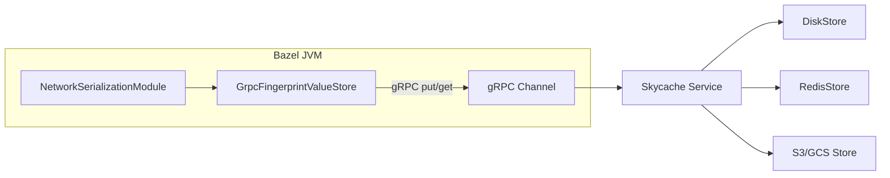

# Open-Source Skycache Network Backend

## Architecture

The backend has three layers:

1. **Bazel plugin** (Java): a `SerializationModule` subclass + `FingerprintValueStore` implementation that speaks gRPC to the backend service
2. **Backend service** (Go or Java): a standalone gRPC server implementing a simple key-value API
3. **Storage adapters**: pluggable backends (local disk, Redis, S3/GCS)



## Scope Decisions

- **Phase 1 ships only `FingerprintValueStore`** (the low-level key-value store). This is sufficient for upload/download mode since `SkyValueRetriever` has a direct `FingerprintValueStore` code path that works without a `RemoteAnalysisCacheClient`.
- **Phase 2 adds `RemoteAnalysisCacheClient`** for smarter invalidation and metadata queries. Phase 1 works without it.
- **No fork of Bazel.java required initially** -- the plugin can be loaded by building a custom Bazel binary that swaps one line in the module list (or via a Bazelisk-style wrapper that patches the deploy jar). Long-term, we propose a `--experimental_modules` flag upstream.

## Detailed Design

### Part 1: gRPC Service Definition

A new proto file defining the service contract. Intentionally simple -- a content-addressed blob store:

```protobuf
syntax = "proto3";
package skycache.v1;

service FingerprintStore {
  rpc Put(PutRequest) returns (PutResponse);
  rpc Get(GetRequest) returns (GetResponse);
  rpc BatchPut(BatchPutRequest) returns (BatchPutResponse);
  rpc BatchGet(BatchGetRequest) returns (BatchGetResponse);
}

message PutRequest {
  bytes fingerprint = 1;  // 16 bytes (PackedFingerprint) or UTF-8 (StringKey)
  bytes value = 2;
}
message PutResponse {
  bool was_novel = 1;     // true if this was a new entry
}

message GetRequest {
  bytes fingerprint = 1;
}
message GetResponse {
  bytes value = 1;        // empty if miss
  bool found = 2;
}

message BatchPutRequest {
  repeated PutRequest entries = 1;
}
message BatchPutResponse {
  repeated PutResponse results = 1;
}

message BatchGetRequest {
  repeated GetRequest entries = 1;
}
message BatchGetResponse {
  repeated GetResponse results = 1;
}
```

Batching is essential -- during upload, Bazel serializes thousands of entries in parallel. The `FingerprintValueService` deduplicates at the cache layer, but the store still sees O(10k) puts per build.

### Part 2: `GrpcFingerprintValueStore` (Bazel Plugin)

Implements `FingerprintValueStore`. Lives in a new package, e.g. `com.google.devtools.build.lib.skyframe.serialization.grpc`.

Key implementation details:

- **`put()`**: Convert `KeyBytesProvider.toBytes()` + `byte[] value` to a `PutRequest`. Return a `SettableWriteStatus`. On RPC completion, call `markSuccess(response.wasNovel)` or `failWith(cause)`. Batch puts using a time-windowed batcher (e.g. collect for 1ms or 256 entries, whichever comes first, then send `BatchPut`).

- **`get()`**: Convert `KeyBytesProvider.toBytes()` to a `GetRequest`. Return a `SettableFuture<byte[]>`. On response, set `null` if `!found`, otherwise set the bytes. Similarly batch with `BatchGet`.

- **`getStats()`**: Track bytes sent/received, entries found/missing, request counts. Return `FingerprintValueStore.Stats`.

- **Channel management**: Create a `ManagedChannel` from the service address. Support TLS via `--experimental_skycache_tls_*` flags. Reuse across commands (channel lives in the `RemoteAnalysisCachingServicesSupplier`).

Reference for batching pattern: Bazel's own `GrpcRemoteCache` in [src/main/java/com/google/devtools/build/lib/remote/](src/main/java/com/google/devtools/build/lib/remote/) uses similar batching for CAS uploads.

### Part 3: `NetworkSerializationModule`

Extends [SerializationModule.java](src/main/java/com/google/devtools/build/lib/skyframe/serialization/SerializationModule.java) and overrides the `@ForOverride` method:

```java
public class NetworkSerializationModule extends SerializationModule {
  @Override
  protected RemoteAnalysisCachingServicesSupplier getAnalysisCachingServicesSupplier() {
    return new GrpcRemoteAnalysisCachingServicesSupplier();
  }
}
```

The `GrpcRemoteAnalysisCachingServicesSupplier` implements [RemoteAnalysisCachingServicesSupplier](src/main/java/com/google/devtools/build/lib/skyframe/serialization/analysis/RemoteAnalysisCachingServicesSupplier.java):

- **`configure(options, clientId, buildId, jsonLogWriter)`**: Read `--experimental_analysis_cache_service` (or a new flag) for the backend address. Create/reuse the gRPC channel. Instantiate `GrpcFingerprintValueStore`.
- **`getFingerprintValueService()`**: Return a `FingerprintValueService` wrapping the `GrpcFingerprintValueStore`, using `FingerprintValueCache(SyncMode.LINKED)` for bidirectional caching.
- **`getAnalysisCacheClient()`**: Return `null` in Phase 1 (direct store mode). Phase 2 adds an implementation.
- **`shutdown()`**: Drain in-flight RPCs, close the channel.

### Part 4: Backend Service

A standalone binary implementing the `FingerprintStore` gRPC service. Recommended in Go for simplicity and deployment, but could be Java.

**Storage interface:**

```go
type Store interface {
    Put(ctx context.Context, key []byte, value []byte) (wasNovel bool, err error)
    Get(ctx context.Context, key []byte) (value []byte, found bool, err error)
}
```

**Adapters:**

| Adapter | Use case | Key mapping |
|---------|----------|-------------|
| `DiskStore` | Single-machine, cheapest | `<root>/<hex(key[0:2])>/<hex(key)>` (sharded directory) |
| `RedisStore` | Multi-machine, low latency | Key = raw bytes, value = raw bytes |
| `S3Store` / `GCSStore` | Durable, shared across CI | Key = hex string as object key |

The disk adapter is the minimum viable backend. Structure mirrors Bazel's own disk cache layout.

**Eviction:** LRU by last-access-time, configurable max size. For disk: background goroutine scans and prunes. For Redis: use Redis's built-in LRU.

### Part 5: Integration into Bazel Binary

Three approaches, in order of invasiveness:

**Option A (recommended for dev/CI):** Build a custom Bazel binary.

In [Bazel.java](src/main/java/com/google/devtools/build/lib/bazel/Bazel.java) line 88, replace:

```java
com.google.devtools.build.lib.skyframe.serialization.SerializationModule.class,
```

with:

```java
com.google.devtools.build.lib.skyframe.serialization.grpc.NetworkSerializationModule.class,
```

Build with `bazel build //src:bazel-dev`. This produces a Bazel binary with network Skycache support.

**Option B (no source change):** Use `--host_jvm_args` to add the plugin jar to classpath and a tiny wrapper that uses reflection to swap the module. Fragile but works for testing.

**Option C (upstream):** Propose an `--experimental_extra_modules` startup flag that loads additional `BlazeModule` classes from a jar on the JVM classpath. This is a small change to `BlazeRuntime.createBlazeModules()` and would benefit the whole ecosystem.

### Part 6: Usage

**Start the backend:**

```bash
skycache-server --port=9099 --storage=disk --storage-path=/tmp/skycache --max-size=10G
```

**Configure Bazel (in `.bazelrc`):**

```
# Upload after build
build:skycache-upload --experimental_remote_analysis_cache_mode=upload
build:skycache-upload --experimental_analysis_cache_service=localhost:9099

# Download before build
build:skycache-download --experimental_remote_analysis_cache_mode=download
build:skycache-download --experimental_analysis_cache_service=localhost:9099
```

**Workflow for multiple worktrees:**

```bash
# Worktree A: build and upload
cd ~/repo-wt-a && bazel build --config=skycache-upload //...

# Worktree B: download and build (hits cache from A)
cd ~/repo-wt-b && bazel build --config=skycache-download //...
```

## Open Questions

- **Flag reuse vs new flag:** The existing `--experimental_analysis_cache_service` flag is currently a string "locator" with unspecified format. We could reuse it (treat it as a `host:port` gRPC address) or introduce a new `--experimental_skycache_grpc_address` to avoid conflicts if Google ever ships their own backend.
- **Authentication:** The backend service should support mTLS at minimum. Whether to integrate with Bazel's `CredentialModule` or use channel-level TLS is a design choice.
- **`RemoteAnalysisCacheClient` (Phase 2):** The `lookupTopLevelTargets` method requires server-side metadata tracking (which CL/config was uploaded). This is the intelligence layer that determines cache hit feasibility before downloading thousands of entries. Phase 1 skips this and downloads eagerly.

## File Layout

```
src/main/java/com/google/devtools/build/lib/skyframe/serialization/grpc/
  BUILD
  NetworkSerializationModule.java
  GrpcRemoteAnalysisCachingServicesSupplier.java
  GrpcFingerprintValueStore.java
  RequestBatcher.java
src/main/protobuf/
  skycache_service.proto
src/test/java/.../serialization/grpc/
  GrpcFingerprintValueStoreTest.java
  NetworkSkycacheIntegrationTest.java
tools/skycache-server/          (or a separate repo)
  main.go
  store/
    disk.go
    redis.go
  proto/
    skycache_service.proto
```
