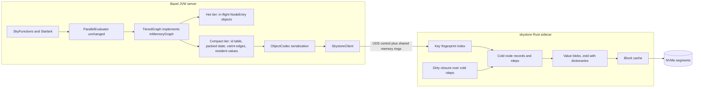
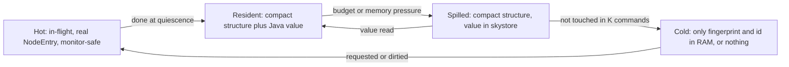

# Tiered Skyframe engine: Java hot plane + Rust "skystore" sidecar on SSD

## Verdict

- **Rust over sockets works for the cold/storage plane but not for the hot evaluation plane.** On the cold path an SSD read (~50-100 µs) dwarfs a Unix-domain-socket round trip (~5-15 µs). On the hot path every dependency registration, doneness check, and parent signal would turn a ~1-3 µs in-process operation into an RPC.
- **Recommended shape: split-plane.**
  - Java keeps scheduling and node state for in-flight and resident nodes, using the existing `ParallelEvaluator` through the already-public alternative-graph extension point.
  - A Rust sidecar ("skystore") owns everything cold: spilled values, cold edges, the key index, invalidation closure, compaction, compression, and persistence.
- **The DAG stays as the semantics. The representation changes:** dense int IDs, columnar node state, compressed frozen edges, and reverse deps demoted to SSD.
- **Biggest unknown: values, not edges, likely dominate heap.** Prior measurement on ~205k nodes found node entries at ~7.8 MB and compressed dep arrays at ~19 MB, but total heap was not attributed. Phase 0 must measure the split before committing, because value spilling needs serialization codecs for every type we spill.
- **Zabel (dzbarsky's Zig rewrite) supports this split rather than contradicting it.** Its wins come from owning the whole stack (its own Starlark compiler, value row layouts, native rules), which an engine swap under Java SkyFunctions cannot reach. Its reported memory wins are value-layout wins, which is why this plan adds a parallel value-layout track in Java (Track V).

## Why not the whole engine in Rust (estimates; validated by the Phase 0 spike)

- **Throughput.** A large analysis is ~10^7 node evaluations with ~2-3 engine interactions each. That is ~3x10^7 cross-process round trips, i.e. hundreds of CPU-seconds of syscalls and context switches, versus tens of seconds of engine overhead today.
- **Semantics split across processes.** Values, keys, `ErrorInfo`, event NestedSets, and `SkyKeyComputeState` are Java objects.
  - Change pruning calls Java `equals`.
  - nokeep_going error bubbling re-enters SkyFunctions.
  - The atomic `addReverseDepAndCheckIfDone`/`setValue` pair would become a cross-process transaction. Today it is ~47 `synchronized` occurrences in [IncrementalInMemoryNodeEntry.java](src/main/java/com/google/devtools/build/skyframe/IncrementalInMemoryNodeEntry.java) and [AbstractInMemoryNodeEntry.java](src/main/java/com/google/devtools/build/skyframe/AbstractInMemoryNodeEntry.java).
- **A separate process does not save machine RAM by itself.** Only the compact representation and SSD tiering do.
- **Bootstrap constraint.** Bazel builds from source with only a JDK and a C++ compiler, and there is no rules_rust today. The sidecar must therefore be optional: a bootstrap build runs the in-process compact graph from Phase 2.
- **Role of C.** No hand-written C is planned. C libraries (zstd, liburing) are linked into the Rust sidecar.

## Zabel: dzbarsky's Zig rewrite of Bazel

**What it is**
- A from-scratch Zig reimplementation of Bazel by hermeticbuild (David Zbarsky).
- The source is private (`hermeticbuild/zabel` returns 404). Binaries for Linux and macOS (aarch64 and x86_64) are published at `hermeticbuild/zabel_releases`: v0.0.1 on 2026-07-27 through v0.0.8 on 2026-09-06.
- Work has been visible since at least March 2026. There is no Windows build.

**Architecture, as far as the release notes show**
- **Engine.** Modeled on Buck2's DICE ("DICE action and configured-owner publications", "producer-owned DICE values"). Changes are repeatedly advertised as adding "no additional DICE dependencies", so edge count is treated as a cost.
- **Values.** Stored as fixed-size "retained rows" with explicit byte budgets: "provider-builder field rows from 72 to 32 bytes", "bounded 64-byte retained rows", "no common retained-row growth".
- **Volatility.** Typed "projections" with explicit volatility: stable projection 29 and volatile projection 30 feed execution projection 31, so volatile changes don't invalidate actions.
- **File-system dependencies.** Recorded as first-class FILE/DIR/ENOENT "observations".
- **Starlark.** Its own bytecode compiler with registers and immutable compiled programs, plus a SIGPROF sampling profiler.
- **Native implementations.** gRPC/HTTP2, REAPI, BES, and async CAS reads are native, as are some rules (CppCompile, genrule, config_setting, platform).
- **Incrementality.** Showcased in `build --watch`: an LLVM C-source rebuild went from 10.5 s to 1.7 s, and an unchanged BUILD rebuild from 6.1 s to 0.11 s. The notes mention shared on-disk caches under `~/.cache/zabel` (registry, repository, ActionCache, CAS) and cross-process leases, but no persisted analysis graph and no server daemon.
- **Compatibility testing.** Checked against a "pinned source-built Bazel oracle" by matching aquery action keys and label-order checksums.

**Reported wins are value-layout and interpreter wins**
- Rule attribute defaults stored once per rule declaration: -14.5% median peak RSS and -8.4% wall time on LLVM loading queries.
- Provider rows shrunk from 72 to 32 bytes.
- Starlark evaluation: -10% to -17% retired instructions.

**Back-ports into Java Bazel**
- The `dzbarsky/bazel` fork carries `codex/*-upstream` branches with the same kind of wins: frozen provider-dict compaction, schema sharing for schemaless structs, weakly interned configuration matchers, runfiles path interning, compact option metadata, and allocation cuts.
- Reusing repository mappings cut allocations by 1.85% on a 140k-root analysis.
- One branch already landed upstream as `ce3c4f298e` (pre-sized dirty dependency sets).

**What we take**
- **Phase 0 comparison (approved).** Run the public workloads Zabel reports on (LLVM via hermetic-llvm, the BuildBuddy repo) with the SHA256-verified binary in an isolated directory, to get a native-rewrite reference point.
- **Phase 1 oracle checks.** Compare aquery action keys and output digests, not only Skyframe values.
- **Phase 2 layout discipline.** Per-kind row layouts with byte budgets, a "retained bytes per node" CI metric, and edge count treated as a cost.
- **Track V.** Value-layout work in Java, coordinated with dzbarsky's open branches so we don't duplicate them.

**What we cannot take**
- The source is private.
- It is not drop-in: no Windows, native rules reimplemented piecemeal, and documented unsupported cases (configurable native `exec_properties`, nonempty legacy environment constraints).
- Its gains depend on replacing the Starlark interpreter and the value model, which the drop-in constraint rules out.

## Target architecture

Residency tiers. This is the non-destructive "sliding window": unlike Skyfocus, cold nodes stay incremental and verifiable.

## Data-structure verdict ("better than a DAG?")

**Keep (semantic contract):**
- Memoized calls with dynamically discovered, grouped dependencies.
- Order-sensitive dependency groups whose contents are order-insensitive within a group.
- Versions with change pruning; cycles are errors.

**Change (representation):**
- Dense `int` IDs instead of object pointers.
- One key table, removing the duplicate key reference held by both the `ConcurrentHashMap` entry and the node entry.
- A packed per-node state word plus int `lastChanged`/`lastEvaluated` versions.
- Dependencies frozen on commit as sorted-per-group delta+varint in an append-only arena; mutable deltas are merged at quiescence, LSM-style.
- RoaringBitmap for high-fan-in reverse deps (e.g. `PrecomputedValue` or configuration keys with millions of rdeps).
- Hash-consed dependency groups, only if Phase 0 shows duplication.

**Demote reverse deps to SSD.** Persisted rdeps are read only by invalidation, deletion, and query `rdeps()`. In-evaluation rdeps stay in RAM.

**Rejected:**
- Pull-based Salsa-style verification with no rdeps at all. Null and incremental builds would become O(reachable graph) instead of O(changed cone); this stays a Phase 7 research item ("lazy dirtying").
- Graph coarsening or hypergraphs. They change the granularity SkyFunctions see, so they are not drop-in.
- Datalog or differential dataflow. Incompatible with imperative SkyFunctions.

## Compression plan (bake-off in Phase 0 on real serialized values)

**Integer edges:**
- Java tier: group-sorted delta + LEB128 varint (KISS, ~1-2 bytes per edge with creation-order ID locality).
- Large rdep sets: Roaring, which is already a dependency (`org.roaringbitmap`, used in [LeafIdAssignment.java](src/main/java/com/google/devtools/build/lib/skyframe/serialization/analysis/LeafIdAssignment.java)).
- Skystore: evaluate Stream VByte, SIMD bit-packing, or Elias-Fano for cold segments, plus WebGraph-style ID renumbering (BFS or layered label propagation) during compaction.

**Key strings (paths, labels):** FSST (random-access string compression, as used in DuckDB) or front-coding in sorted key blocks.

**Serialized values, zstd tuning:**
- Per-`SkyFunctionName` trained dictionaries. This is the main lever for small records.
- Level 1-3 on the write path; recompress at ~9-15 during background compaction. Decompression speed barely depends on level.
- Magicless frames with no frame checksum, content-size, or dictID fields; checksums move to blocks (crc32c/xxh3).
- Reused contexts and digested CDict/DDict.
- Long-distance matching only for large blobs.
- 16-64 KB blocks for records written together.

**Alternatives to measure:**
- LZ4 with dictionary for a fast warm tier.
- OpenZL (Meta's format-aware compressor, 2025; maturity to verify) for columnar node segments.
- Content-addressed fingerprints, which already dedupe change-pruned equal values across versions.

## Prior art and how it is reused

**Inside Bazel:**
- **Extension point for alternative graphs.** `NodeEntry`, `DirtyBuildingState`, `CycleDetector`, and `InMemoryGraphImpl` are documented as public "for alternative graph implementations". [QueryableGraph.java](src/main/java/com/google/devtools/build/skyframe/QueryableGraph.java) already has `Reason`, async batch gets, `prefetchDeps`, and size limits.
- **Value tier.** Skycache's serialization path ([FingerprintValueStore.java](src/main/java/com/google/devtools/build/lib/skyframe/serialization/FingerprintValueStore.java), [SkyValueRetriever.java](src/main/java/com/google/devtools/build/lib/skyframe/serialization/SkyValueRetriever.java), `putSharedValue` for NestedSet sharing). Open-source Bazel has only an in-memory store (TODO b/358347099).
- **Conformance and eviction direction.** [SkyframeEvictionTest.java](src/test/java/com/google/devtools/build/skyframe/SkyframeEvictionTest.java) is upstream's June 2026 fuzz harness "for node eviction". The abstract `MemoizingEvaluatorTest`, `GraphTest`, and `InMemoryNodeEntryTest` suites are already parameterized.
- **Lessons.** Skyfocus (deleted in c9bdec481a) used destructive pruning and errored on changes outside the working set; we avoid both. [HighWaterMarkLimiter.java](src/main/java/com/google/devtools/build/lib/skyframe/HighWaterMarkLimiter.java) drops state where we would spill. `--heuristically_drop_nodes` plus `NodeDroppingInconsistencyReceiver` show tolerated inconsistency.
- **Platform.** JDK 25 is embedded with compact object headers already on, and FFM is available. zstd-jni and RoaringBitmap are already dependencies.

**External:**
- Salsa: LRU-evicted values with kept dependencies; durability levels.
- Buck2 DICE: Rust and in-memory, no persistence.
- Zabel: a Zig rewrite with a DICE-style engine and row-based values (see the section above).
- Turbopack turbo-tasks: persistent task graph on disk.
- Pants: Rust engine in-process via FFI, LMDB store.
- Shake: persisted dependency database.
- Ray Plasma: a UDS control channel plus shared-memory data, the IPC model we copy.
- Watchman and EdenFS: coarse-grained build daemons over UDS.
- RocksDB: per-file zstd dictionaries.

## Phases (each is a stack of atomic commits with a review gate)

**Phase 0: Measure and spike (no behavior change)**
- Heap attribution, extending [SkyframeMemoryDumper.java](src/main/java/com/google/devtools/build/lib/buildtool/SkyframeMemoryDumper.java): structure (entries, deps, rdeps, map nodes, keys) versus values, per `SkyFunctionName`.
- Working-set tracing over replayed commit history (the bazel repo plus one large client repo): per command, record nodes read for value, read for version only, dirtied, and recomputed.
- Codec coverage and compression bake-off on real values: list the gaps (known: `FileStateValue`, `DirectoryListingValue`, `BzlLoadValue`, driver values).
- Java-Rust IPC microbenchmark: UDS versus shared-memory ring, batch get/put, on Linux and macOS.
- Benchmark matrix: cold, null, leaf edit, BUILD edit, .bzl edit, flag change, server restart. Metrics: peak and retained heap, GC CPU, wall time.
- Zabel comparison on the same public workloads (LLVM via hermetic-llvm, the BuildBuddy repo). Use the SHA256-verified v0.0.8 binary from an isolated directory, and measure peak RSS, wall time, and incremental rebuilds next to Bazel.
- **Exit:** a decision memo with go/no-go for each later phase.

**Phase 1: Decouple Bazel from in-memory internals (upstream-friendly)**
- Replace `getInMemoryGraph()` uses and casts to `IncrementalInMemoryNodeEntry` with a narrow maintenance API: function-filtered enumeration, `getIfPresent`, `remove`, `clearValue`, `clearDirectDeps`, rdep surgery, dumps.
- About 16 production files are affected, mainly `SkyframeExecutor`, [SequencedSkyframeExecutor.java](src/main/java/com/google/devtools/build/lib/skyframe/SequencedSkyframeExecutor.java), [FrontierSerializer.java](src/main/java/com/google/devtools/build/lib/skyframe/serialization/analysis/FrontierSerializer.java), [SelectedEntrySerializer.java](src/main/java/com/google/devtools/build/lib/skyframe/serialization/analysis/SelectedEntrySerializer.java), [DumpCommand.java](src/main/java/com/google/devtools/build/lib/runtime/commands/DumpCommand.java), [FilesystemValueChecker.java](src/main/java/com/google/devtools/build/lib/skyframe/FilesystemValueChecker.java), `VendorCommand`, and `LocalResourceUsageCollectors`.
- Evaluator factory seam selected by a startup option, used in `SequencedSkyframeExecutor.createEvaluator` and [AbstractPackageLoader.java](src/main/java/com/google/devtools/build/lib/skyframe/packages/AbstractPackageLoader.java).
- Reusable conformance suite, the eviction fuzzer extended with page-in/out events plus a symmetry and version invariant checker, and a differential trace comparer (per-node value fingerprint, deps, versions).
- Oracle-level checks in the style Zabel uses: aquery action keys, label-order checksums, and output digests must match the in-memory engine.

**Phase 2: Compact in-process graph (Java; memory and GC win, no disk)**
- ID index, columnar packed state (FFM `MemorySegment` versus `long[]`, chosen by benchmark), frozen varint deps arena, Roaring rdeps at quiescence.
- In-flight nodes stay real on-heap `NodeEntry` objects, hydrated on first touch and dehydrated when done at quiescence. Monitors only ever lock stable objects.
- Arena compaction at the end of each command.
- Per-kind row layouts with explicit byte budgets, plus a "retained bytes per node" CI metric so regressions are caught the way Zabel tracks retained-row growth.
- **Exit:** conformance green, measured structure bytes per node and GC drop, at most 2% regression on null and incremental builds.

**Phase 3: skystore sidecar (Rust)**
- Launched by the server, one per output base, with a health check.
- Versioned binary protocol over UDS plus memfd/shm rings; AF_UNIX on Windows 10+.
- Batch operations: `PutValues`, `GetValues`, `PutNodeRecords`, `GetNodeRecords`, `ComputeDirtyClosure`, `Checkpoint`, `Compact`, `Stats`.
- Storage: an append-only segment log plus fingerprint-addressed blobs. Bake off a custom log against fjall/redb.
- I/O and caching: io_uring on Linux, pread thread pool elsewhere; block checksums; S3-FIFO or CLOCK-Pro block cache.
- Build: rules_rust, embedded in the install base; optional in bootstrap builds.
- Failure policy: a crash or corruption is treated as cache loss. Drop the graph and recover from the last checkpoint.

**Phase 4: Value tiering (the sliding window)**
- Per-function residency policy: PIN (default until audited), SPILL, or DROP (recompute; only cheap, deterministic, hermetic functions).
- Spill between commands to fit `--skyframe_resident_heap_budget`, using a recency window of K commands.
- Spill within a command under memory pressure, instead of `HighWaterMarkLimiter` drops, but only for done values with no pending in-evaluation readers.
- Page-in through `getBatchMap`/`getBatchAsync` with `Reason.PREFETCH`, overlapping SSD latency with batch prefetch. Never block inside monitors.
- Shared-value dedupe via fingerprints plus a weak cache of deserialized values; restore SkyKey and Label interning on eviction.
- Close codec gaps in byte order from Phase 0.
- Audit identity-sensitive values (actions held by executor side tables) before allowing SPILL.

**Phase 5: Structure tiering**
- Persisted rdeps live only in skystore. Invalidation calls `ComputeDirtyClosure`; cold nodes are marked dirty lazily and hydrate as `CHECK_DEPENDENCIES` on first touch.
- Then cold deps and versions, and a key-fingerprint index (~12-16 bytes per node in RAM, or on disk behind a Bloom filter).
- A dedicated resident file-state table, so dirtiness checks without `--watchfs` stay fast.

**Phase 6: Persistence across server restarts**
- A crash-consistent checkpoint per command (WAL plus atomic manifest swap).
- A validity stamp (install MD5, graph-affecting startup options, codec registry hash); on mismatch, discard.
- Lazy reopen, then a dirtiness check. On macOS, use the persisted FSEvents event id; on Linux, a full stat scan (today's non-watchfs behavior). Also check output files and re-inject client env and precomputed values.
- Skystore acts as a local L2 in front of remote Skycache (same codecs and fingerprints).

**Phase 7: Evaluator performance (gated)**
- Residency-aware scheduling: a node becomes runnable once its prefetched values are resident.
- Lazy dirtying: dirty only what the build requests.
- Optionally, an in-process Rust codec via FFM, only if profiling demands it.

**Phase 8: Rollout**
- Flag: `--experimental_skyframe_engine=inmemory|compact|tiered`.
- CI shadow mode with a differential comparer.
- Metrics in BEP and profiles: page-ins, spill bytes, hit ratio, p99 page-in latency, resident bytes by function.
- Upstream engagement with Phase 0 data and Phase 1 PRs, aligned with upstream eviction and Skycache work.

**Track V: value-layout wins in Java (runs in parallel with Phases 1-8, no engine dependency)**
- Prioritized by the Phase 0 heap attribution, broken down by value class.
- Candidates already proven by Zabel or dzbarsky's branches:
  - rule attribute defaults stored once per rule class (Zabel: -14.5% peak RSS);
  - provider and struct field-row compaction;
  - depset topology sharing during provider freezing;
  - interning of configuration matchers and paths.
- Check the `dzbarsky/bazel` `codex/*-upstream` branches and open upstream PRs before starting each item.
- Each win is an independent upstream PR.

## Invariants every phase must preserve

- Atomic rdep registration plus scheduling, so each parent is signaled exactly once.
- A node is done if and only if it has a value and no building state.
- Dependency-group semantics and `DirtyType` (DIRTY / CHANGE / REWIND) semantics.
- Version partial order and change pruning: an equal value keeps `lastChanged`.
- Restart, partial reevaluation, and Reset/rewind contracts.
- keep_going versus nokeep_going error semantics.
- Event replay and dedupe.
- `ErrorTransienceValue` behavior.
- SkyKey and Label identity interning across eviction.
- Never evict in-flight or monitor-held entries.

## Key risks

- Values dominate and codec coverage is partial, so engine-only gains are capped. Phase 0 quantifies this; PIN stays the default.
- Identity-sensitive values and side tables. Audit them before SPILL.
- Sidecar crashes and corruption. Treat as cache loss; use checksums and a kill -9 test suite.
- rules_rust and bootstrap. The sidecar is optional.
- SSD write amplification. Append deltas only and budget compaction.
- Divergence from upstream eviction work. Engage early.
