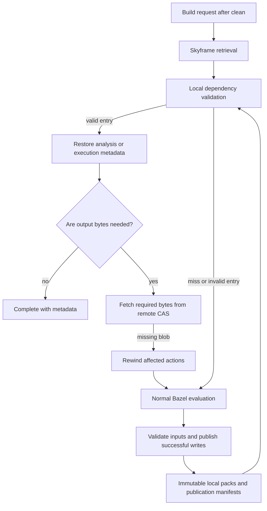

# SkyCache architecture and validation for Bazel discussion

## Scope and motivation

SkyCache is an experimental persistent backend for Bazel's Skyframe analysis cache. It reuses validated configured-target values and selected remote execution metadata after the in-memory graph has been discarded. Its intended use is repeated builds after `bazel clean`, server restart, or switching between Git worktrees of the same repository.

The implementation builds on Bazel's existing serialization, dependency-validation and graph-retrieval paths. Cache & Carry supplies the remote action cache and content-addressable store (CAS); SkyCache keeps graph values and output digests on a shared local filesystem. Output bytes remain in CAS until the build needs them.

Implementation snapshot: `71521fabb3420707c39d73329fa9aa9622e8c382`, 25 October 2026. The [complete implementation patch](https://github.com/JSGette/bazel/blob/jsgette/master/docs/jsgette/measurements/skycache-execution-metadata-2026-10-25/implementation-current.patch) and [execution-metadata change](https://github.com/JSGette/bazel/blob/jsgette/master/docs/jsgette/measurements/skycache-execution-metadata-2026-10-25/implementation-incremental.patch) are published with the validation evidence. This is a prototype for discussion, with the tested scope described below.

## Architecture



The integration has four layers:

| Layer | Responsibility | Main implementation |
|---|---|---|
| Invocation setup | Select the local backend, capture input context, set the analysis-cache mode and apply retention policy | `LocalSkycacheModule`, `LocalSkycacheOptions` |
| Validated graph retrieval | Read serialized values and validate their dependency roots against current input evidence | `LocalAnalysisCacheClient`, `LocalDependencyValidator`, `LocalInputSnapshot` |
| Persistent storage | Store fingerprint-addressed values in immutable packs and publish a manifest after a successful build | `LocalCacheSession`, `PackedFingerprintValueStore` |
| Lifetime management | Pin readers, writers and required parent publications; collect unneeded publications during idle time | `LocalCacheLeaseManager`, `LocalCacheGarbageCollector` |

The local backend uses the existing asynchronous bidirectional analysis-cache machinery. `--experimental_active_directories` determines the active part of the graph and its reuse frontier. A small number of restored frontier values can therefore avoid reconstructing a much larger dependency closure. The number of cache hits is not the number of configured targets whose work was avoided.

Analysis values and portable execution values use distinct envelopes. An execution hit returns remote output metadata through the existing `ActionExecutionFunction` and `ArtifactFunction` retrieval paths before the generating action's dependency closure is traversed.

## Correctness and invalidation

A Git revision is not sufficient validity evidence. `LocalInputSnapshot` captures content, directory membership, file modes and symlinks, including untracked and ignored source files. Observed filesystem dependencies also cover files outside the workspace. Git administration and Bazel convenience output links are excluded from the broad source scan, while explicitly observed dependencies can still record relevant Git metadata.

Each reused entry carries a dependency root. `LocalDependencyValidator` validates the persisted dependency graph and its file witnesses against the current filesystem, with memoization and bounded traversal. Changed or unusable evidence produces a cache miss. This remains real local validation work; the implementation does not eliminate source validation.

The cache namespace includes the Git common-directory identity, native byte order and effective repository/action/test environments. It also includes the remote cache endpoint, executor endpoint, instance name and execution-metadata format. Repository bindings receive additional checks so that a repository name cannot silently resolve to a different tree. Without Git metadata, the namespace uses the workspace's real path.

These checks allow two worktrees of one local Git repository to consult the same store while validating their different source contents. An independent clone does not automatically share that namespace. Build configurations still participate in Bazel's serialized keys; sharing a directory does not make distinct configurations interchangeable.

Publication is a separate admission step. Before publishing new writes, the session rechecks the source snapshot and the input witnesses used by the build, including evidence inherited from reused parent publications. A failed build, changed inputs or storage failure prevents publication. The cache is an optimization: validation failures fall back to normal evaluation.

This model retains Bazel's normal requirement that build inputs remain stable while a build is evaluating them. The final publication check prevents admitting a changed snapshot; it is not a transactional filesystem snapshot.

## Build without the bytes

Execution reuse is restricted to metadata that remains meaningful after local outputs disappear. `LocalExecutionValues` accepts remote file metadata and entirely remote tree-artifact metadata. It excludes rich action data, missing trees, local file outputs and resolved symlink metadata containing absolute output paths. Those cases remain on normal evaluation.

For a valid execution hit, SkyCache does **not** call `GetActionResult` for that action or proactively check whether every referenced CAS blob still exists.

| Download policy | Behavior on a reusable execution hit |
|---|---|
| `minimal` | Retain remote metadata; fetch bytes only if a subsequent local action requires them. A pure cache-hit build can finish without materializing the final executable or intermediate archives. |
| `toplevel` | Fetch requested top-level outputs and required runfiles. Intermediate outputs stay remote unless needed by an action that must run. |

Download policy is deliberately excluded from the local execution namespace, so the same metadata can serve both policies. `--noremote_accept_cached` disables this execution reuse.

CAS eviction is handled lazily. If a required blob is missing, Bazel's existing lost-input rewind path invalidates the affected execution value and recomputes the necessary action. Rewind skips retrieving that same stale execution value again. Missing intermediates that are never requested need no recovery.

Two implementation changes support that path. Actions entering normal execution load the immediate input owners and relevant template/runfiles dependencies needed by rewind synchronization. This fallback work is bypassed by execution hits. Separately, `RemoteActionFileSystem` supplies parent directories in memory when resolving a symlink to known remote metadata, without downloading the input or creating those directories on disk.

Zero action-result lookups does not imply zero service traffic. Remote-client initialization can still call `GetCapabilities`; requested bytes use CAS reads, and Build Event Service uploads can generate their own traffic.

## Sharing and lifecycle

The cache directory is external to the source workspace and output base, so `bazel clean` does not delete it. The storage layout separates immutable object packs from publication manifests:

```text
<cache>/leased-v1/
  objects/packed-v1/<publication-id>/...
  publications-v3/<namespace>/<publication-id>.manifest
  ...lease and collection metadata...
```

Each writer owns private storage. It seals the pack before publishing a manifest, flushes manifest contents, atomically links the manifest into the publication directory and synchronizes that directory. A SHA-256 trailer checks manifest integrity. Readers discover only published manifests, rather than partially written packs.

Publications record references to reused parents. Readers pin the required publication closure; active writers are pinned as well. Collection uses filesystem locks and preserves the parent closure needed by live readers or retained publications. Candidate counts and metadata budgets bound admission work.

This is a shared local filesystem design. Its correctness relies on the filesystem's locking and durability semantics; the WSL ext4 tests do not establish suitability for arbitrary network filesystems or cross-machine distributed storage.

The backend also has an idle graph-eviction policy. Benchmarks below set its idle-eviction timeout to zero and explicitly cleaned the graph, so their gains do not depend on leaving the analysis graph resident between measured builds.

## Evidence and limitations

The initial Datadog benchmark built `//cmd/cluster-agent:cluster-agent` on Linux under WSL. Every measured build followed shutdown and synchronous `bazel clean --noasync --noexpunge`. The harness verified zero Skyframe nodes and edges, an empty execroot, no local action cache, and preserved external SkyCache publications. Clean started the JVM; the measured build used that same JVM with an empty graph.

Median of three measured builds per cell; build time excludes clean/JVM startup:

| Policy and variant | Build seconds | Peak process-tree PSS MiB | GetActionResult calls |
|---|---:|---:|---:|
| minimal, preserved vanilla fork | 8.52 | 2037 | 5704 |
| minimal, candidate with SkyCache off | 8.52 | 1963 | 5704 |
| minimal, SkyCache on | 7.22 | 1659 | 0 |
| toplevel, preserved vanilla fork | 12.17 | 2151 | 5704 |
| toplevel, candidate with SkyCache off | 12.37 | 2171 | 5704 |
| toplevel, SkyCache on | 10.72 | 1732 | 0 |

Against the same candidate with SkyCache off, median build time fell 15.3% for minimal and 13.4% for toplevel; peak PSS fell 15.5% and 20.2%. Against the preserved vanilla fork, time fell 15.3% and 11.9%. The vanilla comparator is a source build at `4cfc05f77ba91900a2e3c6ab135861498cb2a0bf`, rather than a released Bazel binary.

The hit builds restored 12 configured-target values and six execution values. Minimal made zero CAS reads and materialized no final executable or intermediate `.a`/`.x` files. Toplevel read five blobs totaling 121,907,152 bytes for the requested output/runfiles, with the same final executable digest as the controls. Necessary small internal manifests were still generated. [Full benchmark and protocol](https://github.com/JSGette/bazel/blob/jsgette/master/docs/jsgette/skycache-execution-metadata-2026-10-25.md).

The same report contains 348 executed regression-test cases and a 12-build fault-injection fixture covering source invalidation, missing required/final CAS blobs, missing unused intermediates, symlinks and internal-output regeneration. Fault injection used a private HTTP cache; it did not delete data from Cache & Carry.

A separate concurrent test used two Git worktrees with edits in different packages, independent output bases and one shared SkyCache. Simultaneous writers and readers passed; swapping the two edits preserved the expected executable digests. Simultaneous minimal hits took 9.89–9.94 seconds with zero action-result lookups or CAS reads. That passing series used one remote connection and 16 concurrent requests per server. Earlier default-transport attempts encountered service/connectivity failures and remain in the protocol. [Concurrent-worktree evidence](https://github.com/JSGette/bazel/blob/jsgette/master/docs/jsgette/skycache-concurrent-worktrees-2026-10-25.md).

These are warm OS-page-cache and warm external-repository-download measurements on one machine, with a small sample and shared network service. PSS/RSS sampling covers the build process tree, not all host RAM or filesystem cache. Analysis-only caching was slower in an earlier series; the measured improvement depends on avoiding execution-graph traversal as well. Broader rule coverage, cold-filesystem behavior, larger graph scaling and production failure handling remain evaluation areas.

The expanded Datadog scope exposed two current storage limits. A successful six-binary build configured 237,112 targets including aspects, but SkyCache publication failed because its manifest exceeded 64 MiB. Inspection of the unpublished pack reconstructed 418,098 external/absolute witnesses requiring at least 77,546,670 encoded bytes; Linux-header trees and shared-repository paths dominate. Its 1,664,716 unique records also exceed the separate one-million-entry pack sealing limit. A five-binary scope at 220,062 configured targets hit the same manifest limit. These scopes currently cannot produce a reusable publication; increasing only the manifest limit would not resolve both constraints.

## Expanded Datadog results

The follow-up benchmark built six application binaries—Cluster Agent, Process Agent, Trace Agent, DogStatsD, Installer and Private Action Runner—with 80,301 configured targets including aspects, 40% more than the original scope. Three preparation builds were followed by 18 measured builds, with the same verified empty-graph clean protocol and Cache & Carry enabled.

| Output policy | Vanilla fork seconds | SkyCache seconds | Time reduction | Vanilla peak PSS MiB | SkyCache peak PSS MiB |
|---|---:|---:|---:|---:|---:|
| minimal | 11.68 | 6.42 | 45.0% | 2809 | 2372 |
| toplevel | 20.58 | 15.33 | 25.5% | 2643 | 2611 |

Each cell is a median of three measured builds. The same candidate with SkyCache disabled took 11.68 seconds for minimal and 20.94 seconds for toplevel. Relative to that comparator, peak PSS fell 13.8% for minimal but increased 11.0% for toplevel; the memory results do not support a uniform reduction.

Analysis time remained around four seconds. The total-build improvement coincides with reducing normal action processing from 15,167 actions to 26 internal actions and eliminating 14,055 action-result lookups. SkyCache restored 18 configured-target values and 11 execution values; only 23 targets were configured during a hit build. Local validation still consumed substantial work.

Every requested executable digest matched the vanilla control. Minimal downloaded no output bytes; toplevel fetched ten required output/runfile blobs totaling 304,075,144 bytes. Neither hit policy materialized intermediate `.a` or `.x` files. BES profile checks were identified separately from build-output validation.

The 220k/237k-target scopes described above remain outside the current publication limits. [Full expanded benchmark, failed scopes and reproducible evidence](https://github.com/JSGette/bazel/blob/jsgette/master/docs/jsgette/skycache-datadog-wide-2026-10-25.md).

## Discussion questions

- Is the existing analysis-cache retrieval interface the right place to admit portable remote execution metadata?
- Which additional execution-value forms can safely survive output deletion and workspace relocation?
- What validity and lifetime contracts should Bazel expose for local persistent publications, parent references and CAS rewind?
- Which representative workloads and failure cases should gate an upstream proposal?
