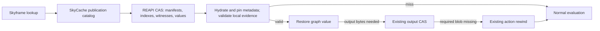

# Extend SkyCache with REAPI-backed remote storage

**Use REAPI CAS and ByteStream for immutable bytes, with a small SkyCache service for publication discovery and commit.** This reuses established remote-cache infrastructure while preserving SkyCache's multiple candidates, dependency validation and deferred output downloads. An implementation using only standard REAPI RPCs is possible for restricted publication exchange, but ActionCache does not supply equivalent discovery, concurrency or retention semantics. The design below follows `JSGette/bazel`, branch `jsgette/master`, pinned at `4b32ccc188fcf3bddee221c5c737e18da393031b` on 25 October 2026. It incorporates the latest large-tree proposal without presenting its compact witnesses, segmented packs or selective validation as implemented features. All protocol messages and delivery steps below are proposals; this investigation changed no Bazel code and ran no tests. ([Pinned architecture proposal](https://github.com/JSGette/bazel/blob/4b32ccc188fcf3bddee221c5c737e18da393031b/docs/jsgette/skycache-large-tree-proposal-2026-10-25.md))

## The latest architecture needs publications, not just blobs

The functioning prototype stores graph values and selected remote execution metadata in a shared **local filesystem**. `LocalAnalysisCacheClient` validates values through `LocalDependencyValidator` and `LocalInputSnapshot`; `LocalCacheSession` publishes sealed packs after successful builds and final input checks. Local leases and garbage collection preserve required parents. The published implementation patch corresponds to source tree `f6a4aaf7fafcf54b4e06097e1eddb2710a07c74d`; the newer branch commit contains the scaling proposal rather than an already deployed remote backend. ([Architecture](https://github.com/JSGette/bazel/blob/4b32ccc188fcf3bddee221c5c737e18da393031b/docs/jsgette/skycache-architecture-2026-10-25.md), [source provenance](https://github.com/JSGette/bazel/blob/4b32ccc188fcf3bddee221c5c737e18da393031b/docs/jsgette/measurements/skycache-windows-2026-10-25/source-provenance.json))

That proposal is the right remote format foundation. Its 237,112-target experiment produced 418,098 external/absolute witnesses requiring at least 77,546,670 bytes, beyond the 64 MiB manifest cap; 1,664,716 pack records also exceeded the separate million-entry limit. A remote protocol should therefore transfer small manifests, independently addressed witness blocks, bounded pack segments and lazy index pages. Merely uploading the existing monolithic files would preserve both capacity problems and impose unnecessary network transfers. ([Large-tree diagnosis and proposed layout](https://github.com/JSGette/bazel/blob/4b32ccc188fcf3bddee221c5c737e18da393031b/docs/jsgette/skycache-large-tree-proposal-2026-10-25.md))

**A SkyCache fingerprint is not a CAS digest.** Selected entries use a fingerprint of frontier-version data plus the serialized `SkyKey`; their bytes contain an analysis/execution tag, dependency root and serialized value. The same logical key can have different values in different publications. The current store accepts arbitrary key/value bytes and separately checks value integrity. Replacing `put(fingerprint, value)` with a CAS upload under that fingerprint would violate the CAS contract. Preserve an explicit logical-key-to-content mapping and continue trying candidates after a stale or malformed one. ([Implementation patch](https://github.com/JSGette/bazel/blob/4b32ccc188fcf3bddee221c5c737e18da393031b/docs/jsgette/measurements/skycache-execution-metadata-2026-10-25/implementation-current.patch))



## Two catalog operations supply the missing semantics

The catalog is an authenticated, append-only set of immutable publications within a compatibility namespace. It neither executes actions nor interprets Java `SkyValue` payloads. Each configured catalog scope binds one authorized metadata CAS authority, `instance_name` and digest function; manifests cannot redirect reads to arbitrary endpoints. The first profile should require advertised SHA-256 support and identity transport, with compression optional. This is a SkyCache profile requirement, not a claim that every REAPI server supports SHA-256.

Keep four identifiers distinct. `namespace_id` is SHA-256 of a canonical compatibility descriptor; logical keys retain their existing fingerprint/key-byte representation; `Digest{hash,size_bytes}` identifies exact CAS bytes; a publication is identified by its immutable manifest digest. The namespace descriptor includes protocol and key-format versions, serializer/codec identity, required byte order, effective environments/configuration context, repository-sharing identity and authorized output-store identity. Do not remove fields already covered by serialized keys until that coverage is audited. Download policy remains excluded so `minimal` and `toplevel` can share execution metadata. ([Current namespace and download behavior](https://github.com/JSGette/bazel/blob/4b32ccc188fcf3bddee221c5c737e18da393031b/docs/jsgette/skycache-architecture-2026-10-25.md))

The following is illustrative pseudo-proto. The v1 deployment configuration must fix maximum message, string, reference, decoded-byte and traversal limits; REAPI capabilities do not advertise these custom catalog limits. `Digest` is the standard REAPI message; all referenced blobs use the fixed CAS scope and algorithm.

```proto
message Scope {
  string instance_name = 1;
  bytes namespace_id = 2;          // 32-byte compatibility-descriptor hash
  uint32 protocol_major = 3;      // 1 for this profile
}
message PublicationRef {
  Digest manifest = 1;            // immutable publication identity
  uint64 catalog_sequence = 2;    // insertion order within this scope
}
message DiscoverRequest {
  Scope scope = 1;
  uint32 page_size = 2;           // zero selects default; server clamps maximum
  bytes page_token = 3;
  bytes revision_hint = 4;        // ordering hint; never validity evidence
}
message DiscoverResponse {
  repeated PublicationRef candidates = 1;
  bytes next_page_token = 2;
}
message CommitRequest {
  Scope scope = 1;
  Digest manifest = 2;
  bytes idempotency_key = 3;
  bytes revision_hint = 4;
}
message PublicationManifest {
  uint32 format_version = 1;
  bytes namespace_id = 2;
  bytes codec_identity = 3;
  Digest key_index_root = 4;
  Digest owned_objects_directory = 5;
  Digest witness_directory = 6;
  Digest root_binding_dictionary = 7;
  repeated Digest parent_manifests = 8; // bounded direct-parent list
}
service SkyCacheCatalog {
  rpc DiscoverPublications(DiscoverRequest) returns (DiscoverResponse);
  rpc CommitPublication(CommitRequest) returns (PublicationRef);
}
```

`DiscoverPublications` returns publications, not one result per logical key. Clients inspect their bounded indexes, batching independent reads. The first request pins a catalog high-water sequence and ordering: matching revision hints first if supported, then descending sequence, with deterministic tie-breaking. An opaque authenticated token binds that snapshot, ordering, namespace, principal/access scope and query fields. Later commits cannot move existing candidates between pages or starve older candidates. Deletions may remove candidates; they must not duplicate or reorder survivors. Malformed/mismatched tokens return `INVALID_ARGUMENT`; expired tokens return `FAILED_PRECONDITION`, requiring discovery to restart. Discovery is bounded by page size and a client invocation budget; reaching that budget causes normal evaluation. A future batched logical-key lookup is an optimization, not part of this minimum.

`CommitPublication` checks authorization, fetches the manifest, verifies its hash and size, and validates the bounded envelope, compatibility and namespace before atomically inserting its catalog row. A missing manifest returns `FAILED_PRECONDITION`, corrupt fetched bytes `DATA_LOSS`, and malformed requests/manifests `INVALID_ARGUMENT`. Readers see either no row or the complete row. Concurrent publishers append independent candidates. Deduplicate live entries by scope and manifest digest, retaining the original sequence and ranking hint and ignoring alternate hints on duplicate insertion. Within the documented retry-retention window, the same principal/scope/idempotency key and request returns the original sequence; reuse for a different manifest or hint returns `ALREADY_EXISTS`. Retain the idempotency binding through that window even if the publication is evicted. Catalog retention can bound candidate count/age, with discovery explicitly best effort.

The manifest references bounded, canonical index and directory pages. Index leaves map full logical key bytes to either a record in a digested block or an explicit `(parent manifest digest, logical key)` import. Each block contains record keys, types, lengths and payloads; verify all of them before decoding. Internal fingerprint references resolve through the **originating publication's immutable index**, including its exact imports. A missing dependency must never be filled from an arbitrary newer candidate. Reject conflicting mappings, reference cycles, excessive parent depth and unsupported formats. The objects directory inventories owned metadata blobs without requiring the catalog to deserialize Java objects; bounded directory pages avoid recreating a giant manifest.

Witness blocks use binary hashes, explicit missing/not-directory states, root dictionaries and relative path components while preserving repository bindings, modes, directory membership, negative lookups and symlink/path-resolution operations. Give each independently fetched page/block its own CAS digest. A pack segment can group records for efficient transport, but a ByteStream range does not authenticate itself against a whole-pack digest. Either fetch and verify the complete bounded segment, or verify each range against a digest committed by a verified index. Independently digested blocks are the simpler first design. Compression must preserve separate encoded and decoded limits. ([Witness and segment proposal](https://github.com/JSGette/bazel/blob/4b32ccc188fcf3bddee221c5c737e18da393031b/docs/jsgette/skycache-large-tree-proposal-2026-10-25.md), [ByteStream range contract](https://github.com/googleapis/googleapis/blob/9415ba048aa587b1b2df2b96fc00aa009c831597/google/bytestream/bytestream.proto#L111-L140))

## Upload, validation and retention have separate contracts

A writer builds in a private local session, seals immutable blocks and constructs the manifest. It ensures that its metadata graph, including required inherited metadata, has been uploaded, using `FindMissingBlobs`, batched uploads or ByteStream. Check every batch item's status and completed stream, not merely RPC success. Reused metadata can remain in explicit parents or be copied into a self-contained publication. Upload the manifest after children. **Recheck the source snapshot and all used input/parent evidence immediately before commit**, after potentially lengthy uploads, and commit only a successful build. Abandoned uploads leave unreachable objects for normal CAS eviction. The final check retains the prototype's stable-input assumption; it does not create a transactional filesystem snapshot or prove that files cannot change between the check and RPC. ([Existing admission rules](https://github.com/JSGette/bazel/blob/4b32ccc188fcf3bddee221c5c737e18da393031b/docs/jsgette/skycache-architecture-2026-10-25.md), [CAS upload semantics](https://github.com/bazelbuild/remote-apis/blob/c2c07e3d718d3d490a4958344d9c3e47de0bfaf3/build/bazel/remote/execution/v2/remote_execution.proto#L271-L439))

A reader first checks namespace compatibility, then fetches verified manifests and only the index pages needed for its logical keys. It fetches the selected value's complete **metadata** closure: serialized referenced objects, dependency records, required parents, root bindings and witnesses. Stage and pin that closure in the local leased store before exposing the value to Skyframe. Every mandatory metadata reference must resolve and pass digest, format, parser and work-budget checks. A missing, corrupt, incompatible or source-stale candidate is rejected; older candidates remain eligible. Batching and invocation-local memoization reduce round trips without making validation optional.

Initially preserve today's global external-witness admission checks, even when blocks are fetched lazily. The latest proposal's selective admission is a separate correctness change: move repository binding and complete path/symlink evidence into every affected value's dependency closure before removing the global guard. An unchanged file at an absolute shared-cache path does not prove that the logical repository still resolves there. Register evidence actually reused for the writer's final revalidation. A Git revision, old Merkle root or directory timestamp never substitutes for fresh validation of mutable inputs. ([Selective-validation prerequisites](https://github.com/JSGette/bazel/blob/4b32ccc188fcf3bddee221c5c737e18da393031b/docs/jsgette/skycache-large-tree-proposal-2026-10-25.md))

Cross-clone sharing needs an explicit namespace migration. The current Git common-directory/real-workspace identity intentionally separates independent clones. Replace that local identity only with an administrator-configured repository-sharing identity, plus verified workspace/repository root bindings and an audit of serialized absolute paths. Arbitrary external paths require verified root mappings, a trustworthy immutable identity or rejection from portable reuse; string replacement is insufficient. Preserve environment, configuration and output-store compatibility. Endpoint aliases are interchangeable only when configured to identify the same authorized output tenant, instance and digest namespace. A complete serializer/cross-clone audit has not been performed; cross-OS codec/path portability also remains unproved. ([Current sharing boundary](https://github.com/JSGette/bazel/blob/4b32ccc188fcf3bddee221c5c737e18da393031b/docs/jsgette/skycache-architecture-2026-10-25.md))

**Commit atomicity concerns visibility, not a transaction over CAS blobs.** Ordinary REAPI offers no portable recursive pin for references hidden inside SkyCache metadata. A successful upload, existence check or catalog commit cannot prevent subsequent eviction. In the initial best-effort profile, incomplete metadata means a candidate miss; already hydrated local closures remain protected by local leases. A stronger optional lease can cover manifest, blocks, segments and transitive parents only if the catalog's backend can actually pin them against GC. A lease row in an unrelated database is insufficient. Flattening bounded parent closures can reduce dependency-chain fragility. ([REAPI retention guidance](https://github.com/bazelbuild/remote-apis/blob/c2c07e3d718d3d490a4958344d9c3e47de0bfaf3/build/bazel/remote/execution/v2/remote_execution.proto#L324-L358))

Output bytes follow the existing, different contract. Leave their digests opaque inside execution values; do not expose them as SkyCache `ActionResult.output_files`. A valid execution hit still skips ordinary action-result lookups and blanket output-existence checks. `minimal` fetches only subsequently needed bytes; `toplevel` fetches requested outputs/runfiles. Missing required blobs trigger existing rewind, which must blacklist the same stale execution candidate for that invocation; unused missing intermediates require no recovery. Source-validation failure is a miss, never something rewind repairs. Preserve `--noremote_accept_cached` behavior. ([Execution reuse and recovery](https://github.com/JSGette/bazel/blob/4b32ccc188fcf3bddee221c5c737e18da393031b/docs/jsgette/skycache-architecture-2026-10-25.md))

Retry transient `UNAVAILABLE` failures with bounded backoff and `RetryInfo`; resume interrupted large writes using `QueryWriteStatus`. If resumption is unsupported or the upload was forgotten, restart under a new upload resource within the retry budget; content addressing makes this safe. Missing metadata is expected cache failure; malformed bytes, incompatible formats, `PERMISSION_DENIED` and quotas need distinct diagnostics even when evaluation continues locally. Authenticate catalog and CAS access, authorize writers by sharing scope, and isolate incompatible/trust domains. A valid digest proves bytes, not the producer's honesty or the truth of dependency assertions; `instance_name` and action salt are not authorization mechanisms. ([REAPI errors and retries](https://github.com/bazelbuild/remote-apis/blob/c2c07e3d718d3d490a4958344d9c3e47de0bfaf3/build/bazel/remote/execution/v2/remote_execution.proto#L141-L196), [Bazel remote-cache writer guidance](https://bazel.build/remote/caching))

## REAPI can supply all transport, but not all semantics

The researched stable release is **v2.12.0**; pinned main `c2c07e3d718d3d490a4958344d9c3e47de0bfaf3` includes changes documented for v2.13. The proposed minimum uses long-established cache APIs and does not require v2.12 or remote execution. Negotiate actual endpoint versions, algorithms, compression and size limits with `GetCapabilities`. Optional v2.12 `SplitBlob`/`SpliceBlob` and main's v2.13 streaming chunk APIs are transfer optimizations, not prerequisites or substitutes for witness validation. ([Stable release](https://github.com/bazelbuild/remote-apis/releases/tag/v2.12.0), [pinned capabilities and chunk APIs](https://github.com/bazelbuild/remote-apis/blob/c2c07e3d718d3d490a4958344d9c3e47de0bfaf3/build/bazel/remote/execution/v2/remote_execution.proto#L443-L648))

| SkyCache responsibility | Reuse available | Remaining SkyCache contract |
|---|---|---|
| Immutable metadata bytes | CAS, ByteStream, digests, batching, compression | Bounded formats and reference graph |
| Candidate discovery/publication | No equivalent CAS operation | Catalog, multiple versions, pagination, idempotency |
| One known immutable publication | Restricted ActionCache adapter or caller-supplied CAS digest | Discovery outside that entry; local validation |
| Named manifest association | Optional Remote Asset Push/Fetch | Qualifier profile, discovery and concurrency policy |
| Metadata lifetime | Server-specific CAS retention | Best-effort misses or real backend-supported pins |
| Source validity and output recovery | Existing Bazel/SkyCache logic | Preserve witnesses, compatibility and rewind |

For an all-standard REAPI adapter, construct an actual canonical `Action` and `Command`, upload both, and use the **Action's actual digest** for `GetActionResult`/`UpdateActionResult`. The command declares a fixed output such as `skycache/manifest`; its result points to the manifest blob as an `OutputFile`. A genuinely reproducible immutable profile includes a deterministic content descriptor and all inputs required to produce that manifest/bundle in the action input root. Clients must already know that descriptor or receive it from CI/discovery. Canonical serialization, key format and adapter version prevent different descriptor encodings from accidentally aliasing. Arbitrary SkyKey hashes are not valid substitutes for Action digests. ([ActionCache requirements](https://github.com/bazelbuild/remote-apis/blob/c2c07e3d718d3d490a4958344d9c3e47de0bfaf3/build/bazel/remote/execution/v2/remote_execution.proto#L141-L196), [Action and Command](https://github.com/bazelbuild/remote-apis/blob/c2c07e3d718d3d490a4958344d9c3e47de0bfaf3/build/bazel/remote/execution/v2/remote_execution.proto#L652-L927))

A stable synthetic Action keyed only by namespace/logical key can instead carry a changing candidate-list manifest. That is an application-specific transport convention, **not equivalent hermetic-action semantics**. AC has one result per action digest, no listing and no compare-and-swap. Concurrent read/modify/write updates lose candidates; deterministic revision slots require prior revision knowledge; bounded slot rings have collisions and overwrite alternatives. Serialization of writers or external discovery supplies missing behavior, but then the protocol is no longer an independent replacement for the catalog. Corruption safety still comes from validation; these limitations primarily reduce discovery and hit rate.

An AC server only understands standard result references. A manifest-only result hides its transitive metadata dependencies. Expose metadata bundles through declared outputs or a standard output `Tree`, make a complete self-contained bundle, or accept client-handled missing descendants. Real servers check output completeness, so one missing exposed bundle can invalidate the entire synthetic result. Never enumerate ordinary execution outputs there: that would restore eager output checks and undermine SkyCache's deferred recovery. Inline result fields are unsuitable as an opaque manifest store because servers may return equivalent modified results. The adapter also makes metadata `GetActionResult` calls; its benefit is avoiding ordinary execution-action lookups, not literally eliminating all AC traffic. ([ActionResult contract](https://github.com/bazelbuild/remote-apis/blob/c2c07e3d718d3d490a4958344d9c3e47de0bfaf3/build/bazel/remote/execution/v2/remote_execution.proto#L1243-L1530), [Buildbarn completeness checking](https://raw.githubusercontent.com/buildbarn/bb-storage/main/pkg/blobstore/completenesschecking/completeness_checking_blob_access.go))

Remote Asset's URI/qualifier-to-digest association is a cleaner named-manifest abstraction, but Push support is optional and expiration/reference hints do not establish candidate discovery, conditional updates or strict retention. CAS-only exchange with an externally supplied publication digest is the smallest interoperability experiment. Neither alternative provides complete transparent remote SkyCache semantics on its own. ([Remote Asset contract](https://github.com/bazelbuild/remote-apis/blob/c2c07e3d718d3d490a4958344d9c3e47de0bfaf3/build/bazel/remote/asset/v1/remote_asset.proto#L350-L444))

## Implement storage first, then transport and selective reuse

First implement the proposed bounded format in `PackedFingerprintValueStore` and `LocalCacheSession`, updating `LocalCacheLeaseManager` and `LocalCacheGarbageCollector` together. Preserve existing validation, isolate the new format namespace and retain old caches for fallback. Gate this on publication of the retained large scopes, bounded writer/index memory, interrupted sealing and concurrent readers/writers with GC. The relevant local classes are under `src/main/java/com/google/devtools/build/lib/skyframe/serialization/local/`. ([Inspected source locations and delivery order](https://github.com/JSGette/bazel/blob/4b32ccc188fcf3bddee221c5c737e18da393031b/docs/jsgette/skycache-large-tree-proposal-2026-10-25.md))

Then add a remote store/session behind the existing fingerprint-value and analysis-cache interfaces, retaining `LocalAnalysisCacheClient`'s candidate-validation behavior and configuring it through `LocalSkycacheModule`/`LocalSkycacheOptions`. Implement the two-RPC catalog and REAPI read-through hydration without changing execution-value semantics. Gate on duplicate commit retries, concurrent publishers, stable pagination, stale-newest/valid-older candidates, wrong-scope reads, partial uploads, parent eviction, corrupt blocks, bounded decompression and metadata disappearance between discovery and hydration. Test actual target cache servers; no compatibility experiment has yet been run.

Audit namespace and codec relocation before enabling independent-clone sharing. Then migrate repository-binding evidence in `LocalInputSnapshot` and `LocalDependencyValidator`, enabling selective validation only after equivalent evidence is demonstrated. Gates must cover repository rebinding, ignored/untracked changes, modes, directory membership, negative lookups, symlink resolution and unrelated-subtree changes. Separately test required versus unused output eviction, `minimal`/`toplevel`, cache-disabled execution and rewind's stale-candidate exclusion. Existing validator limits can still cause conservative misses; distinguish required traversal bounds from optional memoization capacity. ([Validation migration requirements](https://github.com/JSGette/bazel/blob/4b32ccc188fcf3bddee221c5c737e18da393031b/docs/jsgette/skycache-large-tree-proposal-2026-10-25.md))

Measure metadata bytes, RPC count, candidate attempts, witnesses checked, peak memory and cold/warm elapsed time before choosing block sizes, concurrency or compression defaults. Existing local measurements establish neither remote speedup nor cross-host portability. The deployment decisions still open are the actual endpoint's capabilities and retention integration, the trusted repository-sharing identity, and measured resource budgets. Keeping publication semantics separate from the REAPI data plane lets those decisions evolve without changing Skyframe's correctness boundary.
