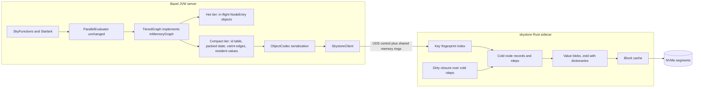
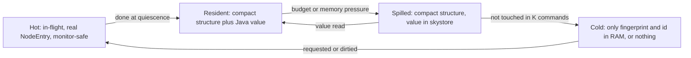

# Tiered Skyframe Engine

Java hot plane + Rust "skystore" sidecar on SSD. Drop-in replacement for
Skyframe's in-memory graph so the rest of Bazel sees no difference.

**Status (2026-10-19):** The optional [skystore implementation](../../tools/skystore/README.md)
has Rust/Java IPC, checksummed disk value storage, rules_rs builds, and an
experimental `tiered_idle` integration. That integration retains the graph in
Java and restores all detached glob values before each command. It is an
intermediate storage experiment, **not this document's disk-backed graph**.
Its completed profiles do not measure demand paging.

The first demand-paged graph core is now implemented as `DiskBackedGraph`: it
uses stable Java handles, an explicit completed-node residency limit, and full
cold records containing values, both versions, dependency groups, and reverse
edges. It passes the existing evaluator contract with supported values evicted
between operations, and a Linux test pages records through the rules_rs-built
Rust process. The opt-in `tiered_genrule` command mode now pages audited native
genrule action nodes during real builds. Broader codecs, byte-level residency
accounting, and production-scale storage remain pending.
Decisions locked 2026-10-16; disk-backed graph acceptance clarified 2026-10-19.

## Implemented graph-core checkpoint (2026-10-19)

- The evaluator accepts an alternative graph through a constructor; defaults
  remain unchanged. Change-pruning dependencies and last-evaluation versions
  are exposed through the node interface rather than a concrete-class cast.
- A node handle survives eviction. Completed eligible nodes are stored on disk;
  dirty/evaluating nodes and unsupported value types stay resident. Per-entry
  operation locks exclude eviction while an operation is using its delegate.
  Storage I/O runs outside the original node monitors.
- Records carry a format version, stable record ID, last-change/last-evaluation
  versions, dependency group boundaries, reverse edges, value bytes, and CRC32C.
  A write must succeed before the live delegate is released. Missing, corrupt,
  or unavailable authoritative records fail the operation.
- Keys, state and version scans, and graph cleanup do not page in cold nodes.
  A weak value reference preserves identity while a caller still holds the
  original value. Production codecs must additionally preserve shared nested
  sets, artifacts, configurations, and mutable action state.
- Statistics distinguish resident, pinned, and cold node counts and record
  page-ins, evictions, and logical bytes read/written. These are **not physical
  SSD I/O counters or heap-byte measurements**.
- The current budget counts eligible completed nodes, not bytes. Handles,
  keys, versions and a key-ID dictionary remain resident; deleted dictionary
  entries and obsolete Rust records need future compaction. The store is still
  ephemeral and retains the prototype capacity limits. Pooled label interning
  is disabled for this alternative graph to avoid I/O under interner locks.

Linux validation through Cache & Carry:

- Complete Skyframe suite: **1,640 test records, 1,634 passed, 6 skipped**.
  This includes 177 graph/evaluator cases using disk records and forced eviction.
- Real Rust graph integration: **3 passed**, including a 32-node graph with a
  two-node resident limit, concurrent reads/edge updates, missing records, and
  process death. The test uses audited glob values; it does not prove action
  value serialization.
- Existing idle-tier, Rust unit/Clippy/rustfmt, Java client and IPC integration
  targets passed. `//src:bazel-dev` built successfully.
- Corruption tests include a same-length payload change, and the graph tests
  cover grouped edges, reverse-edge races, change pruning, cold dependency
  changes, unsupported/active pinning, write failure, and disjoint working sets.

Reproduce the focused tests:

```sh
bazel test --config=efcache --bes_backend= --jobs=4 \
  //src/test/java/com/google/devtools/build/skyframe:DiskBackedGraphTest \
  //src/test/java/com/google/devtools/build/skyframe:DiskBackedMemoizingEvaluatorTest \
  //src/test/java/com/google/devtools/build/lib/skyframe/tiering:SkystoreGraphTest
```

## Native genrule demand paging (2026-10-19)

A source-built Bazel can now select the graph during real analysis and execution:

```sh
bazel --output_base=/absolute/separate/output-base build \
  --experimental_skyframe_engine=tiered_genrule \
  --experimental_skyframe_resident_nodes=32 \
  --experimental_skystore_binary=/absolute/path/to/skystore \
  //your:target
```

The allowlist is deliberately exact: native `GenRuleAction` in
`RuleConfiguredTargetValue`, with one action and no input discovery. Other
actions and values, errors, event wrappers, and in-flight nodes remain pinned.
This is a working action-paging slice, **not full action-type coverage or a
byte-bounded production engine**. The resident limit counts eligible node
delegates, not objects still held by external callers, pinned values, metadata,
or the operating system page cache.

The local codec retains transitive-package metadata, action/target aliasing,
canonical configuration identity, and weakly interned artifacts. Shared nested
sets use fingerprint-addressed chunks in the Rust store. Configuration and
BuildOptions references remain pinned for an evaluator generation. Remote
analysis-cache substitutions and enhanced Starlark action codecs are excluded.
Missing chunk reads complete their shared futures exceptionally; repeated
readers cannot become stuck on an unresolved future.

Each evaluator generation owns a fresh Rust process, store, and codec scope.
Changing engines/limits/binary resets the evaluator; a dead process detected
between commands rebuilds the graph. Clean, state dropping, interruption, and
tracking-mode changes are supported. Storage startup failure falls back to an
ordinary graph and retries on the next command. Failure to read an authoritative
record during evaluation fails closed. Discarding analysis values and remote
analysis caching disable this experiment; the remote **action** cache remains
supported. Files are ephemeral, without cross-server persistence or compaction.

`OUTPUT_BASE/skyframe-tiering.json` reports enabled status, resident/pinned/cold
nodes, logical node I/O, chunk reads/writes, pinned configuration count, and the
sidecar PID. Switching back to `inmemory` clears stale enabled statistics.

Linux validation includes the native codec's actual Rust chunk round trip,
forced cold shared-cache reads, repeated missing-chunk failure, 28 real-command
checks (including action-key inspection), and five lifecycle checks. The common
vanilla command matrix verifies output digests and action keys; independent
graph/evaluator tests force eviction between completed operations. The
[measurement report](measurements/skyframe-lazy-genrule-linux-2026-10-19.md)
records the measured scope and remaining limitations.

## Required outcome: graph on disk, bounded working set in RAM

The objective is to stop retaining the full action/Skyframe graph in RAM.
This is separate from Bazel's action-result cache and CAS: Cache & Carry can
accelerate builds, but using it does not move the Skyframe graph out of Java.

- Rust owns cold node records, values, direct edges, and reverse edges on SSD.
  Neither the JVM nor the Rust process may keep a second full decoded graph.
- RAM holds compact lookup/state metadata, active evaluation state, explicitly
  accounted pinned objects, and a cache with an enforced residency budget.
  A key/proxy object for every node is still memory that must be measured.
- Graph access loads only the needed records/chunks, with bounded prefetch.
  Starting a command, enumerating keys, inspecting versions, or shutting down
  must not trigger whole-graph rehydration.
- Eviction preserves versions, dependency groups, reverse-edge consistency,
  change pruning, interning, and action identity. Active readers must retain
  valid objects until they finish. Disk I/O must not occur under node monitors.
- Unsupported values remain explicitly pinned until audited lossless codecs
  exist; report their count and retained bytes. A run that keeps the action
  graph resident cannot be presented as achieving the disk-backed objective.
- The comparison must use a stored graph larger than its resident cache,
  revisit small and disjoint working sets, and cover edits that dirty cold
  dependencies. Report total JVM-plus-Rust memory, pinned/active/cache bytes,
  pages and bytes read, hit/miss/eviction counts, latency, CPU, and output
  equivalence against vanilla.
- Separate warm filesystem-cache reads from cold disk reads and verify the
  latter with I/O counters. In WSL, guest page-cache eviction alone does not
  prove physical SSD reads because host caching may still satisfy them.
  Include filesystem-cache memory when assessing whole-machine savings.

The initial idle experiment does not satisfy these acceptance conditions.
A faster idle spill/restore loop or a lazy glob-only value proxy is not a
substitute for the graph-storage implementation.

### Implementation constraints confirmed in the current tree

The existing analysis-cache codecs require a local-graph audit before reuse.
`RemoteConfiguredTargetValue.codec()` substitutes remote value classes and
omits transitive-package state. `ActionExecutionValue` decoding introduces
`DeserializedSkyValue` markers with separate invalidation behavior.
`ModuleCodec` can require Skyframe dependencies while decoding. A successful
lookup in the registry is not proof of lossless support: its default fallback
can reconstruct objects through `DynamicCodec`.

Use the Phase 1 factory/maintenance seams and conformance work below before
switching graph representations. Audit codec identity and invalidation contracts
alongside the lazy graph, then benchmark that implementation.
**Tracks:** engine phases 0–8 + parallel Track V (Java value-layout wins).

## Verdict

- **Rust over sockets works for the cold/storage plane, not the hot evaluation
  plane.** An SSD read (~50–100 µs) dwarfs a Unix-domain-socket round trip
  (~5–15 µs). On the hot path every dep registration, doneness check, and
  parent signal would turn a ~1–3 µs in-process op into an RPC.
- **Recommended shape: split-plane.**
  - Java keeps scheduling and node state for in-flight and resident nodes,
    using the existing `ParallelEvaluator` through the already-public
    alternative-graph extension point.
  - A Rust sidecar ("skystore") owns everything cold: spilled values, cold
    edges, the key index, invalidation closure, compaction, compression, and
    persistence.
- **The DAG stays as the semantics. The representation changes:** dense int
  IDs, columnar node state, compressed frozen edges, reverse deps demoted to
  SSD.
- **Biggest unknown: values, not edges, likely dominate heap.** Prior
  measurement on ~205k nodes found node entries at ~7.8 MB and compressed dep
  arrays at ~19 MB; total heap was not attributed. Phase 0 must measure the
  split before committing — value spilling needs codecs for every spilled type.
- **Zabel (dzbarsky's Zig rewrite) supports this split rather than
  contradicting it.** Its wins come from owning the whole stack (Starlark
  compiler, value row layouts, native rules), which an engine swap under Java
  SkyFunctions cannot reach. Its reported memory wins are value-layout wins —
  hence parallel Track V in Java.

## Why not the whole engine in Rust

Estimates to validate in the Phase 0 IPC spike:

- **Throughput.** A large analysis is ~10^7 node evaluations with ~2–3 engine
  interactions each → ~3×10^7 cross-process round trips (hundreds of
  CPU-seconds of syscalls) versus tens of seconds of engine overhead today.
- **Semantics split across processes.** Values, keys, `ErrorInfo`, event
  NestedSets, and `SkyKeyComputeState` are Java objects.
  - Change pruning calls Java `equals`.
  - nokeep_going error bubbling re-enters SkyFunctions.
  - The atomic `addReverseDepAndCheckIfDone` / `setValue` pair would become a
    cross-process transaction. Today that is ~47 `synchronized` sites in
    `IncrementalInMemoryNodeEntry` and `AbstractInMemoryNodeEntry`.
- **A separate process does not save machine RAM by itself.** Only the compact
  representation and SSD tiering do.
- **Bootstrap constraint.** Bazel builds from source with only a JDK and a C++
  compiler. `rules_rs` builds the optional sidecar separately. A
  bootstrap build runs the in-process compact graph from Phase 2.
- **Role of C.** No hand-written C. C libraries (zstd, liburing) are linked into
  the Rust sidecar.

## Zabel: dzbarsky's Zig rewrite of Bazel

### What it is

- From-scratch Zig reimplementation of Bazel by hermeticbuild (David Zbarsky).
- Source is private (`hermeticbuild/zabel` → 404). Binaries for Linux and macOS
  (aarch64 and x86_64) are at `hermeticbuild/zabel_releases`: v0.0.1
  (2026-07-27) through v0.0.8 (2026-09-06). No Windows build.
- Work visible since at least March 2026.

### Architecture (from release notes)

- **Engine.** Modeled on Buck2's DICE ("DICE action and configured-owner
  publications", "producer-owned DICE values"). Changes repeatedly advertised
  as adding "no additional DICE dependencies" — edge count treated as a cost.
- **Values.** Fixed-size "retained rows" with explicit byte budgets:
  provider-builder field rows 72 → 32 bytes; "bounded 64-byte retained rows";
  "no common retained-row growth".
- **Volatility.** Typed "projections": stable 29 and volatile 30 feed execution
  31, so volatile changes don't invalidate actions.
- **FS dependencies.** First-class FILE/DIR/ENOENT "observations".
- **Starlark.** Own bytecode compiler with registers and immutable compiled
  programs; SIGPROF sampling profiler.
- **Native.** gRPC/HTTP2, REAPI, BES, async CAS; some rules reimplemented
  (CppCompile, genrule, config_setting, platform).
- **Incrementality.** `build --watch`: LLVM C-source rebuild 10.5 s → 1.7 s;
  unchanged BUILD rebuild 6.1 s → 0.11 s. Shared on-disk caches under
  `~/.cache/zabel` (registry, repository, ActionCache, CAS) and cross-process
  leases; no persisted analysis graph, no server daemon.
- **Compatibility.** Checked against a "pinned source-built Bazel oracle" via
  aquery action keys and label-order checksums.

### Reported wins (value-layout and interpreter)

- Rule attribute defaults once per rule declaration: −14.5% median peak RSS,
  −8.4% wall time on LLVM loading queries.
- Provider rows 72 → 32 bytes.
- Starlark evaluation: −10% to −17% retired instructions.

### Back-ports into Java Bazel

- `dzbarsky/bazel` fork carries `codex/*-upstream` branches: frozen
  provider-dict compaction, schema sharing for schemaless structs, weakly
  interned configuration matchers, runfiles path interning, compact option
  metadata, allocation cuts.
- Reusing repository mappings: −1.85% allocations on a 140k-root analysis.
- One branch landed upstream as `ce3c4f298e` (pre-sized dirty dependency sets).

### What we take

- **Phase 0 comparison (approved).** SHA256-verified v0.0.8 binary in an
  isolated directory; LLVM via hermetic-llvm and BuildBuddy workloads; peak
  RSS, wall time, incremental rebuilds next to Bazel.
- **Phase 1 oracle checks.** aquery action keys and output digests, not only
  Skyframe values.
- **Phase 2 layout discipline.** Per-kind row layouts with byte budgets,
  "retained bytes per node" CI metric, edge count as a cost.
- **Track V.** Value-layout work in Java, coordinated with dzbarsky's open
  branches so we don't duplicate them.

### What we cannot take

- Source is private.
- Not drop-in: no Windows; native rules reimplemented piecemeal; documented
  unsupported cases (configurable native `exec_properties`, nonempty legacy
  environment constraints).
- Gains depend on replacing the Starlark interpreter and the value model,
  which the drop-in constraint rules out.

## Target architecture



Residency tiers — non-destructive "sliding window". Unlike Skyfocus, cold
nodes stay incremental and verifiable.



## Data-structure verdict ("better than a DAG?")

**Keep (semantic contract):**

- Memoized calls with dynamically discovered, grouped dependencies.
- Order-sensitive dependency groups; within-group contents order-insensitive.
- Versions with change pruning; cycles are errors.

**Change (representation):**

- Dense `int` IDs instead of object pointers.
- One key table (removes duplicate key ref in CHM entry + node entry).
- Packed per-node state word + int `lastChanged` / `lastEvaluated` versions.
- Deps frozen on commit as sorted-per-group delta+varint in an append-only
  arena; mutable deltas merged at quiescence (LSM-style).
- RoaringBitmap for high-fan-in reverse deps (e.g. `PrecomputedValue`,
  configuration keys with millions of rdeps). Already a Bazel dependency
  (`org.roaringbitmap`, used in `LeafIdAssignment`).
- Hash-consed dependency groups only if Phase 0 shows duplication.

**Demote reverse deps to SSD.** Persisted rdeps are read only by invalidation,
deletion, and query `rdeps()`. In-evaluation rdeps stay in RAM.

**Rejected:**

- Pull-based Salsa-style verification with no rdeps — null/incremental builds
  become O(reachable graph) instead of O(changed cone). Phase 7 research item
  ("lazy dirtying").
- Graph coarsening / hypergraphs — change granularity SkyFunctions see; not
  drop-in.
- Datalog / differential dataflow — incompatible with imperative SkyFunctions.

## Compression plan (bake-off in Phase 0)

**Integer edges:**

- Java tier: group-sorted delta + LEB128 varint (KISS, ~1–2 bytes/edge with
  creation-order ID locality).
- Large rdep sets: Roaring.
- Skystore: evaluate Stream VByte, SIMD bit-packing, or Elias-Fano for cold
  segments; WebGraph-style ID renumbering (BFS / LPA) during compaction.

**Key strings (paths, labels):** FSST (DuckDB-style random-access string
compression) or front-coding in sorted key blocks.

**Serialized values — zstd tuning:**

- Per-`SkyFunctionName` trained dictionaries (main lever for small records).
- Level 1–3 on write path; recompress ~9–15 during background compaction.
  Decompression speed barely depends on level.
- Magicless frames (no frame checksum / content-size / dictID); checksums on
  blocks (crc32c / xxh3).
- Reused contexts and digested CDict/DDict.
- Long-distance matching only for large blobs.
- 16–64 KB blocks for co-written records.

**Alternatives to measure:**

- LZ4 + dictionary for a fast warm tier.
- OpenZL (Meta format-aware compressor) for columnar node segments.
- Content-addressed fingerprints (already dedupe change-pruned equal values
  across versions).

## Prior art

### Inside Bazel

- **Alternative-graph extension point.** `NodeEntry`, `DirtyBuildingState`,
  `CycleDetector`, `InMemoryGraphImpl` are public "for alternative graph
  implementations". `QueryableGraph` already has `Reason`, async batch gets,
  `prefetchDeps`, size limits.
- **Value tier.** Skycache serialization: `FingerprintValueStore`,
  `SkyValueRetriever`, `putSharedValue` for NestedSet sharing. OSS Bazel has
  only an in-memory store (TODO b/358347099).
- **Conformance / eviction.** `SkyframeEvictionTest` (June 2026 fuzz harness
  "for node eviction"). Abstract `MemoizingEvaluatorTest`, `GraphTest`,
  `InMemoryNodeEntryTest` are parameterized.
- **Lessons.** Skyfocus (deleted c9bdec481a) used destructive pruning and
  errored on changes outside the working set — avoid both.
  `HighWaterMarkLimiter` drops state where we would spill.
  `--heuristically_drop_nodes` + `NodeDroppingInconsistencyReceiver` show
  tolerated inconsistency.
- **Platform.** JDK 25 embedded with compact object headers; FFM available;
  zstd-jni and RoaringBitmap already dependencies.

### External

- Salsa: LRU-evicted values with kept dependencies; durability levels.
- Buck2 DICE: Rust, in-memory, no persistence.
- Zabel: Zig rewrite, DICE-style engine, row-based values (section above).
- Turbopack turbo-tasks: persistent task graph on disk.
- Pants: Rust engine in-process via FFI, LMDB store.
- Shake: persisted dependency database.
- Ray Plasma: UDS control + shared-memory data (IPC model we copy).
- Watchman / EdenFS: coarse-grained build daemons over UDS.
- RocksDB: per-file zstd dictionaries.

### Compatibility surface (drop-in contract)

SkyFunction-author API is interface-clean (`SkyKey` / `SkyValue` /
`SkyFunction.Environment` / `WalkableGraph` / `MemoizingEvaluator`). Hard
coupling is Bazel-on-Skyframe treating `MemoizingEvaluator.getInMemoryGraph()`
as a real in-memory store — ~16 production files (especially
`SkyframeExecutor`, `FrontierSerializer`, `DumpCommand`). A replacement must
either implement a full `InMemoryGraph` facade or refactor those points
(Phase 1).

## Phases

Each phase is a stack of atomic reviewable commits with a review gate.

### Phase 0 — Measure and spike (no behavior change)

- Heap attribution via `SkyframeMemoryDumper` extension: structure (entries,
  deps, rdeps, map nodes, keys) vs values, per `SkyFunctionName`.
- Working-set tracing over replayed commit history (bazel repo + one large
  client repo): per command, nodes read for value / version only / dirtied /
  recomputed.
- Codec coverage + compression bake-off on real values. Known gaps:
  `FileStateValue`, `DirectoryListingValue`, `BzlLoadValue`, driver values.
- Java↔Rust IPC microbenchmark: UDS vs shared-memory ring, batch get/put,
  Linux and macOS.
- Benchmark matrix: cold, null, leaf edit, BUILD edit, .bzl edit, flag change,
  server restart. Metrics: peak/retained heap, GC CPU, wall time.
- Zabel comparison (approved): SHA256-verified v0.0.8 in an isolated
  directory; LLVM (hermetic-llvm) + BuildBuddy; peak RSS, wall time,
  incremental rebuilds next to Bazel.
- **Exit:** decision memo with go/no-go per later phase.

### Phase 1 — Decouple Bazel from in-memory internals (upstream-friendly)

- Replace `getInMemoryGraph()` / `IncrementalInMemoryNodeEntry` casts with a
  narrow maintenance API: function-filtered enumeration, `getIfPresent`,
  `remove`, `clearValue`, `clearDirectDeps`, rdep surgery, dumps.
- ~16 production files: `SkyframeExecutor`, `SequencedSkyframeExecutor`,
  `FrontierSerializer`, `SelectedEntrySerializer`, `DumpCommand`,
  `FilesystemValueChecker`, `VendorCommand`, `LocalResourceUsageCollectors`.
- Evaluator factory seam via startup option
  (`SequencedSkyframeExecutor.createEvaluator`, `AbstractPackageLoader`).
- Reusable conformance suite; eviction fuzzer with page-in/out events +
  symmetry/version invariant checker; differential trace comparer (per-node
  value fingerprint, deps, versions).
- Oracle checks (Zabel-style): aquery action keys, label-order checksums,
  output digests must match the in-memory engine.

### Phase 2 — Compact in-process graph (Java; memory/GC win, no disk)

- ID index, columnar packed state (FFM `MemorySegment` vs `long[]`,
  benchmark-chosen), frozen varint deps arena, Roaring rdeps at quiescence.
- In-flight nodes stay real on-heap `NodeEntry` objects; hydrate on first
  touch, dehydrate when done at quiescence. Monitors only lock stable objects.
- Arena compaction at end of each command.
- Per-kind row layouts with byte budgets + "retained bytes per node" CI metric.
- **Exit:** conformance green; measured structure bytes/node and GC drop; ≤2%
  regression on null and incremental builds.

### Phase 3 — skystore sidecar (Rust)

- Launched by the server, one per output base, health check.
- Versioned binary protocol over UDS + memfd/shm rings; AF_UNIX on Windows 10+.
- Batch ops: `PutValues`, `GetValues`, `PutNodeRecords`, `GetNodeRecords`,
  `ComputeDirtyClosure`, `Checkpoint`, `Compact`, `Stats`.
- Storage: append-only segment log + fingerprint-addressed blobs. Bake off
  custom log vs fjall/redb.
- I/O: io_uring on Linux, pread thread pool elsewhere; block checksums;
  S3-FIFO or CLOCK-Pro block cache.
- Build: rules_rs, embedded in install base; optional in bootstrap.
- Failure: crash/corruption = cache loss; drop graph, recover from last
  checkpoint.

### Phase 4 — Value tiering (sliding window)

- Per-function residency: PIN (default until audited), SPILL, or DROP
  (recompute; only cheap deterministic hermetic functions).
- Spill between commands to fit `--skyframe_resident_heap_budget` (recency
  window of K commands).
- Spill within a command under memory pressure (instead of
  `HighWaterMarkLimiter` drops), only for done values with no in-evaluation
  readers.
- Page-in via `getBatchMap` / `getBatchAsync` with `Reason.PREFETCH`; never
  block inside monitors.
- Shared-value dedupe via fingerprints + weak cache of deserialized values;
  restore SkyKey/Label interning on eviction.
- Close codec gaps in Phase 0 priority order.
- Audit identity-sensitive values (actions held by executor side tables)
  before SPILL.

### Phase 5 — Structure tiering

- Persisted rdeps only in skystore. Invalidation → `ComputeDirtyClosure`; cold
  nodes marked dirty lazily, hydrate as `CHECK_DEPENDENCIES` on first touch.
- Then cold deps/versions and key-fingerprint index (~12–16 bytes/node in RAM,
  or on disk behind a Bloom filter).
- Dedicated resident file-state table so dirtiness checks without `--watchfs`
  stay fast.

### Phase 6 — Persistence across server restarts

- Crash-consistent checkpoint per command (WAL + atomic manifest swap).
- Validity stamp (install MD5, graph-affecting startup options, codec registry
  hash); mismatch → discard.
- Lazy reopen + dirtiness check. macOS: persisted FSEvents event id. Linux:
  full stat scan (today's non-watchfs behavior). Also check outputs; re-inject
  client env and precomputed values.
- Skystore as local L2 in front of remote Skycache (same codecs/fingerprints).

### Phase 7 — Evaluator performance (gated)

- Residency-aware scheduling: runnable once prefetched values are resident.
- Lazy dirtying: dirty only what the build requests.
- Optional in-process Rust codec via FFM if profiling demands it.

### Phase 8 — Rollout

- Flag: `--experimental_skyframe_engine=inmemory|compact|tiered`.
- CI shadow mode with differential comparer.
- BEP/profile metrics: page-ins, spill bytes, hit ratio, p99 page-in latency,
  resident bytes by function.
- Upstream engagement with Phase 0 data and Phase 1 PRs; align with upstream
  eviction and Skycache work.

### Track V — Value-layout wins in Java (parallel with Phases 1–8)

No engine dependency. Prioritized by Phase 0 heap attribution by value class.

Candidates proven by Zabel / dzbarsky branches:

- Rule attribute defaults once per rule class (Zabel: −14.5% peak RSS).
- Provider and struct field-row compaction.
- Depset topology sharing during provider freezing.
- Interning of configuration matchers and paths.

Check `dzbarsky/bazel` `codex/*-upstream` branches and open upstream PRs
before starting each item. Each win is an independent upstream PR.

## Invariants every phase must preserve

1. Atomic rdep registration + scheduling — each parent signaled exactly once.
2. Done iff has a value and no building state.
3. Dependency-group semantics and `DirtyType` (DIRTY / CHANGE / REWIND).
4. Version partial order and change pruning: equal value keeps `lastChanged`.
5. Restart, partial reevaluation, and Reset/rewind contracts.
6. keep_going vs nokeep_going error semantics.
7. Event replay and dedupe.
8. `ErrorTransienceValue` behavior.
9. SkyKey and Label identity interning across eviction.
10. Never evict in-flight or monitor-held entries.

## Key risks

- Values dominate and codec coverage is partial → engine-only gains capped.
  Phase 0 quantifies; PIN stays default.
- Identity-sensitive values and side tables — audit before SPILL.
- Sidecar crashes/corruption — treat as cache loss; checksums + kill −9 suite.
- rules_rs and bootstrap — sidecar optional.
- SSD write amplification — append deltas only; budget compaction.
- Divergence from upstream eviction work — engage early.

## Related local notes

- Sessions: `20261016_skyframe-graph-entry-ram-wins-scan`,
  `20261016_skyframe-withhashset-on-demand-toset`,
  `20261016_skyframe-memory-wins-after-withhashset`,
  `20261016_ssd-skyframe-prior-art-survey`,
  `20261016_skyframe-drop-in-compatibility-surface`.
- Plan file (Cursor): `tiered_skyframe_engine_993c2901.plan.md`.
