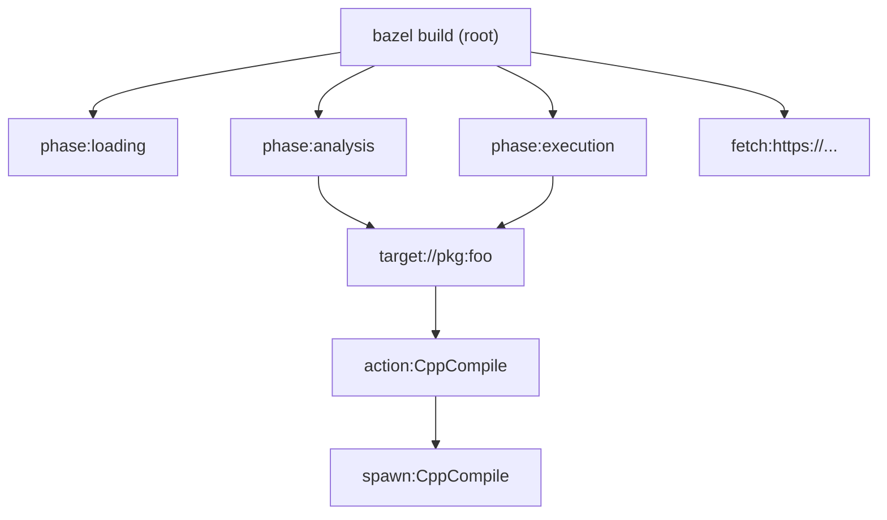

# OTel Trace Enrichment Plan

## Goal

Bring our in-process OTel traces in line with the level of detail that **bazel_conduit** achieves from BEP: richer phase and target spans, actions clearly linked under targets, fetches and other activities visible, and command-line context.

## Reference: What bazel_conduit extracts (from BEP)

- **Build**: `invocation_id`, `command`, `workspace`, options/command line, workspace status.
- **Phases**: Loading (pattern expanded), Analysis (targets configured), Execution, optional Metrics.
- **Targets**: Span from `TargetConfigured` to `TargetCompleted` with `label`, `kind` (rule class), `config_hash`, duration, outputs (via NamedSetOfFiles), success.
- **Actions**: Under target; `mnemonic`, `exit_code`, `primary_output`; sampled (e.g. failed + slow).
- **Fetches**: Not explicitly in the BEP design doc; NOTES mention lifecycle and repo fetch context.
- **Command**: `unstructuredCommandLine`, `options_parsed`, `structuredCommandLine`.

Our implementation uses the **EventBus** (not BEP), so we map the same concepts using the events that are actually posted to the EventBus.

---

## Current gaps

1. **phase:analysis** – Only `bazel.phase.name=analysis`. No target count, duration, or analysis metrics.
2. **Targets** – We create a target span in `TargetCompleteEvent` and end it immediately, so target spans have **zero duration** and no real “window” for children. We do store a context and use it as parent for actions/spawns, so the **hierarchy** (target → action → spawn) is correct in the trace, but target timing is wrong.
3. **Actions** – We only create action spans on **completion** (ActionExecutedEvent, ActionCompletionEvent, CachedActionEvent). We do not show **action start** or the lifecycle (cache check → schedule → run). Spawns are parented to target (or execution phase) but not to a dedicated “action” span that spans from start to finish.
4. **Fetches** – No spans for repository or HTTP fetches that happen before or during the build.
5. **Command** – No command-line or options on the build span.

---

## Planned changes

### 1. Richer phase:analysis span

**Events:** `AnalysisPhaseStartedEvent`, `AnalysisPhaseCompleteEvent` (already subscribed).

- **On start:** Add attributes to the analysis phase span (or build span):
  - `bazel.analysis.target_count` – number of labels from `event.getLabels()` (size of set).
- **On complete:** Before ending the phase span, set:
  - `bazel.analysis.duration_ms` – `event.getTimeInMs()`
  - `bazel.analysis.targets_configured` – from `event.getTargetsConfigured()` (total and/or configured-only as available)
  - `bazel.analysis.actions_constructed` – from `event.getActionsConstructed()`
  - `bazel.analysis.actions_by_mnemonic` – summary from `event.getActionsConstructedByMnemonic()` (e.g. key–count map or truncated string)
  - `bazel.analysis.cache_dropped` – `event.wasAnalysisCacheDropped()`

**Files:** `OTelSpanMapper.java` only. No new EventBus subscriptions.

---

### 2. Target spans with real duration and rule kind

**Problem:** Today we only see `TargetCompleteEvent`. Ending the target span in the same handler gives zero duration.

**Approach:** Use **TopLevelTargetAnalyzedEvent** to **start** a target span for top-level targets, and **TargetCompleteEvent** to **end** it. That gives a span from “analysis done” to “build done” (includes execution of that target’s actions). For non–top-level targets we only get `TargetCompleteEvent`, so we keep a single-event “instant” target span there.

- **Subscribe to `TopLevelTargetAnalyzedEvent`:**
  - Start a span `target:<label>`, parent = analysis or execution phase context (prefer execution if already started).
  - Store the span’s context in `targetContexts` keyed by label (so actions/spawns can use it as parent).
  - Optionally store the span itself in a map “open target spans” so we can end it later.
- **In `TargetCompleteEvent` handler:**
  - If we have an open target span for this label, **end** it and set attributes: success, exit code if any, rule kind if available from the event/configured target.
  - If we do **not** have an open span (non–top-level target), create the current “instant” target span and set the same attributes; still update `targetContexts` so any late actions can attach (or keep current behavior).
- **Target attributes to set (from event / ConfiguredTarget):**
  - `bazel.target.label`, `bazel.target.success` (existing)
  - `bazel.target.rule_kind` or `bazel.target.kind` – from `ConfiguredTarget` / event where available (e.g. rule class tag or target kind).

**Files:** `OTelSpanMapper.java`. Add dependency on events/modules that provide `TopLevelTargetAnalyzedEvent` (already on EventBus from `AnalysisPhaseRunner`). May need to add BUILD dep for `TopLevelStatusEvents` or the runner.

---

### 3. Actions linked to targets and full action lifecycle

**Problem:** Action spans are created only at completion; we don’t show “action started” or cache/schedule/run steps, and we don’t explicitly parent spawns under an “action” span.

**Approach:** Treat “action” as a span that starts when the action starts and ends when it completes (executed, cached, or completion event). Spawns then use the **action** context as parent when available.

- **Subscribe to `ActionStartedEvent`:**
  - Start span `action:<mnemonic>` with parent = `resolveActionParent(targetLabel)` (same as today).
  - Store the span’s context (and optionally the span) keyed by a **stable action key**: e.g. `action.getPrimaryOutput() != null ? action.getPrimaryOutput().getExecPathString() : (owner label + mnemonic)`.
- **Subscribe to `CachingActionEvent`, `SchedulingActionEvent`, `RunningActionEvent`:**
  - Look up the open action span by the same key; if found, add attributes (e.g. `bazel.action.cache_check`, `bazel.action.scheduling`, `bazel.action.running`) or timestamps. Optionally create short child spans for “cache check” / “schedule” / “run” under the action span.
- **SpawnExecutedEvent:**
  - Keep current parent resolution (target or execution phase). Optionally: if we can derive the “current” action from the spawn (e.g. resource owner → action → key), parent the spawn under that action’s context so the trace shows Build → Target → Action → Spawn.
- **ActionExecutedEvent / CachedActionEvent / ActionCompletionEvent:**
  - Look up the action span by key; if found, set status and end it. If not found (e.g. we didn’t get ActionStartedEvent), keep current behavior: create a completion-only action span.

**Files:** `OTelSpanMapper.java`. Add subscriptions for `ActionStartedEvent`, `CachingActionEvent`, `SchedulingActionEvent`, `RunningActionEvent`. Ensure BUILD deps for these event classes.

---

### 4. Fetches and other activities

**Event:** `FetchProgress` (ExtendedEventHandler) – posted for HTTP/repo downloads; `UiEventHandler` already subscribes, so it’s on the EventBus. `RepositoryFetchProgress` implements `FetchProgress`.

- **Subscribe to `FetchProgress`:**
  - When `!event.isFinished()`: start a span e.g. `fetch:<resource>` (or `fetch` with attribute `bazel.fetch.resource = getResourceIdentifier()`), parent = build or a “phase:fetch” span if we introduce one.
  - When `event.isFinished()`: end the matching span (match by `getResourceIdentifier()`).
  - Attributes: `bazel.fetch.resource`, `bazel.fetch.progress` (description).

**Files:** `OTelSpanMapper.java`. Add subscription for `FetchProgress`; use a map resourceIdentifier → span (or context) to match start/end. BUILD: ensure we depend on the type that exposes `FetchProgress` (e.g. from `events` or the package that defines it).

---

### 5. Command line and options

**Events:** Command line and options are posted to EventBus in `BlazeCommandDispatcher`: `UnstructuredCommandLineEvent`, `OriginalCommandLineEvent`, `CanonicalCommandLineEvent`, and `GotOptionsEvent` (from `CommandEnvironment`).

- **Option A (minimal):** Subscribe to one of the command-line events (e.g. `OriginalCommandLineEvent` or `CanonicalCommandLineEvent`) and add to the **build span** attributes, e.g. `bazel.command_line` (string) or `bazel.command_line.args` (array of strings if the event exposes it). Truncate if very long to avoid huge traces.
- **Option B:** Add a short-lived child span under build, e.g. `command_line`, with the same attributes, then end it immediately so the build span stays clean and the command is still visible in the trace.

**Files:** `OTelSpanMapper.java`. Add subscription for the chosen command-line event and optionally `GotOptionsEvent` (for key options). BUILD: add deps for the event classes (likely under `//src/main/java/com/google/devtools/build/lib/runtime`).

---

### 6. Optional: loading phase and build metrics

- **Loading phase:** We already have execution and analysis. Add `LoadingPhaseStartedEvent` / `LoadingPhaseCompleteEvent` to create `phase:loading` with optional attributes (e.g. packages loaded) if the events expose them.
- **Build metrics:** Subscribe to `BuildMetricsEvent` (posted by `MetricsCollector`) and add attributes to the **build span** at the end (e.g. action counts, build timing summary) so the top-level span carries the same kind of summary as in BEP’s buildMetrics.

---

## Implementation order (recommended)

1. **Analysis phase attributes** – Low risk, immediate value.
2. **Target duration + rule kind** – TopLevelTargetAnalyzedEvent + TargetCompleteEvent; fix target span lifecycle and add `bazel.target.rule_kind`.
3. **Action lifecycle** – ActionStartedEvent + completion/cache/run events; key actions by primary output (or owner+mnemonic) and parent spawns under action when possible.
4. **Fetches** – FetchProgress start/end spans.
5. **Command line** – Command-line event → build span (or small child span) attributes.
6. **Loading phase + BuildMetrics** – Optional polish.

---

## Diagram (target / action / spawn hierarchy after changes)

---

## Testing

- Extend `OTelSpanMapperTest` to:
  - Post `AnalysisPhaseStartedEvent` / `AnalysisPhaseCompleteEvent` with non-empty targets and verify analysis span attributes.
  - Post `TopLevelTargetAnalyzedEvent` then `TargetCompleteEvent` and verify one target span with non-zero duration and rule kind.
  - Post `ActionStartedEvent` then `ActionCompletionEvent` (or `SpawnExecutedEvent` then completion) and verify action span exists and spawn is under it.
  - Post `FetchProgress` (ongoing then finished) and verify fetch span.
- Optionally run a real build with `--experimental_otel_trace_json=/tmp/trace.json` and inspect in a trace viewer or compare with the Jaeger trace you shared (structure and key attributes).

---

## Spawn and action attributes (inputs, outputs, cache)

- **Spawn:** In addition to `bazel.spawn.input_count`, `bazel.spawn.output_count`, and `bazel.spawn.outputs_sample`:
  - `bazel.spawn.inputs` – Full list of input paths (newline-separated), no truncation.
  - `bazel.spawn.outputs` – Full list of output paths (newline-separated), no truncation.
  - `bazel.spawn.cache_hit` – Whether the spawn result came from cache (local/remote/disk).
  - `bazel.spawn.cache_digest` – When `bazel.spawn.cache_hit` is true, the cache entry digest (hash string) when available.
- **Action:** When an action is a cache hit (`bazel.action.cache_hit` = true):
  - `bazel.action.cache_key_digest` – The action cache key (fingerprint string) from `action.getKey(...)`, when `ActionKeyContext` is available (e.g. build commands with SkyframeExecutor).

### Action and target durations

- **Actions:** Start and end timestamps are taken from the events so that **span duration matches actual execution time**, not event-bus processing time:
  - **ActionStartedEvent:** Start time from `getNanoTimeStart()` (BlazeClock), converted to wall-clock via `BlazeClock.createNanosToMillisSinceEpochConverter()`.
  - **ActionExecutedEvent:** End time from `getEndTime()` (Instant from spawn results); when creating a completion-only span, both `getStartTime()` and `getEndTime()` are used.
  - **CachedActionEvent:** End time from `getNanoTimeFinish()` (BlazeClock), converted to wall-clock; start from `getNanoTimeStart()` when creating a completion-only span.
  - **ActionCompletionEvent:** Start/end from `getRelativeActionStartTimeNanos()` and `getFinishTimeNanos()` (BlazeClock), converted to wall-clock.
- **Targets:** Target spans do not carry timestamps in the current events (`TopLevelTargetAnalyzedEvent`, `TargetCompleteEvent`). Target span duration is therefore **time from when the target span was started to when it was ended** (i.e. event processing order), not a separate “target execution” clock. To get exact target-wall duration, the events would need to include timestamps.

### No truncation

- **Attribute values** are never truncated: build targets, invocation command line, spawn command line, and input/output path lists are stored in full so all parameters are visible in the trace.
- **Fetch span names** use the full resource identifier (no truncation).

### Fetch attributes (source)

- **Fetch spans** (from `FetchProgress`):
  - `bazel.fetch.resource` – Unique resource identifier for the fetch (same as source).
  - `bazel.fetch.source` – **Source of the fetch:** URL (e.g. `https://...`), file path (e.g. archive extraction path), or repository identifier (e.g. `repository @repo_name`). Set on every fetch span so the trace always shows where the fetch is from.
  - `bazel.fetch.progress` – Human-readable progress message.

---

## Notes

- **Jaeger trace:** The URL you gave (`http://localhost:16686/trace/...`) is the UI; we couldn’t fetch it from this environment. The plan above is based on bazel_conduit’s BEP design and the EventBus events we found in the codebase. If you can export that trace as JSON (e.g. from Jaeger’s API), we can align attribute names and span structure to match.
- **Repository fetches:** RepositoryFetchProgress is posted to `env.getListener()` during Skyframe repo fetch; if that listener is the Reporter (or forwards to EventBus), we’ll see it via `FetchProgress`. If not, only HTTP/download fetches that go through a path that posts to EventBus will appear; repo fetches could be added later by posting a FetchProgress-compatible event to the EventBus from repository code.
